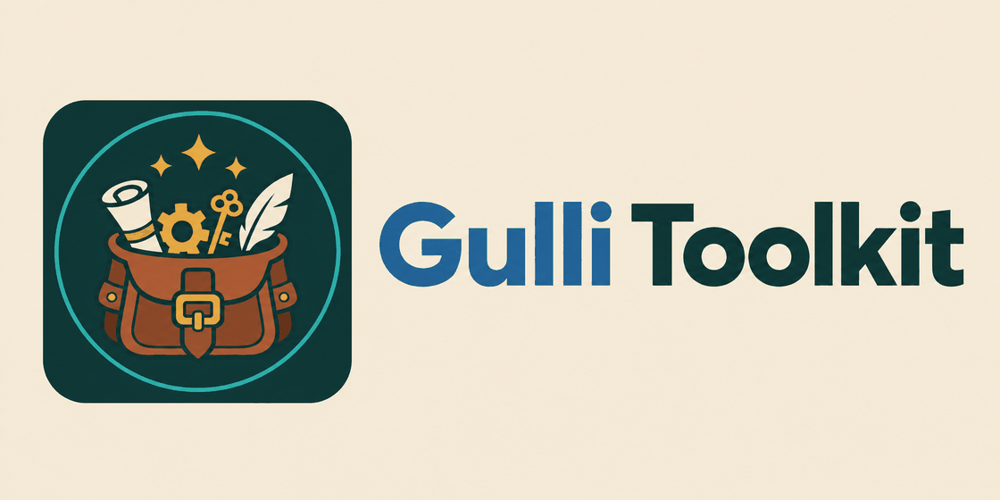
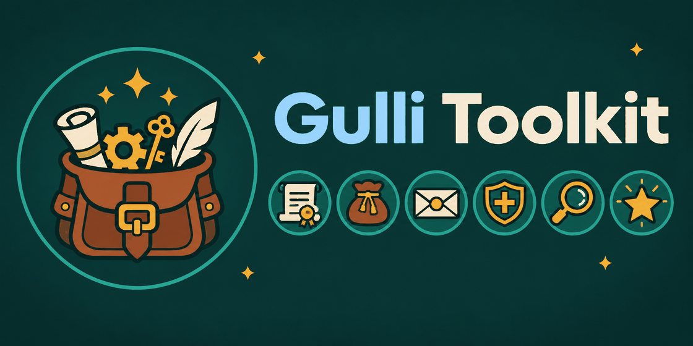
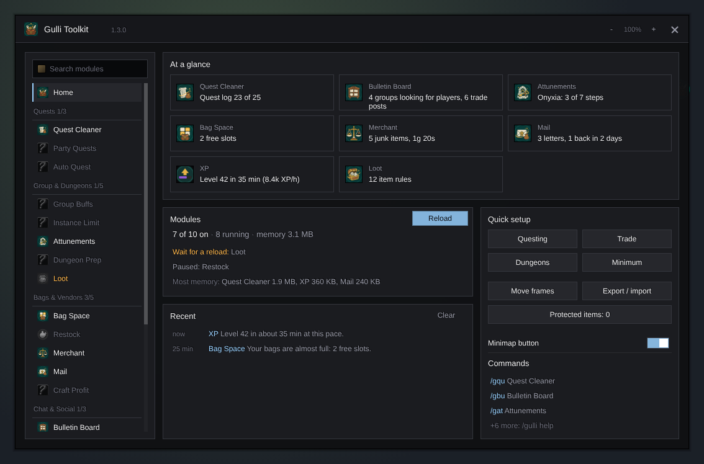
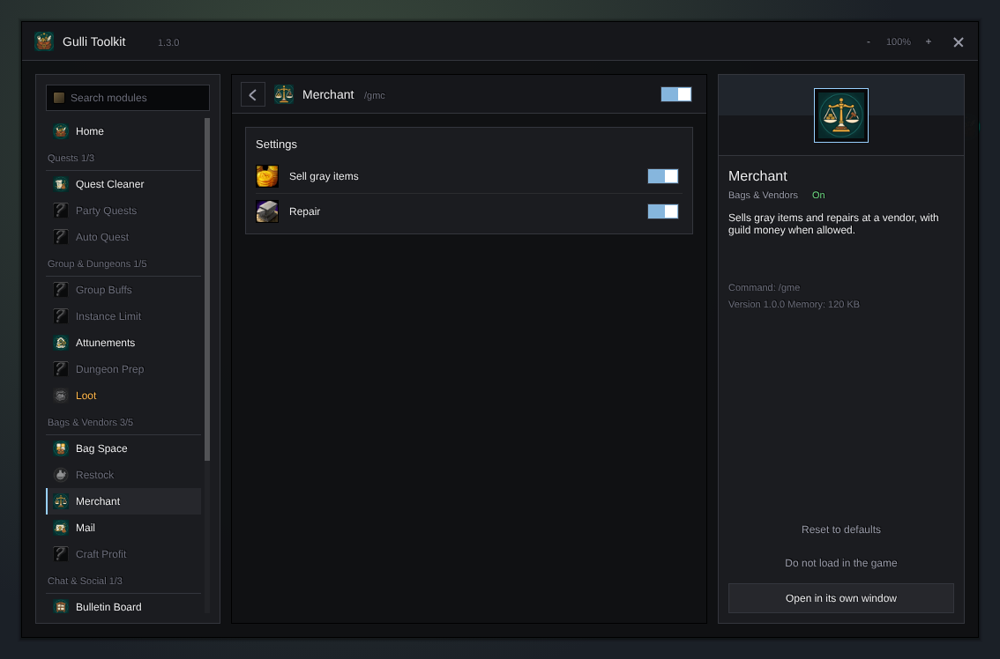

<p align="center">
  <picture>
    <source media="(prefers-color-scheme: dark)" srcset="docs/toolkit/wordmark-dark.png">
    
  </picture>
</p>

<p align="center"><b>Small, handy addons for WoW Forever in one set. Install the toolkit and get them all, or take only the ones you like.</b></p>

<p align="center">
  <a href="../../releases"></a>
  
  
</p>

---

<p align="center"></p>

## The modules

| Module | What it does | Open it |
|---|---|---|
| [Quest Cleaner](docs/questcleaner/README.md) | Abandons low-level quests and deletes leftover quest items from your bags. You see a list before anything goes. | `/gqc` |
| [Mob Finder](docs/mobfinder/README.md) | Finds the mobs and rares you look for, with a sound and a Target button. | `/gmf` |
| [Group Buffs](docs/groupbuffs/README.md) | Casts the buffs your group is missing, one press at a time, also in combat. | `/ggb` |
| [Bulletin Board](docs/bulletin/README.md) | Sorts trade and group chat into a board: groups by dungeon, selling, buying, crafting, guilds. | `/gbul` |
| [Party Quests](docs/partyquests/README.md) | Shows which quests your group shares and who still needs one. Share in one tap. | `/gpq` |
| [Instance Limit](docs/instancelimit/README.md) | Counts your dungeon entries this hour and today, and shows when the next one is free. | `/gil` |
| [Attunements](docs/attune/README.md) | Raid attunements and dungeon keys for all your characters, with the next step and where it starts. | `/gat` |
| [Bag Space](docs/bagspace/README.md) | Frees the bag slots you ask for: merges stacks, sells or deletes the cheapest junk. | `/gbs` |
| [Dungeon Prep](docs/dungeonprep/README.md) | A dungeon's quests for your faction, a way to pick them up from where you stand, and a checklist before you go. | `/gdp` |
| [Quick Chat](docs/quickchat/README.md) | Phrases on big buttons and a phrase wheel, group messages for quests and dungeons, whispers you missed. | `/gqk` |
| [Chores](docs/chores/README.md) | A to-do list for each character: mail that runs out, cooldowns, trainer, rested XP, repairs; all characters in one table. | `/gch` |
| [Restock](docs/restock/README.md) | Keeps reagents, ammo, food and water at your amount and buys them at a vendor. | `/grs` |
| [Merchant](docs/merchant/README.md) | Sells gray items and repairs at a vendor, with guild money when allowed. | `/gmc` |
| [Mail](docs/mail/README.md) | Take all from the mailbox, and your characters and recent recipients as names to tap. | `/gml` |
| [Auto Quest](docs/autoquest/README.md) | Takes and hands in quests. Rewards with a choice stay your pick. | `/gaq` |
| [Tooltip](docs/tooltip/README.md) | Stack and auction prices, the quests that need an item, what your other characters hold, ids. | `/gtt` |
| [XP](docs/xp/README.md) | XP per hour, time and kills to the next level. | `/gxp` |
| [Loot](docs/loot/README.md) | Rolls Need, Greed or Pass by your rules for each quality and item. | `/glt` |
| [Social](docs/social/README.md) | Invite on a whispered word, accept friends, turn away strangers, duels and guild invites. | `/gso` |
| [Reminders](docs/reminders/README.md) | A movable panel of icons for missing class buffs, poisons, pet, ammo and soul shards. | `/grm` |
| [Craft Profit](docs/craftprofit/README.md) | Profitable crafts and the cheapest way to level a profession, drawn as a route: where to buy, what to craft, where to sell. | `/gcp` |

## Features

- **One window for all.** Type `/gulli`, or click the toolkit's own button on the edge of the minimap (or in the addon button there). On the left is a short list of every module, sorted into groups (Quests, Group & Dungeons, Bags & Vendors, Chat & Social, Info & Alerts). A grey name means the module is off or paused.
- **Click a module, see it.** The module's own window opens in the middle of `/gulli` at once. Next to a small window you see what the module does, its command, its version and **Reset to defaults**. **<** goes back to **Home**, **Open in its own window** takes it out. The toolkit opens again where you left it.
- **Home: everything at a glance.** Short news from every module that runs (XP to the next level, dungeon entries left, groups on the board, what waits on your other characters), a **Modules** card (how many are on, which wait for a reload, which the game does not load, which were updated, and which use the most memory), the **Recent** messages with how long ago they came (click one to open its module), **Quick setup** and the commands of your modules.
- **Quick setup.** One click switches on a set of modules for **Questing**, **Trade**, **Dungeons** or a **Minimum**, and the others off.
- **Move frames.** **Move frames** on the home page (or `/gulli move`) unlocks the bars and panels of every module at once, such as the XP bar, so you can drag them. Press it again to lock them.
- **Take your settings along.** **Export / import** gives one line of text with every Gulli setting. Paste it on another computer, phone or handheld and press **Import**.
- **A button on the minimap.** The toolkit icon sits on the edge of the minimap: click it to open `/gulli`, drag it to move it around the minimap. Turn off **Minimap button** in `/gulli` (or type `/gulli minimap`) to hide it.
- **Search.** Type in the search box to find a module by name, what it does, its command or one of its settings. **Enter** opens the first one found.
- **Updates.** A dot on a module's icon means it was updated since you last opened it. When someone in your group has a newer version, the toolkit tells you once in chat.
- **Switch off what you do not need, at once.** Open a module in `/gulli` and flip the switch at the top right. Merchant, Loot, Auto Quest, Social, Mail and Restock stop and start right away, with no reload. To free its memory too, press **Do not load in the game** on the module's card and reload. Other modules still switch after a reload; they get the instant switch step by step. Modules that act on their own also have a switch for each thing they do.
- **Each module works alone.** You do not need the toolkit to use a module. With the toolkit, they come together in one place.
- **Install once.** In Runeloader, install **Gulli Toolkit** and every module comes with it. Remove the ones you do not want; the rest keeps working.
- **Protected items.** On the home page of `/gulli`, press **Protected items** and drop an item there (or type `/gulli protect` and shift-click it). No module ever sells, deletes or moves it.
- **One look.** Every module has the same flat dark window in your class colour, in the style of ElvUI: settings in cards, the main button at the bottom right, and an icon from the game next to each setting, timer and spell, so you find things at a glance.
- **Made for handhelds.** Big buttons and switches, so it works with a mouse and with touch on WoW Forever for Android. The window shrinks to fit a small screen, and **-** and **+** make it smaller or bigger.
- **Your language.** English, German, Spanish, French, Polish, Portuguese, Russian and Chinese. It follows the language of your game.

## Install

**With [Runeloader](https://github.com/Gulliby-development/runeloader)** (Android): open **Browse**, search for **Gulli Toolkit** and tap **Install**. You get the toolkit and every module. In **Library**, open the toolkit to see its modules and remove the ones you do not want.

**Everything in one zip:** download [`Gulli-Toolkit-All.zip`](../../releases/download/bundle/Gulli-Toolkit-All.zip) and unpack it into the game's `Interface/AddOns` folder. It holds the newest version of the toolkit and of every module, and it is rebuilt after each release.

**By hand, one by one:**

1. **Download** the zips you want from the [releases](../../releases): `Gulli-Toolkit-<version>-forever.zip` for the toolkit, `Gulli-<Module>-<version>-forever.zip` for each module.
2. **Unpack** each one into the game's `Interface/AddOns` folder. You get folders like `Interface/AddOns/Gulli-Toolkit` and `Interface/AddOns/Gulli-QuestCleaner`.
3. **Restart** the game, or type `/reload`.

## How to use it

1. Type `/gulli`, or click the toolkit icon on the minimap.
2. Click a module in the list on the left, or type in **Search modules**. Its window opens in the middle; **<** or **Home** brings you back to the home page. Or use the module's own command, such as `/gqc`, for a window of its own.
3. To switch a module off, open it and flip the switch at the top right.

`/gulli help` lists every command of the toolkit and of the modules you have.

`/gulli questcleaner` opens a module directly, in its own window.

<p align="center"></p>
<p align="center"></p>

## FAQ

<details>
<summary><b>Do I need the toolkit?</b></summary>

No. Each module is a normal addon and works alone. The toolkit only puts them in one window.
</details>

<details>
<summary><b>A module says "Not installed"</b></summary>

The toolkit knows about it, but it is not in your AddOns folder. Install it with Runeloader or from the releases.
</details>

<details>
<summary><b>I switched a module off, but it is still there</b></summary>

A module that can pause stops at once. Any other one, and **Do not load in the game**, wait for the interface to load again: press **Reload** on the module's page or in the **Modules** card on the home page, or type `/reload`.
</details>

<details>
<summary><b>The switch does not move, and chat says "The game did not switch it"</b></summary>

Update the toolkit: version 1.6.1 fixed this. If it still happens, type `/gulli debug <module>` (for example `/gulli debug PartyQuests`) and send us the lines it prints.
</details>

<details>
<summary><b>A module is on, but it says "Not loaded: Out of date"</b></summary>

The game did not load it because its version is older than the game. In the game's AddOns list, tick **Load out of date AddOns** and reload. Other reasons, such as a missing addon it needs, are shown the same way.
</details>

## For developers

<details>
<summary><b>How the repository is built</b></summary>

Each top-level `Gulli-<Name>` folder is one addon: `Gulli-Toolkit` is the core, the others are modules. Each folder is released on its own tag: the core on `Core-v<version>`, a module on `<Name>-v<version>`. The [Runeloader index](https://github.com/Gulliby-development/runeloader-index) reads them every night and lists the repository as one package: the core plus one entry per module.

A module registers with the toolkit when it is loaded:

```lua
if GulliToolkit and GulliToolkit.Register then
    GulliToolkit.Register({ key = "QuestCleaner", open = function() ns.Toggle() end,
                            icon = "Interface\\AddOns\\Gulli-QuestCleaner\\icon", slash = "/gqc",
                            -- optional: a hub group, switches the search finds, the window for the
                            -- hub, a line for the home page, moving frames, defaults and the pause
                            category = "Quests",
                            options = { { label = "...", tip = "...", get = function() ... end, set = function(on) ... end } },
                            window = function() return ns.Window() end,
                            summary = function() return "3 quests to abandon" end,
                            move = function(on) end, reset = function() end,
                            pause = function(on) end })
end
```

Its TOC has `## OptionalDeps: Gulli-Toolkit` and `## X-Gulli-Module: <Name>`. [AGENTS.md](AGENTS.md) has the full contract.
</details>

<details>
<summary><b>Releases</b></summary>

Bump `## Version` in the folder's TOC and run the **Release** workflow from the Actions tab with `module` set to `Core` or the module name.
</details>

<details>
<summary><b>Tests</b></summary>

Each addon has its tests on a small fake WoW client:

```sh
for t in tests/*/test.lua; do lua5.1 "$t"; done
```
</details>

---

<p align="center">
  <sub>Gulli Toolkit is a fan project. It is not affiliated with Blizzard Entertainment.<br>
  It is free software under the <a href="LICENSE">GPLv3</a>.</sub>
</p>
