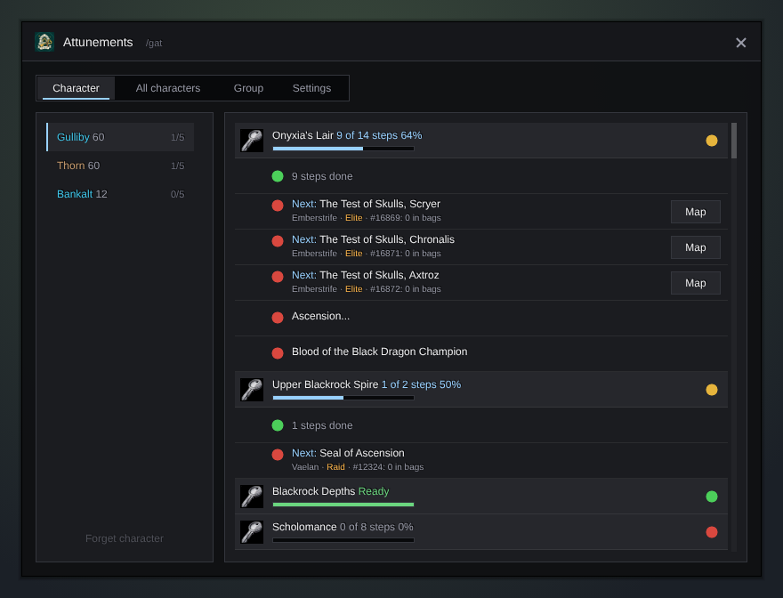

<h1 align="center">Gulli-Attune</h1>

<b>Tracks raid attunements and dungeon keys for all your characters: Onyxia, Upper Blackrock Spire, Blackrock Depths, Scholomance, Maraudon.</b>

  
  
  

---

Some raids and dungeon doors need a quest chain first. Gulli Attunements shows each step for every character, and where to go next.

## Features

- **Onyxia first.** In WoW Forever, Onyxia's Lair is the one raid that needs an attunement: every raider carries the Drakefire Amulet. Both the Alliance and the Horde chain are there. The Barrow Deeps and Hyjal Summit need nothing.
- **Dungeon keys.** The Seal of Ascension (Upper Blackrock Spire), the Shadowforge Key (Blackrock Depths), the Skeleton Key (Scholomance, both factions) and the Scepter of Celebras (Maraudon).
- **Only WoW Forever.** Raids that Forever does not have (Molten Core, Blackwing Lair, Naxxramas) are not listed. We update the list when Blizzard adds or changes an attunement.
- **Every character.** Each character saves its progress when you play it. Pick a character on the left.
- **The next steps.** They are marked **Next**, with the place where the quest starts, the level it needs, and if it is elite, a dungeon or a raid. The items a step asks for show how many you have. Steps that run side by side (the four Tests of Skulls) are all marked at once. **Map** puts a pin on the quest giver (and a TomTom arrow, if you have TomTom).
- **A progress bar** on each chain, with the percent. Finished steps fold into one line.
- **Done is done.** A finished chain is one green line. A key or an amulet in your bags counts as done.
- **All characters** in one table: every character, every chain. Click a row to open that character.
- **Your group and guild.** Group members with Attune share their progress. The **Group** tab shows who has what; **Ask guild** asks your guild. **Tell group** writes in group chat who has no access yet. Point at a player to see their progress in the tooltip.
- **News.** A finished step and a finished chain show in the hub's Recent list. When you take a step, the chat says "Step 5 of 16". With **Tell the guild** on, the guild hears when you are ready.
- **Export.** One line of text with every character's progress, to copy to a guild site.

## Install

**With [Runeloader](https://github.com/Gulliby-development/runeloader)** (Android): install **Gulli Toolkit**. Attunements comes with it.

**By hand:** download `Gulli-Attune-<version>-forever.zip` from the [releases](https://github.com/Gulliby-development/gulli-toolkit/releases) and unpack it into `Interface/AddOns`. Then type `/reload`.

## How to use it

1. Log in with each character once.
2. Type `/gat`, or open it from `/gulli`.
3. Pick a character. Follow the steps marked **Next**. Click **Map** for a map pin.
4. In a group, open the **Group** tab before a raid.

## FAQ

<b>A character is missing</b>

Log in with it once. **Forget character** removes an old one from the list.

<b>Is it tested in the game?</b>

Not yet in WoW Forever itself. It is tested on a fake game client. If something does not work, tell us on GitHub.

---

Part of <a href="../../README.md">Gulli Toolkit</a>. A fan project, not affiliated with Blizzard Entertainment. Free software under the <a href="../../LICENSE">GPLv3</a>.

