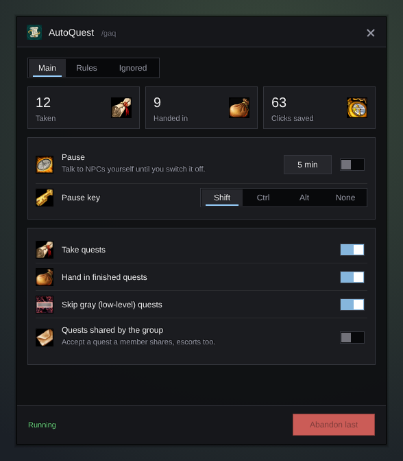

<h1 align="center">Gulli-AutoQuest</h1>

<b>Takes and hands in quests for you. You still pick the reward when there is a choice.</b>

  
  
  

---

Talking to a quest giver takes four or five taps. On a phone that adds up. Gulli Auto Quest does them for you.

## Features

- **Takes quests** when you talk to a quest giver.
- **Hands in finished quests,** before it takes new ones.
- **Skips gray quests** that give you almost no experience. You can turn that off.
- **Your rewards stay your choice.** When a quest has more than one reward, it waits for you and marks the one that sells for the most. A switch lets it take that one for you.
- **No surprise costs.** A quest that asks for gold is never handed in on its own, and a quest that takes cloth, ore or other non-quest items waits for you (a switch changes that).
- **Pause without a keyboard.** A **Pause** switch (also in `/gulli`), a **5 min** button, and a pause key you choose: Shift, Ctrl, Alt or none.
- **Ignore list.** Ignore an NPC or a quest with one tap in the **Ignored** tab, or `/gaq ignore` at an NPC. Remove them from the list there too.
- **Quests from your group** are accepted only when you turn that on (escorts can start without warning).
- **Rules.** Skip elite, dungeon and raid, or group quests; keep some quest log places free; pick the only dialogue line of an NPC.
- **See what it did.** Taken, handed in and clicks saved for this session (a `/reload` keeps them), a line in the Gulli Toolkit feed, and a chat line if you want.
- **Undo.** **Abandon last** drops the last quest it took for you.

## Install

**With [Runeloader](https://github.com/Gulliby-development/runeloader)** (Android): install **Gulli Toolkit**. Auto Quest comes with it.

**By hand:** download `Gulli-AutoQuest-<version>-forever.zip` from the [releases](https://github.com/Gulliby-development/gulli-toolkit/releases) and unpack it into `Interface/AddOns`. Then type `/reload`.

## How to use it

1. It works on its own.
2. Type `/gaq` to change what it does. `/gaq pause` turns the pause on or off.

## FAQ

<b>It took a quest I did not want</b>

Press **Abandon last** in `/gaq`. To stop it at that NPC for good, open the **Ignored** tab and press **Ignore** with the NPC's name.

<b>Is it tested in the game?</b>

Not yet in WoW Forever itself. It is tested on a fake game client. If something does not work, tell us on GitHub.

---

Part of <a href="../../README.md">Gulli Toolkit</a>. A fan project, not affiliated with Blizzard Entertainment. Free software under the <a href="../../LICENSE">GPLv3</a>.

