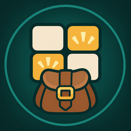
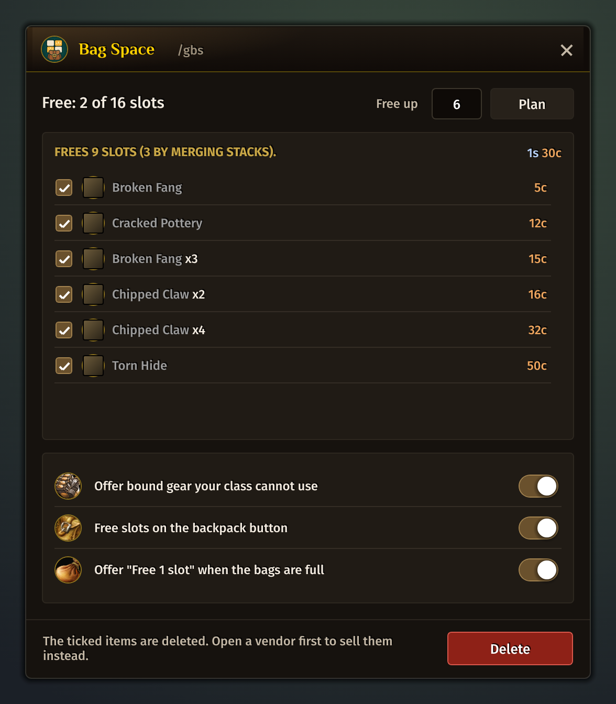

<h1 align="center">Gulli-BagSpace</h1>

<b>Frees as many bag slots as you ask for: merges stacks, then sells or deletes the cheapest junk.</b>

  
  
  

---

Your bags are full in the middle of a dungeon. Tell Gulli Bag Space how many slots you need, look at the list, press **OK**.

## Features

- **Ask for a number.** "Free up 5" and you get a plan for 5 slots.
- **Stacks first.** Half stacks of the same item are merged before anything goes.
- **Cheapest first.** Gray items first, then white weapons and armour. Other white items are offered unticked.
- **Never the wrong item.** Quest items, keys, the hearthstone, profession tools (fishing poles, mining picks, skinning knives, ...), items in an equipment set and items you protected in the toolkit are never offered.
- **Sells at a vendor.** With a vendor open, items are sold in small steps. The vendor keeps only the last 12 for buyback, and the window warns you when you sell more. Away from a vendor items are deleted.
- **Nothing lost on the way.** The game deletes one item per click, so each **OK** away from a vendor deletes one item; the rest stay ticked for the next **OK**. At a vendor one **OK** sells them all.
- **Remembers your choice.** Untick an item and it is not offered again. `/gbs reset` brings those items back.
- **Your junk list.** Alt+click an item in your bags to always count it as junk. Gulli Merchant uses the same list.
- **Auction prices.** With a price addon (Auctionator, auxForever, Naowh Forever, TradeSkillMaster or Hammerprice), an item that sells for much more at the auction house is shown unticked, with its price.
- **Gear you cannot use.** Bound armour and weapons your class can never wear are offered with the white gear.
- **Free a slot for every item.** When the game says your bags are full, a notice offers to sell or delete the cheapest junk. With loot open, it counts how many new slots the loot needs: two items that fit no stack you have mean two slots. At a vendor one tap sells them all; anywhere else each tap deletes one, and the notice stays until all the loot fits.
- **Disenchant with a key.** If you know Enchanting, pick a key in `/gbs` (for example `N`, or `Alt-D`). Point at a green, blue or purple weapon or armour in your bags and press the key: it is disenchanted. It works with any bag addon. While you do not point at such an item, the key does what it always does. It does nothing in a fight, on items it cannot disenchant, or on items you protected or keep in an equipment set. A switch turns it off.
- **Sort and count.** A **Sort** button, and the number of free slots on the backpack button.
- **A warning** in chat when only two slots are left.

## Install

**With [Runeloader](https://github.com/Gulliby-development/runeloader)** (Android): install **Gulli Toolkit**. Bag Space comes with it.

**By hand:** download `Gulli-BagSpace-<version>-forever.zip` from the [releases](https://github.com/Gulliby-development/gulli-toolkit/releases) and unpack it into `Interface/AddOns`. Then type `/reload`.

## How to use it

1. Type `/gbs`, or `/gbs 5` for five slots.
2. Look at the list. Untick what you want to keep.
3. Press **Delete**, or **Sell** when a vendor is open.

## FAQ

<b>Can I get an item back?</b>

Sold items: the last 12, from the vendor's buyback tab. Deleted items: no. Open a vendor first if you are not sure.

<b>The key does not disenchant. Why?</b>

Check that **Disenchant with a key** is on in `/gbs`, that you set a **Disenchant key**, that you know Enchanting, and that you are not in a fight. Only green, blue and purple weapons and armour show the "N: disenchant" line in their tooltip. A mouse button can be the key too, but some bag addons keep mouse clicks for themselves (Baganator uses the middle click for favourites), so a keyboard key is safer. If your skill is too low for the item, the game says so.

<b>How do I keep an item forever?</b>

With Gulli Toolkit: `/gulli`, **Protected items**, and drop the item there.

<b>Is it tested in the game?</b>

Not yet in WoW Forever itself. It is tested on a fake game client. If something does not work, tell us on GitHub.

---

Part of <a href="../../README.md">Gulli Toolkit</a>. A fan project, not affiliated with Blizzard Entertainment. Free software under the <a href="../../LICENSE">GPLv3</a>.

