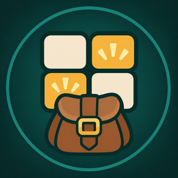
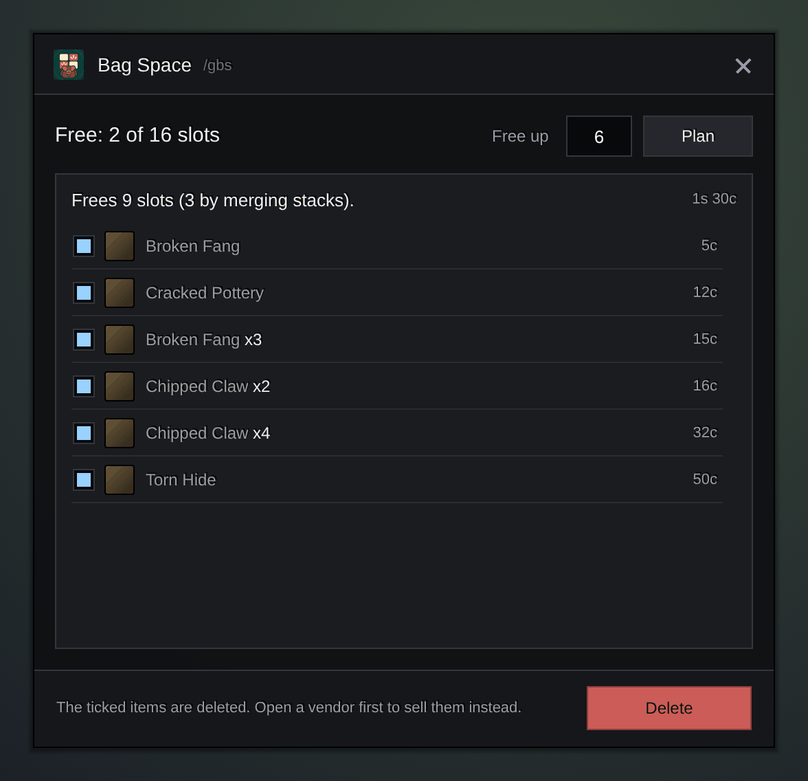

<h1 align="center">Gulli-BagSpace</h1>

<b>Frees as many bag slots as you ask for: merges stacks, then sells or deletes the cheapest junk.</b>

  
  
  

---

Your bags are full in the middle of a dungeon. Tell Gulli Bag Space how many slots you need, look at the list, press **OK**.

## Features

- **Ask for a number.** "Free up 5" and you get a plan for 5 slots.
- **Stacks first.** Half stacks of the same item are merged before anything goes.
- **Cheapest first.** Gray items first, then white weapons and armour. Other white items are offered unticked.
- **Never the wrong item.** Quest items, keys, the hearthstone and items you protected in the toolkit are never offered.
- **Sells at a vendor.** With a vendor open, items are sold, and you can buy them back. Away from a vendor they are deleted.
- **A warning** in chat when only two slots are left.

## Install

**With [Runeloader](https://github.com/Gulliby-development/runeloader)** (Android): install **Gulli Toolkit**. Bag Space comes with it.

**By hand:** download `Gulli-BagSpace-<version>-forever.zip` from the [releases](https://github.com/Gulliby-development/gulli-toolkit/releases) and unpack it into `Interface/AddOns`. Then type `/reload`.

## How to use it

1. Type `/gbs`, or `/gbs 5` for five slots.
2. Look at the list. Untick what you want to keep.
3. Press **Delete**, or **Sell** when a vendor is open.

## FAQ

<b>Can I get an item back?</b>

Sold items: yes, from the vendor's buyback tab. Deleted items: no. Open a vendor first if you are not sure.

<b>How do I keep an item forever?</b>

With Gulli Toolkit: `/gulli`, **Protected items**, and drop the item there.

<b>Is it tested in the game?</b>

Not yet in WoW Forever itself. It is tested on a fake game client. If something does not work, tell us on GitHub.

---

Part of <a href="../../README.md">Gulli Toolkit</a>. A fan project, not affiliated with Blizzard Entertainment. Free software under the <a href="../../LICENSE">GPLv3</a>.

