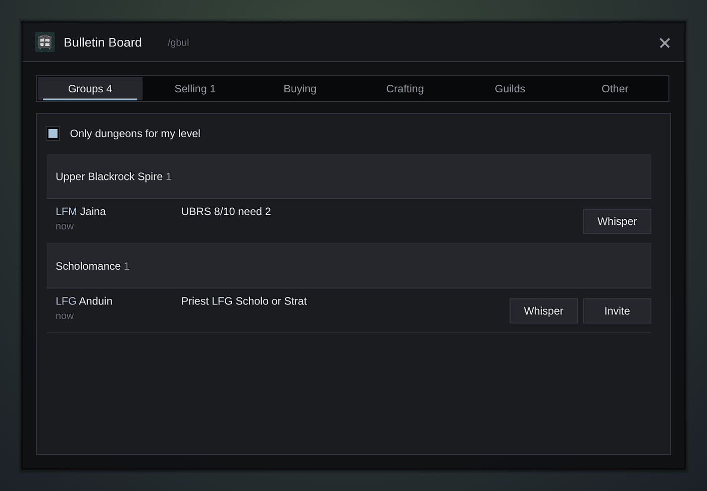

<h1 align="center">Gulli-Bulletin</h1>

<b>Reads the trade and group chat for you and sorts it into a clear board: groups by dungeon, selling, buying, crafting and guilds.</b>

  
  
  

---

Trade chat in a big city moves fast. Gulli Bulletin Board reads it for you and sorts every message into tabs, so you find a group or a seller in a few seconds.

## Features

- **Tabs instead of a wall of text.** Groups, Selling, Buying, Crafting, Guilds and Other.
- **Crafting, split in two.** **Need a crafter** lists players who look for one ("LF enchanter", "need a BS"). **Crafters** lists players who offer their work ("LFW", "your mats", an enchant link). Tap professions to see only those: Enchanting, Blacksmith, Tailoring, Leather, Alchemy, Engineering, Cooking, Lockpick.
- **Groups by dungeon.** LFG and LFM messages are grouped under the dungeon they name (Deadmines, SM Library, Strat...). Tick **Only dungeons for my level** to hide the rest.
- **Only WoW Forever dungeons.** From Ragefire Chasm to Stratholme, plus Barrow Deeps, Hyjal Summit and Onyxia. Short words such as "dm me" or "st" do not make false groups.
- **Pick your dungeons.** In **Setup**, tick **Show** to list only those dungeons, and **Alert** to hear a sound and get a chat line when a new group for them comes up. The alert also shows in the hub's Recent feed.
- **Ask in one tap.** **Ask** whispers "Hi! Level 56 Priest, healer. Can I join you for Stratholme?" with your level, class and the role you set in **Setup**. LFG rows have **Invite**.
- **See who and what.** Names are in class colours, an LFM shows the roles it needs (tank, healer, damage), and selling rows show the item icon.
- **Search and fold.** Type in **Search** to filter any tab. Click a dungeon header to fold it.
- **Hide spam.** **x** on a row hides that player for good; in **Setup** you can hide words too (boost, www...). **Show again** brings hidden players back.
- **Watch words.** Get the same alert when someone writes a word you watch, such as an item name.
- **Small feed.** A small panel on the screen with the newest groups for your alerted dungeons. Set its opacity, and let clicks go through it so it never gets in the way.
- **Survives /reload.** The board is saved, so it is still there after a reload.
- **My LFM.** With Gulli Quick Chat installed, **My LFM** on a dungeon header opens a ready group message for it.
- **One line per player.** When a player posts again, the old line is replaced, so nobody floods the board.
- **Whisper and Invite** on every row, with big buttons for touch.
- **Old messages go away** after 15 minutes.
- **Reads many languages.** It knows WTS, WTB, LFG, LFM and the usual words in English, German, Spanish, French, Polish, Russian and Chinese.

## Install

**With [Runeloader](https://github.com/Gulliby-development/runeloader)** (Android): install **Gulli Toolkit**. Bulletin Board comes with it.

**By hand:** download `Gulli-Bulletin-<version>-forever.zip` from the [releases](https://github.com/Gulliby-development/gulli-toolkit/releases) and unpack it into `Interface/AddOns`. Then type `/reload`.

## How to use it

1. Type `/gbul`, or open it from `/gulli`.
2. Pick a tab. In **Groups**, the dungeon name is a header and the groups are under it.
3. In **Setup**, tick the dungeons you want to see or be alerted for.
4. Press **Whisper** to write to the player, or **Invite** to invite them.
5. `/gbul clear` empties the board.

## FAQ

<b>The board is empty</b>

It shows messages from Trade, General, LookingForGroup, /say and /yell. Join the channels, wait a minute, and the board fills up. **Setup** tells you when you are not in LookingForGroup or Trade.

<b>A message is in the wrong tab</b>

The addon sorts by words such as WTS, WTB, LFG, LFM, "selling" or "recruiting". A message with unusual words goes to **Other**.

<b>Is it tested in the game?</b>

Not yet in WoW Forever itself. It is tested on a fake game client. If something does not work, tell us on GitHub.

---

Part of <a href="../../README.md">Gulli Toolkit</a>. A fan project, not affiliated with Blizzard Entertainment. Free software under the <a href="../../LICENSE">GPLv3</a>.

