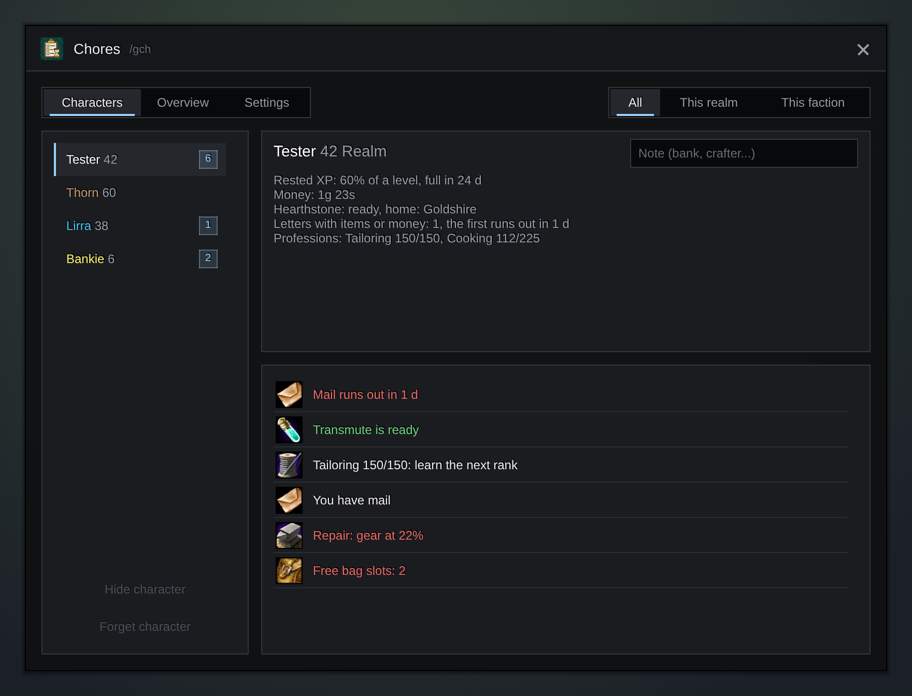
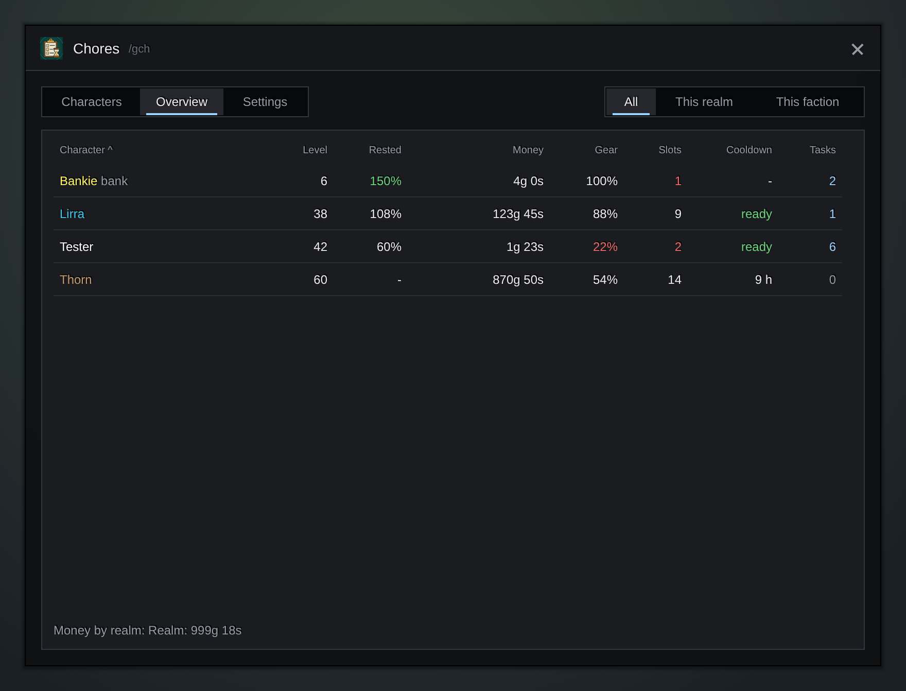

<h1 align="center">Gulli-Chores</h1>

<b>A to-do list for each character: rested XP, mail, crafting cooldowns, the trainer, repairs and bag space.</b>

  
  
  

---

You have many characters. Gulli Chores remembers what waits for each of them.

## Features

- **Every character.** Each one saves its state when you play it.
- **What waits.** Mail with items or money that runs out soon, ready crafting cooldowns (transmutes, Mooncloth, Salt Shaker), new spells at the trainer (on even levels), a profession at its rank limit, new mail, full rested XP, gear to repair and full bags.
- **Rested XP keeps growing** while you are away, and the card tells you when it is full.
- **The card** of a character: money, hearthstone and home, letters with items, cash on delivery letters, professions, saved raids and played time. Write a **note** (bank, crafter...).
- **Overview:** every character in one table: level, rested XP, money, gear, free slots, next cooldown and tasks. Tap a column head to sort. Under it, your money per realm.
- **Filter** by realm or faction. **Hide** a bank character so it does not count.
- **At login,** one chat line tells you what waits on your other characters. **While you play,** it tells you once when a cooldown is ready or rested XP is full on any character.
- **Settings:** switch each task off, and choose when gear needs repair, how few free slots count as full and how early mail warns you.
- Gulli Tooltip reads the bags and bank that Chores saves, to show what your other characters hold.

## Install

**With [Runeloader](https://github.com/Gulliby-development/runeloader)** (Android): install **Gulli Toolkit**. Chores comes with it.

**By hand:** download `Gulli-Chores-<version>-forever.zip` from the [releases](https://github.com/Gulliby-development/gulli-toolkit/releases) and unpack it into `Interface/AddOns`. Then type `/reload`.

## How to use it

1. Log in with each character once.
2. Type `/gch`, or open it from `/gulli`.
3. Pick a character on the left, or open **Overview** for all of them.
4. Open the mailbox and the bank once on each character, so the mail times and the bank are known.

## FAQ

<b>The trainer line does not go away</b>

Open the trainer window once. The addon then knows you visited it at this level.

<b>The mail warning or the bank is missing</b>

The game shows mail times only at the mailbox, and the bank only at the bank. Open them once on that character.

<b>Is it tested in the game?</b>

Not yet in WoW Forever itself. It is tested on a fake game client. If something does not work, tell us on GitHub.

---

Part of <a href="../../README.md">Gulli Toolkit</a>. A fan project, not affiliated with Blizzard Entertainment. Free software under the <a href="../../LICENSE">GPLv3</a>.

