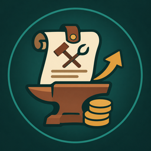
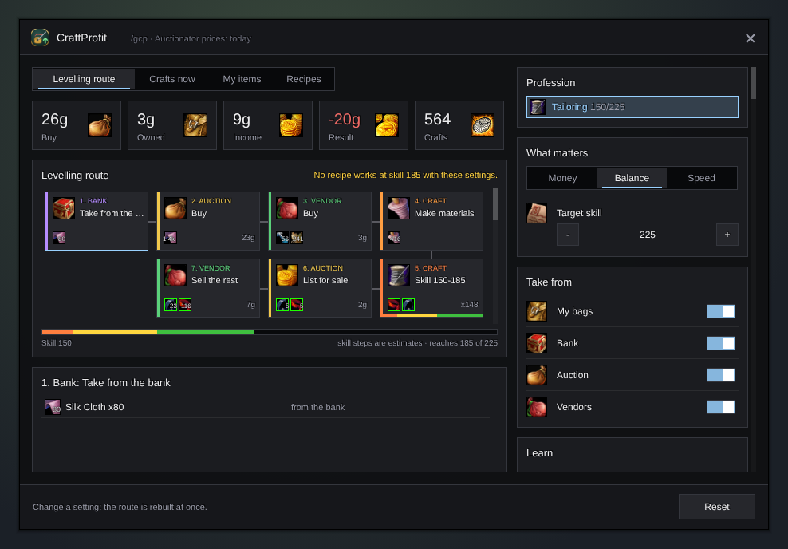

<h1 align="center">Gulli-CraftProfit</h1>

<b>Profitable crafts and the cheapest way to level a profession, from your bags, your bank and Auctionator prices.</b>

  
  
  

---

Want to level Tailoring without losing your gold? Gulli CraftProfit looks at what you have, what things cost at the auction and at vendors, and draws a route: take this from the bank, buy that at the auction, craft these, learn this at the trainer, sell the rest.

## Features

- **A route, not a table.** Each stop shows where to go, with the real game icons of what you buy, craft or sell there. Tap a stop to see the list.
- **One run at a time.** The route is your next run: one kind of craft, with only the shopping it needs. Craft it, and the route plans the next run from your new skill and the new prices. Below the route you still see how far the whole way is.
- **Routes side by side.** Up to four ways to level, from the cheapest to the fastest, and two ways to just make money: from what you already have, or also buying reagents and patterns when the craft still pays. A money run is one recipe, crafted while it still pays and the market still takes it. It does not raise your skill, and it buys at most a few stacks of one reagent at the auction (**Auction buy, at most**), because only a few sell at the cheapest price. Each tab shows the gold, so you can compare them.
- **How much you may lose.** Set **Ready to lose**, and CraftProfit picks the fastest way to level that stays within it. Ways that cost more are marked.
- **Not levelling?** Switch off **Level the profession**, and you only see the crafts that make money. When your skill is at the top, the money routes open by themselves.
- **You choose the rest.** Use your bags and bank or not, buy at the auction or only at vendors, buy patterns, go to the trainer, sell at the auction or to a vendor. The route changes at once, and the changed stops light up.
- **Honest money.** The auction cut (5%, or 15% at a neutral auction), the deposit you lose when an item does not sell, and how many of one item the market will take. Your own cloth counts at what you could sell it for.
- **Crafts now.** Your recipes sorted by profit per craft, and how many you can make from what you have.
- **My items.** For each material in your bags and bank: sell at the auction, sell to a vendor, or craft it.
- **Recipes.** Patterns you can buy or learn, and the craft that pays them back.

## Install

**With [Runeloader](https://github.com/Gulliby-development/runeloader)** (Android): install **Gulli Toolkit**. CraftProfit comes with it.

**By hand:** download `Gulli-CraftProfit-<version>-forever.zip` from the [releases](https://github.com/Gulliby-development/gulli-toolkit/releases) and unpack it into `Interface/AddOns`. Then type `/reload`.

For auction prices, also install **Auctionator** and scan the auction once.

## How to use it

1. Open your profession window once. CraftProfit reads your recipes.
2. Open the bank once if you want it to count what is there.
3. Type `/gcp`. Pick a route at the top, set the switches on the right and follow the stops.

## FAQ

<b>Do I need Auctionator?</b>

No, but without it only vendor prices count, and the route never buys or sells at the auction.

<b>Why are the numbers marked as estimates?</b>

The game shows only the colour a recipe has at your skill now (orange, yellow, green, grey). CraftProfit remembers the colours it sees and guesses when a recipe turns grey, on the careful side. The more you level, the better the guess.

<b>Why does the whole way take hundreds of crafts?</b>

Green and yellow recipes do not raise your skill every time, so one skill point can take several crafts. The number under the route is for the whole way to your target. You do not need to plan it: follow one run, and the next one is planned for you.

<b>Does it buy or craft for me?</b>

No. It only shows the route. You buy, craft and sell yourself.

<b>Is it tested in the game?</b>

Not yet in WoW Forever itself. It is tested on a fake game client. Type `/gcp probe` with a profession window open and send us what it prints. If something does not work, tell us on GitHub.

---

Part of <a href="../../README.md">Gulli Toolkit</a>. A fan project, not affiliated with Blizzard Entertainment. Free software under the <a href="../../LICENSE">GPLv3</a>.

