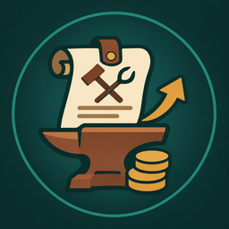
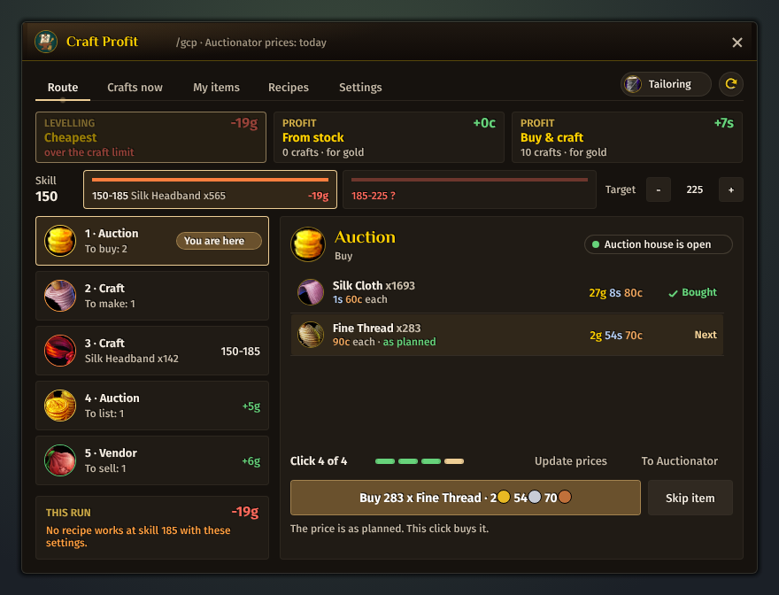
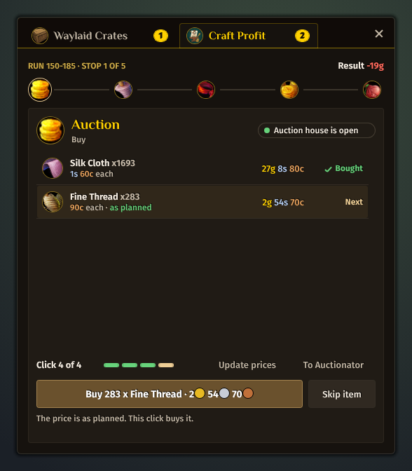

<h1 align="center">Gulli-CraftProfit</h1>

<b>Profitable crafts and the cheapest way to level a profession, from your bags, your bank and auction prices.</b>

  
  
  

---

Want to level Tailoring without losing your gold? Gulli CraftProfit looks at what you have, what things cost at the auction and at vendors, and draws a route: take this from the bank, buy that at the auction, craft these, learn this at the trainer, sell the rest.

## Features

- **A route, step by step.** The stops stand in a list on the left: bank, auction, vendor, crafts, selling, each with the real game icon. The stop you pick opens large on the right with its items and one main button. A stop gets a tick when its items are in your bags, and **You are here** marks the stop for the place you just opened.
- **Buy at the auction from the route.** At the auction stop, press **Check price**, then **Buy**: two presses for each item, because the game lets an addon buy only when you click. A counter shows how far you are ("Click 3 of 4"). The button stays in one place, so you can just keep clicking. Patterns are bought the same way: the first press looks for the pattern, the second buys the cheapest one.
- **No bad surprises.** When the auction asks more than the plan, the button turns yellow and says **Buy anyway**, with **Skip item** beside it. You set how much more is still fine in Settings (10% at first).
- **Who to go to.** A pattern only some vendors sell, or a recipe only one trainer teaches, shows the name and the zone on its line. **Show on map** puts a pin on that spot and opens the map there. Right now the Shadoweave trainers teach their recipes only from skill 200 (it should be 175, a game bug), so CraftProfit plans them from 200 until the game is fixed.
- **Buy for the whole way at once.** At the auction house or a vendor, the stop of your first run also buys what the later runs need there (marked "also for the run to 190"), so you do not walk back after every few skill points. Away from them, each run shows only its own purchases, once. Switch off **Buy for the later runs too** in Settings to buy run by run: then tap a run on the bar over the stops (185, 190 and so on), and its auction and vendor stops buy for that run right away, wherever you are on the way.
- **The route stays yours.** When you buy or craft the first thing of a route, the route is pinned: its recipes and its shopping stay as they are, whatever the prices do. A note says so, with **Undo**. You can also pin it yourself with the round lock button beside **Recalculate**. A pinned route shows a strip under the title, what you have **Bought** and what is **Left to buy**, and "have 600 of 1693" on each line. The round button now says **Refresh stock**: it counts your bags again and never changes the recipes. Want to know if the prices now give a better way? Press **Is there a better route?**: your route and a new calculation stand side by side, what you already bought counts as paid for in both, and you choose **Keep my route** or **Go over to the new one**. **Unpin** makes the route free again. Switch off **Pin the route at the first purchase** in Settings if you only want to pin by hand.
- **Several routes.** Each character keeps one pinned route for each profession, up to ten in all. **Routes** at the top of the window lists them with how far each one is and what is left to buy.
- **Mark a stop done.** Made or bought something another way? Press **Mark done** on the stop (crafts and purchases, in every stage), and the route goes on from the next one. **Not done** puts it back.
- **Vendor discounts.** A vendor price you saw is kept for the character who saw it, with that character's discounts in it. Before you see a vendor, its price counts the discount of your best capital standing and the Legacy node **Bartering** (5% per rank, read from the game).
- **Buy at a vendor in one click.** At a vendor stop, **Buy all** buys everything this vendor sells for the run, patterns too. Vendors sell whole stacks: when you need 4 and it comes in fives, you get 5.
- **A small window beside the auction house and the vendor.** Open the auction house with a run planned, and the buy stop opens next to it. Open a vendor who sells something the run needs, and the vendor stop opens beside the vendor's window, with **Buy all**. It closes by itself when you close that window or walk away. When Waylaid Crates has work at the auction house too, both share that place as tabs, each with a number: what is left to buy. A switch in Settings turns it off.
- **The real skill-up chances.** CraftProfit knows when each recipe turns yellow, green and grey in WoW Forever (Forever changed many of them, and added its own recipes), so it knows how often a craft raises your skill. When the game shows another colour, it trusts the game.
- **One run at a time.** The route is your next run: one kind of craft, with only the shopping it needs. Craft it, and the route plans the next run from your new skill and the new prices. The bar over the stops still shows how far the whole way is.
- **The whole way, run by run.** A bar over the stops shows every run up to your target skill. Each run is named by the skill it ends at (155, 185 and so on), with its craft and the gold it gains or loses. Tap one to see that run; under the stops, **Crafts** says how many crafts that run takes. The runs follow the whole route of the tab you picked, so a stretch the route crafts through never shows a question mark. A red one with a question mark is a stretch where no recipe you know raises the skill; learn a new one, and the route goes on. The target skill is at the end of the bar: change it with **-** and **+**.
- **Routes side by side.** Up to four ways to level, from the cheapest to the fastest, and two ways to just make money: from what you already have, or also buying reagents and patterns when the craft still pays. A money run is one recipe, crafted while it still pays and the market still takes it: at most 50 crafts at a time (craft them, and the next run is planned), each one gaining at least **Least gain per craft** (5 silver at first), and never more for the auction than are on sale there now once CraftProfit has read the lots. It does not raise your skill, and it buys at most a few stacks of one reagent at the auction (**Auction buy, at most**), because only a few sell at the cheapest price. Each tab shows the gold, the target skill and all the crafts of the whole way, so you can compare them.
- **How many crafts at most.** **Crafts to the target, at most** keeps the levelling routes short. It starts on auto: the skill points you still need plus 5 (from 175 to 200 that is 30), and it follows the target skill when you change it. Only the crafts that raise your skill count. Smelting bars or cutting stones for them is preparation: it is not limited, and the route shows it beside them ("Crafts: 26 + 40 prep"). Set your own number with **-** and **+**. The round button left of **-** opens a short list: **auto**, your own number, or **no limit**. When no route keeps within it, you see the one with the fewest crafts, marked in red.
- **How much you may lose.** Set **Ready to lose**, and CraftProfit picks the fastest way to level that stays within it. Ways that cost more are marked.
- **Not levelling?** Switch off **Level the profession**, and you only see the crafts that make money. When your skill is at the top, the money routes open by themselves.
- **You choose the rest.** On the **Settings** tab: use your bags and bank or not, buy at the auction or only at vendors, buy patterns, go to the trainer, sell at the auction or to a vendor. After the first **Calculate**, the route changes on its own, and the changed stops light up.
- **Disenchant what you make.** An enchanter can switch on **Disenchant crafted gear** under **Sell** on the **Settings** tab. When the dust, essences and shards bring more at the auction than the item itself, the route plans a **Disenchant** stop and sells the materials at the auction, never to a vendor.
- **Honest money.** Under the stops: what you buy, what your own materials are worth, what the sales bring and the result, red when you lose gold. The auction cut (5%, or 15% at a neutral auction), the deposit you lose when an item does not sell, and how many of one item the market will take. Your own cloth counts at what you could sell it for.
- **Straight to Auctionator.** At the auction stop, **To Auctionator** puts everything the run buys there into an Auctionator shopping list, with the amounts.
- **Real lot prices.** At the auction house, **Update prices** reads the lots of what the run buys. Buying 60 cloth then costs what the cheapest 60 really cost, not 60 times the first lot.
- **Craft from the route.** At a craft stop, **Make 142** crafts the run in the open profession window, and **Recipe** shows it there. Tap the recipe row to show it too. A stop that makes several things (three kinds of bars, say) goes from one to the next as the game finishes them: the row being made says **Next**, a finished one **Made**, and the button moves on to the next craft. The game crafts only with the profession window open, so while it is closed the button says **Open Tailoring**: the first press opens the window at the recipe, the next one crafts. While it crafts, a thin bar under the stop shows how many of the batch are made, and the craft that runs moves in it. Did your skill already go past the first stage? The stage your skill is in now counts your crafts and your skill just like the first one, and a pattern you bought and learned counts as bought.
- **Your second profession helps.** A Blacksmith or Engineer who also mines can smelt the bars: when buying ore and smelting it is cheaper than buying bars, the route has a Smelting stop, and its button opens the Mining window. It uses only the smelting recipes you already know, so a bar that needs a higher Mining skill is not planned. Open your Mining (Smelting) window once, so CraftProfit can read them.
- **A craft you do not want?** At a craft stop, press **Without this craft**: every route is planned again without it. It works for any craft, whether you know it, learn it from a trainer or buy its pattern. On the **Settings** tab, **Crafts to avoid** lists them: type a name or a recipe ID to add one, press **Use again** to put one back.
- **Mail and your other characters.** Items waiting in your mailbox count as yours. Switch on **Other characters**, and items your alts carry count too (read from Gulli Chores); the route says who sends them.
- **You gather it?** Right-click a reagent in the stop list, or type `/gcp gather <item link>`, and the route stops buying it. A **Gather** stop shows how much to collect.
- **Run log.** Press **Start the run**, craft, then **Finish the run**: you see the gold the plan promised and what you really made or spent.
- **In the item tooltip:** how many of it the chosen run needs.
- **In the game's profession window:** point at a recipe's item to see your chance of a skill-up now and at which skill the recipe turns yellow, green and grey. WoW Forever moved many of these levels, and the game shows only the colour.
- **Crafts now.** Your recipes in their game colour, sorted by profit per craft, and how many you can make from what you have. Tap a column head to sort by it; point at a row to see its reagents and how its value is worked out: the auction price, less the cut, times the share that sells (**Share of finished goods that sells**, 80% at first). Crafting materials such as bolts of cloth, bars or Mooncloth always sell, so they count at 100%: the share is only for finished goods.
- **My items.** For each material in your bags and bank: sell at the auction, sell to a vendor, or craft it.
- **Crafts with a cooldown.** Mooncloth, the alchemy transmutes and Cured Rugged Hide can be made only once a day or once in a few days. A route makes such a craft at most once, and only when it is ready; the rest of the way uses other recipes. The craft stop and the tooltips say how often it can be made, and while it waits the lists show the time left in red after its name ("CD 3d 4h").
- **Why this craft.** Point at a craft stop of the route, or at its recipe, to see why the planner chose it, point by point: its colour and how many crafts a point takes, where the reagents come from (your bags, the bank, made by you, a vendor or the auction), what the item sells for, what a point costs or earns, and why it beat a cheaper one (fewer crafts). Under them stand the next best recipes for that stretch, with how much more or less a point they cost.
- **Search and item stats.** On Crafts now, My items and Recipes, the **Search** box over the list keeps only the rows whose name has what you type. On Recipes, **Only mine** shows the recipes you already know instead of the ones you can get. Point at a row, or at a craft or reagent of the route, to see the item's own game tooltip with its stats, and the reagents and source under it.
- **Simulation: try a profession before you level it.** Turn on **Simulation** at the top of the window (or type `/gcp sim`), pick any profession, the skill to start from and the skill to reach. You can also name the recipe you want it for, such as Mooncloth. Press **Calculate** and you see the whole way: what the materials and the recipes cost, what the sales bring back, every run with its price, the character level that skill needs, and after how many crafts (or days, for a craft with a cooldown) the levelling has paid for itself. Your settings apply as they are, except the ones that mean nothing for a new character: the simulation always levels, always learns from the trainer and has no crafts limit (those settings show grey). Every recipe counts as not learned, so the trainer and the patterns are in the price; patterns that need a reputation and specialization recipes are left out. **Empty bags** counts everything as bought. **Shopping** (beside **Whole way**) is the list of everything the whole way buys, added up. At the auction house or a vendor it opens by itself, and its **Buy** buttons work like a normal run: buy it all on this character and mail it to your alt, who can then level the profession in one go. Apart from that, nothing is bought or crafted, and nothing is saved unless you ask: a violet strip shows you are in the simulation, the stops of the runs are only to look at, and **Exit simulation** forgets it and brings your real profession back. A `/reload` ends it too. To keep a simulated route, press the round lock button beside **Recalculate**: the route goes into **Routes**, where you can open it again later with the same recipes. On a character that has this profession, **Walk it** there turns it into that character's own pinned route.
- **Recipes.** Patterns you can buy or learn: from the trainer, a vendor (with the vendor's name), a quest, a drop or the auction, with the price, the profit per craft and after how many crafts the profit has paid for the pattern. The best profit first. Recipes that WoW Forever does not give (the Season of Discovery ones the game still lists, such as Invoker's Cord) are left out. A pattern that needs a reputation your character does not have yet shows **Reputation** as its source, and no route buys it. The game tells your reputation only after you open the reputation window once (U): until then such patterns are left out, and an orange note over the route asks you to open it. A recipe of a specialization your character did not choose (Gnomish or Goblin Engineering, Dragonscale, Elemental or Tribal Leatherworking, Armorsmith or Weaponsmith) shows **Specialization**, and no route uses it.

## Install

**With [Runeloader](https://github.com/Gulliby-development/runeloader)** (Android): install **Gulli Toolkit**. CraftProfit comes with it.

**By hand:** download `Gulli-CraftProfit-<version>-forever.zip` from the [releases](https://github.com/Gulliby-development/gulli-toolkit/releases) and unpack it into `Interface/AddOns`. Then type `/reload`.

For auction prices, also install one of these and scan the auction once: **Auctionator**, **auxForever**, **Naowh Forever** (it already has prices from every auction house), **TradeSkillMaster** or **Hammerprice**. CraftProfit reads the first one that knows the item, a fresh price before an old one.

## How to use it

1. Open your profession window once. CraftProfit reads your recipes.
2. Open the bank once if you want it to count what is there.
3. Type `/gcp`. Press **Calculate** (the switches are on the **Settings** tab). A big profession takes a few seconds: a bar shows how far it is, and the game does not freeze. Then pick a route at the top (the arrows or the mouse wheel show more routes when they do not all fit) and follow the stops. Switching routes is instant. Switching the profession at the top right or changing the target calculates nothing: the window shows the last result, marked **Outdated**, until you press **Calculate**. When your bags or prices change, press the round **Recalculate** button at the top right. Once you start buying or crafting, the route is pinned and does not change any more (see **The route stays yours**).

## FAQ

<b>Do I need Auctionator?</b>

No. Any of the price addons above works. Without any of them, the route still goes on: what only the auction sells (ore, bars, cloth) gets a guessed price, marked "price guessed", from an old price or five times what a vendor pays for it. A banner over the route says so, only levelling routes show (a profit from guessed prices would mislead), and the auction switches in Settings are grey and off. Once you install a price addon, they come back as you left them. The real price is the one you see at the auction.

<b>Does it work with another profession window, such as Naowh Forever's?</b>

Yes. CraftProfit reads your recipes from the game, not from the window, so any profession window works. It reads only your own professions: a profession you open from another player's link is not saved.

<b>How does it know how many crafts a skill point takes?</b>

An orange recipe always gives a point. A yellow or green one gives it less often, the closer it is to grey. CraftProfit knows the levels of every WoW Forever recipe, so it knows the chance. Only a recipe it does not know (marked as an estimate) is guessed from the colours the game showed.

<b>I bought the reagents, pressed Recalculate and got another route. Why?</b>

That was how it worked before version 1.35: every calculation started from zero, and with the reagents in your bags or new prices another recipe could look cheaper. Now the route is pinned at your first purchase or craft, and the button only counts your stock again. To see what a new calculation would say, press **Is there a better route?**: nothing changes until you choose.

<b>Why does the route lose gold when Crafts now shows a profit?</b>

Crafts now counts one craft sold at the auction. A run makes many of one item, and the auction only buys so many at that price (**At most of one item**, 20 at first); the rest go to a vendor for less. Each item goes where it brings more: to a vendor only when the vendor pays more than the auction after its cut and the deposit you lose on what does not sell. Raise or lower that setting to match your auction. The round button left of **-** sets **no limit**: then every unit goes to the auction. **Auction buy, at most**, **Ready to lose** and **Least gain per craft** have the same button (for the gain it means any gain), and **Ask before buying above the plan by** has it as **never**. A second click, or **-**, brings your number back.

<b>Why does the whole way take hundreds of crafts?</b>

Green and yellow recipes do not raise your skill every time, so one skill point can take more than one craft. The number on a route tile is for the whole way to your target. You do not need to plan it: follow one run, and the next one is planned for you.

<b>Where do the recipe levels come from?</b>

The skill levels, the recipes and the trainer prices come from the WoW Forever profession pages of Wowhead, collected by hand into `tools/craftprofit/wowhead-professions.json`; the Classic recipe tables of the [Skillet-Classic](https://github.com/b-morgan/Skillet-Classic) addon (GPLv3) fill in what Wowhead lacks. Where a pattern comes from (vendor, quest, drop) comes from the WoW Forever data of [QuestieDB](https://github.com/Questie/QuestieDB) (GPLv3), and from Wowhead where QuestieDB lacks it. A vendor's price is four times what a vendor pays for the pattern until you see the vendor. A recipe the trainer teaches is learned there, even when a vendor also sells its pattern. It costs what Wowhead says; when Wowhead does not know, it counts at the most a recipe of its skill costs (50 silver below 75, 1 gold below 150, 2 gold below 225, 2.5 gold above; marked ~). The prices you see at a trainer win and are kept for good, for all your characters. `tools/craftprofit/build_data.py` turns them into `Data.lua`. It also lists the recipes WoW Forever does not give: the Season of Discovery recipes (unless a Forever pattern teaches one) patterns with no vendor, quest or drop in Forever, and recipes Wowhead marks as not in the game. CraftProfit never plans those.

<b>Does it buy or craft for me?</b>

No. It only shows the route. You buy, craft and sell yourself.

<b>Is it tested in the game?</b>

Not yet in WoW Forever itself. It is tested on a fake game client. Type `/gcp probe` with a profession window open and send us what it prints. If something does not work, tell us on GitHub.

---

Part of <a href="../../README.md">Gulli Toolkit</a>. A fan project, not affiliated with Blizzard Entertainment. Free software under the <a href="../../LICENSE">GPLv3</a>.

