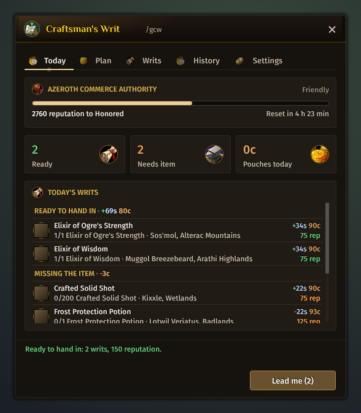
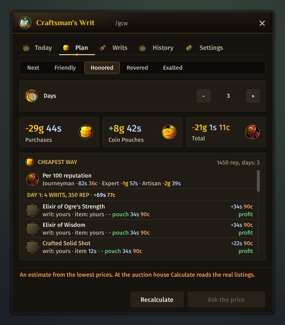

<h1 align="center">Gulli-CraftsmansWrit</h1>

<b>The cheapest way to your trade camp standing with Craftsman's Writs, with every Coin Pouch counted.</b>

  
  
  

 

---

In WoW Forever a Craftsman's Writ is a daily quest: bring one crafted item to a customer and the trade camp (Azeroth Commerce Authority or Durotar Supply and Logistics) gives you reputation and a Coin Pouch. There are 150 writs in three ranks. Each writ can be handed in once a day. Craftsman's Writ tells you what you can hand in today, finds the cheapest writs to the standing you want, buys them and leads you to the customers.

## Features

- **Today.** Your standing with the camp and how much is left to the next one, when the day resets, and every writ you carry: ready to hand in, still missing its item, in the bank or already handed in today, with the time until you can hand it in again. Each one shows what handing it in costs from here: the item you still need at the auction, less its Coin Pouch. Sealed Writs in your bags are listed too.
- **A plan for up to 31 days.** Pick the standing you want (the next one, Friendly, Honored, Revered or Exalted) and the days you have. Craftsman's Writ picks the writs that get you there for the least gold. Each writ can be used once a day, so more days let it use the cheap writs again. The plan is shown day by day.
- **Coin Pouches in plain sight.** Every turn-in gives a Coin Pouch with gold in it. The plan shows it on every line and on top: **Purchases**, minus **Coin Pouches**, equals **Total**. A writ that costs less than its pouch is marked **profit** in green, and the plan always takes it; one that costs more shows its **loss** in red. Craftsman's Writ learns what your pouches really hold when you open them.
- **Bags and bank first.** Writs and items you already have cost nothing. The bank counts too (switch it off if you like).
- **Sealed Writs.** A Sealed Writ holds a random writ of its rank. The plan can count it at the mean price of that rank's items.
- **Real auction prices.** Prices come from your price addon (Auctionator and others). At the auction house, **Calculate** reads the real listings, so buying many also counts the dearer ones.
- **Buy with clicks.** At the auction house the window opens beside the auction window. The **Buy** button buys the plan line by line: the first press asks the price, the second buys.
- **Lead me.** With writs ready, **Lead me** puts a map pin on the nearest customer, and a small tracker lists the others. Customers the data does not know yet are learned when you take or hand in their writ.
- **Diplomat counted.** The Legacy perk Diplomat gives more reputation. Craftsman's Writ reads what you really get after a turn-in and plans with it.
- **All writs and history.** The Writs tab lists every writ of your side with its customer and what one turn-in costs now, the best gain on top (or by profession); a writ handed in today shows when it can be handed in again. History lists what you handed in, with what it cost and what its pouch gave, for a day, a week or all time.
- **Tooltips.** Writs, Sealed Writs, Coin Pouches and the items writs ask for get a line in their tooltip: the rank, the reputation, the customer, the cost per 100 reputation, and your other characters who hold one.

## Install

**With [Runeloader](https://github.com/Gulliby-development/runeloader)** (Android): install **Craftsman's Writ**.

**By hand:** download `Gulli-CraftsmansWrit-<version>-forever.zip` from the [releases](https://github.com/Gulliby-development/gulli-toolkit/releases) and unpack it into `Interface/AddOns`. Then type `/reload`.

Craftsman's Writ works on its own. With the Gulli Toolkit hub it also shows in `/gulli`. For prices, install a price addon such as Auctionator.

## How to use it

1. Type `/gcw` and open **Plan**. Pick the standing you want and the days.
2. Go to the auction house and press **Calculate**, then **Buy** until everything is bought.
3. Open the Sealed Writs, take the writs, and press **Lead me** on the **Today** tab.

Type `/gcw` (or the old `/gwr`) to open the window, `/gcw lead` to start the guide, `/gcw stop` to end it, `/gcw pouches` to see what the pouches hold.

## FAQ

<b>Why can the total be below zero?</b>

Because of the Coin Pouches. A cheap writ can cost less than the gold its pouch gives. Then you earn gold and reputation at the same time.

<b>Can I hand in the same writ twice a day?</b>

No. Each of the 150 writs can be handed in once a day. That is why the plan spreads copies of one writ over several days.

<b>Why two presses to buy?</b>

The game lets an addon ask for a price and buy at the auction house only when you press a button yourself, for each step. It never buys without your press.

<b>Where does the data come from?</b>

The list of writs, the items they ask for and their customers come from AllTheThings' WoW Forever data (MIT licence). The average of a Coin Pouch comes from what players report, until you open your own.

