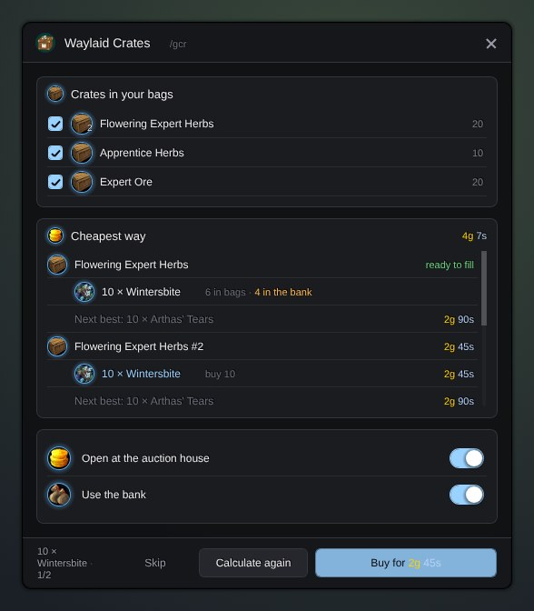

<h1 align="center">Gulli-Crates</h1>

<b>Fills your Waylaid Crates the cheapest way: from your bags, your bank and the auction house.</b>

  
  
  

---

A Waylaid Crate takes any one bundle from its list: 10 Wintersbite, 10 Firebloom, 20 Purple Lotus or 10 Arthas' Tears. Which one is cheapest for you? Gulli Crates works it out and buys the rest.

## Features

- **Opens at the auction house.** Carry a crate and open the auction house: the window opens beside it. A switch turns this off.
- **Pick the crates.** Every crate in your bags is listed. Untick the ones you want to keep for later.
- **The cheapest bundle.** **Calculate** prices every bundle of every crate. What you already have costs nothing; the rest is priced from Auctionator's database.
- **Your bank counts.** Items in your bank are used too, and the list says so in orange: take them out before you fill the crate. A switch turns this off.
- **Several crates at once.** Your stock is shared fairly: a stack that fills one crate is not split over two.
- **Buy what is missing.** Press **Buy** to go through the list. The first press asks the auction house for the real price and shows it on the button. The next press buys. After that, each line is one press.
- **No surprises.** If the real price is much higher than Auctionator's, the line turns orange. Press **Skip** to leave a line out.
- **All 30 crates.** Apprentice, Journeyman, Expert and Artisan: herbs, ore, textiles, curiosities, fabrics, ingots and parts.

## Install

**With [Runeloader](https://github.com/Gulliby-development/runeloader)** (Android): install **Gulli Toolkit**. Crates comes with it.

**By hand:** download `Gulli-Crates-<version>-forever.zip` from the [releases](https://github.com/Gulliby-development/gulli-toolkit/releases) and unpack it into `Interface/AddOns`. Then type `/reload`.

You also need [Auctionator](https://www.curseforge.com/wow/addons/auctionator) for the prices. Scan the auction house with it now and then.

## How to use it

1. Put the crates in your bags and go to the auction house.
2. Untick the crates you do not want, press **Calculate**.
3. Press **Buy** until the list is done.
4. Use each crate: it takes the bundle from your bags. Then hand the sealed crate in at your trade hub.

Type `/gcr` to open the window anywhere.

## FAQ

<b>Why one press per purchase?</b>

The game lets an addon buy at the auction house only when you press a button yourself. So the button does one purchase each time. It never buys without your press.

<b>Why does the real price differ from the plan?</b>

Auctionator remembers the lowest price of one item. Buying 20 may take some dearer ones too. The button always shows the real price before you buy.

<b>Where does the list of bundles come from?</b>

From the crate's own tooltip in the game. If the game cannot give it, from a table in the addon, made from the WoW Forever guides on wowforever.ninja and urgametips.com.

<b>Is it tested in the game?</b>

Not yet in WoW Forever itself. It is tested on a fake game client. If something does not work, tell us on GitHub.

---

Part of <a href="../../README.md">Gulli Toolkit</a>. A fan project, not affiliated with Blizzard Entertainment. Free software under the <a href="../../LICENSE">GPLv3</a>.

