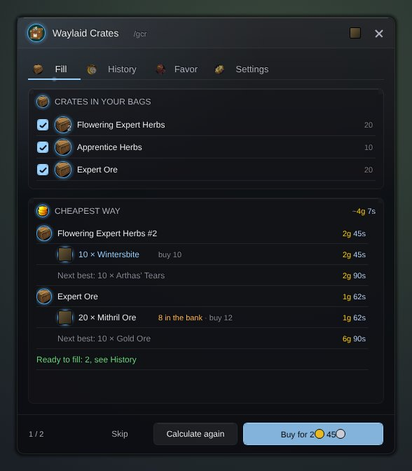
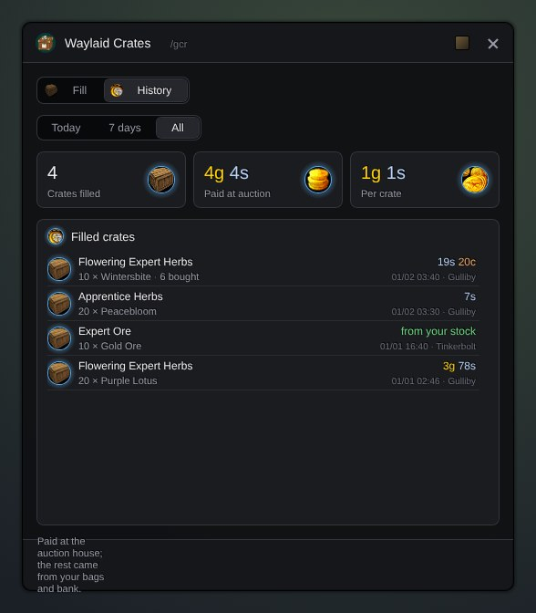
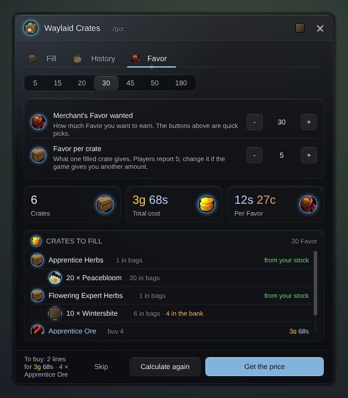

<h1 align="center">Gulli-Crates</h1>

<b>Fills your Waylaid Crates the cheapest way: from your bags, your bank and the auction house.</b>

  
  
  

  

---

A Waylaid Crate takes any one bundle from its list: 10 Wintersbite, 10 Firebloom, 20 Purple Lotus or 10 Arthas' Tears. Which one is cheapest for you? Gulli Crates works it out and buys the rest.

## Features

- **Opens at the auction house.** Carry a crate and open the auction house: the window opens beside it. A switch turns this off.
- **Pick the crates.** Every crate in your bags is listed. Untick the ones you want to keep for later, and tick them again at any time: the price follows at once.
- **The cheapest bundle.** **Calculate** prices every bundle of every crate. What you already have costs nothing; the rest is priced from Auctionator's database.
- **Your bank counts.** Items in your bank are used too, and the list says so in orange: take them out before you fill the crate. A switch turns this off.
- **Several crates at once.** Your stock is shared fairly: a stack that fills one crate is not split over two.
- **Buy what is missing.** Press **Buy** to go through the list. For each line, the first press asks the auction house for the real price and shows it on the button. The second press buys.
- **No surprises.** If the real price is much higher than Auctionator's, the line turns orange. Press **Skip** to leave a line out.
- **History.** The History tab lists every crate you filled: which bundle, when, and what you paid at the auction house for it. Filter by today, 7 days or all, with the totals on top.
- **Bought is bought.** A crate whose items are already in your bags leaves the plan and waits at the top of the History as ready to fill, with what you paid. When you come back to the auction house, the plan is made again, so nothing is offered twice.
- **Old prices.** When Auctionator's prices are more than 4 hours old, a yellow note at the top of the window asks you to run a full scan first. Its cross closes it until your next visit to the auction house.
- **Refresh.** The round arrow at the top looks at your bags again and calculates anew. When no crate is left, or all is bought and you left the auction house, the old plan is cleared by itself.
- **A Favor goal.** The Favor tab asks how much Merchant's Favor you want: pick 5, 15, 20, 30, 45, 50 or 180, or set any number with **-** and **+**. Each crate pays its own Favor: Apprentice 5, Journeyman 10, Expert 15, Artisan 20, and crafted crates (fabrics, ingots, parts) twice as much. **Calculate** looks at every crate up to your level, in your bags and on the auction house, and finds the mix that reaches your goal for the least gold, each crate with its cheapest bundle. It shows how many crates, the total and the price of one Favor. **Buy** buys the crates and their bundles, two presses a line as always.
- **All 30 crates.** Apprentice, Journeyman, Expert and Artisan: herbs, ore, textiles, curiosities, fabrics, ingots and parts.

## Install

**With [Runeloader](https://github.com/Gulliby-development/runeloader)** (Android): install **Gulli Toolkit**. Crates comes with it.

**By hand:** download `Gulli-Crates-<version>-forever.zip` from the [releases](https://github.com/Gulliby-development/gulli-toolkit/releases) and unpack it into `Interface/AddOns`. Then type `/reload`.

You also need [Auctionator](https://www.curseforge.com/wow/addons/auctionator) for the prices. Scan the auction house with it now and then.

## How to use it

1. Put the crates in your bags and go to the auction house.
2. Untick the crates you do not want, press **Calculate**.
3. Press **Buy** until the list is done.
4. Use each crate: it takes the bundle from your bags. Then hand the sealed crate in at your trade hub.

Type `/gcr` to open the window anywhere.

## FAQ

<b>Why two presses per line?</b>

The game lets an addon ask for a price and buy at the auction house only when you press a button yourself, for each step. So each line takes two presses: one for the price, one to buy. It never buys without your press.

<b>Why does the real price differ from the plan?</b>

Auctionator remembers the lowest price of one item. Buying 20 may take some dearer ones too. The button always shows the real price before you buy.

<b>How much Favor does a crate give?</b>

Apprentice 5, Journeyman 10, Expert 15, Artisan 20; crafted crates (fabrics, ingots, parts) 10, 20, 30 and 40. These come from the game's quest data for "A Sealed Crate". The Artisan numbers are not in that data yet and follow the same steps. Sometimes a crate pays double (a Performance Bonus); the plan never counts on it. The tab only uses crates up to your level, and only crates the auction house has a price for in Auctionator.

<b>Where does the list of bundles come from?</b>

From the crate's own tooltip in the game. If the game cannot give it, from a table in the addon, made from the WoW Forever guides on wowforever.ninja and urgametips.com.

<b>Is it tested in the game?</b>

Not yet in WoW Forever itself. It is tested on a fake game client. If something does not work, tell us on GitHub.

---

Part of <a href="../../README.md">Gulli Toolkit</a>. A fan project, not affiliated with Blizzard Entertainment. Free software under the <a href="../../LICENSE">GPLv3</a>.

