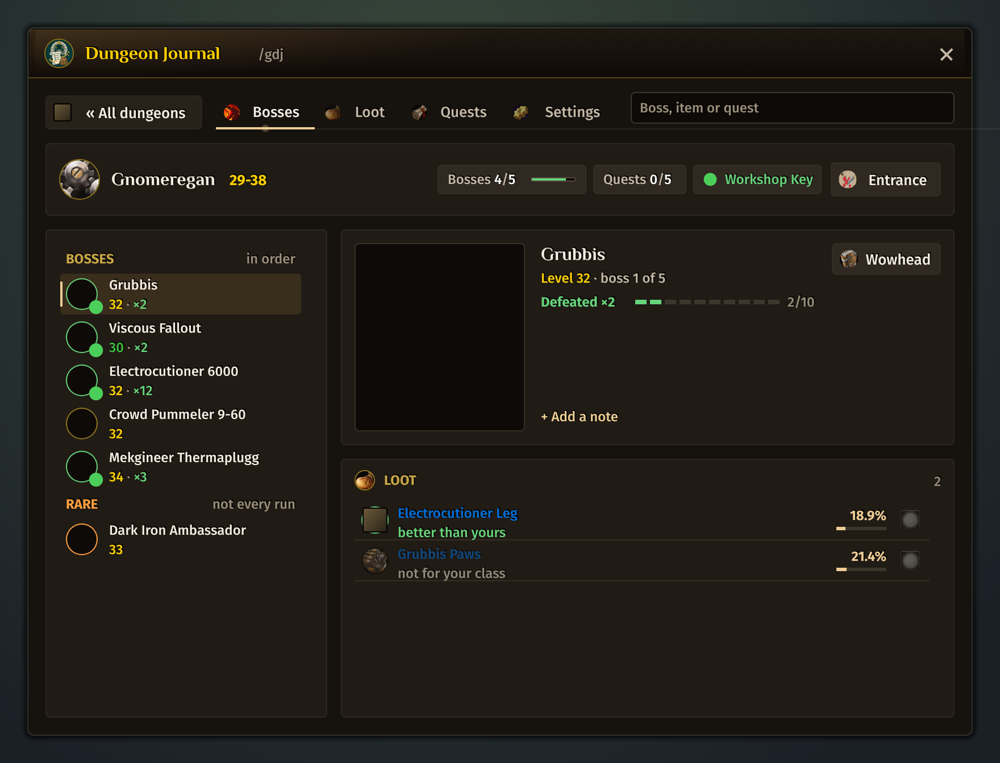
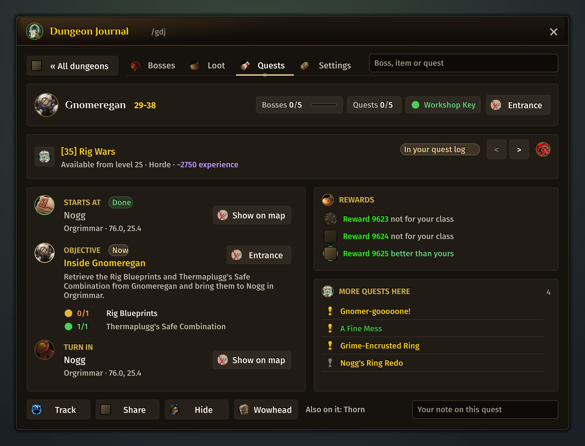

<h1 align="center">Dungeon Journal</h1>

<b>Every dungeon of WoW Forever: its bosses, what they drop and how often, its quests and the way to pick them up.</b>

  
  
  

 

---

You are about to run a dungeon. Who is inside, what can drop for you, and did you take all its quests? The Dungeon Journal shows it on one page. (Its folder is still called Gulli-DungeonPrep.)

## Features

- **Bosses.** Each dungeon lists its bosses in the order you meet them, wing by wing in the big dungeons, then its rare mobs in their own block. Each boss shows its level in the game's colours for you (red is too hard, grey is easy). A boss you killed gets a green ring with a check and the number of kills, and the header counts them (**Bosses 4/5**). The page shows the boss in 3D (drag to turn it) and its spells by name.
- **Loot and drop chances.** Every item a boss drops, with its chance and a thin bar for it. Items for your class come first, items better than yours are marked, items for another class are pale. Ctrl+click tries an item on, Shift+click links it in chat.
- **Your own numbers.** The journal counts your kills and what dropped. After 10 kills of a boss it shows your own chances, and items the data did not know are added.
- **Wishlist.** Click the star next to an item (or right-click the item) to wish for it. The **Loot** tab shows what the bosses do not have: **From mobs** is the loot of the ordinary mobs, **For me** is everything in the dungeon for your class, boss by boss, and **Wishlist** is your list. When a wished item drops, you get a notice and a sound.
- **Notes.** Write your own note on a boss or a quest. It stays there for next time.
- **A warning at the door.** When you enter a dungeon with quests you have not taken yet, it tells you once. The journal opens on the dungeon you are in.
- **Lead me.** On the **Quests** tab, **Lead me** pins the next quest giver on the map, and the next one after you take each quest. With nothing left to take, it pins who takes back your finished quests, then the entrance.
- **In the dungeon or not.** In the Lead me list, a row with the dungeon's small round icon under its "?" or "!" is a quest whose next step is inside the dungeon: you take it there, do it there or hand it in there. The quest list says "Inside Maraudon" for the same quests.
- **Every dungeon of WoW Forever**, also the new ones: the Hall of Thanes, the Ruins of Lordaeron, the Excavation Site in the Wetlands, the City of Dalaran, the Drowned City, Krol'dok Stronghold, Alcaz Prison, Blackmaw Hold and Shaper's Terrace.
- **A page for each quest**, like a dungeon journal. Its header shows how much experience the quest gives you (with "~" when the number comes from the addon's data and not from your quest log; the quest list shows it too). Click a quest to see its way in three steps: where it **starts**, what to do, and where to **turn it in**. Each step says if it is done or the one to do now. A step that happens in the dungeon shows the dungeon's icon and "Inside Maraudon". A line joins the steps and turns green where they are done. A step can have a short tip from the levelling guides (in English), such as "Do not kill The Questioner before this". The middle step lists what to bring, each with its item's icon and a bar (with the count while the quest is in your log), and the bosses the quest needs, with their picture, level and place in the run: click one to open its boss page. Under the steps you see the experience, the first reward and the next quests of the chain. **Show on map** sets a pin and opens the map there, and **Entrance** pins the way in. Beside it you see the whole quest chain as numbered steps (done steps ticked, the step you still miss in red), the rewards by name (marked when they are better than yours or not for your class) and the dungeon's other quests, one click away. Click a step of the chain to open that quest. The arrows go to the quest before and after it in the list. **Track** puts it on your quest tracker, **Share** offers it to your group, **Hide** takes it off the list. **Wowhead** shows the quest's Wowhead link in a small box: press Ctrl+C to copy it. A boss's page has the same button.
- **A header for each dungeon**, like a dungeon journal: its name and levels, how many of its bosses you killed, how many of its quests are done, in your log and to take, whether its key is in your bags, and the **Entrance** button. The dungeon list shows how many quests wait in each dungeon.
- **All dungeons at a glance.** The journal opens on big tiles of every dungeon, the ones for your level first: the name in capitals, the dungeon's picture at full light, and under it the levels on the left and the quests that wait there on the right. Click one to open it: its pages (Bosses, Loot, Quests, Settings) take the whole window, and **« All dungeons** goes back to the tiles. Inside a dungeon it opens on the dungeon you are in.
- **Suggests a dungeon** for your level. Every dungeon shows the picture the game shows when you enter it (its loading screen), WoW Forever's new dungeons too. The level range has the game's colours: red is too hard, yellow is right for you, green is easy, gray gives little experience.
- **Levelling chains first.** A dungeon has many quests, but while levelling you take only a few chains for it (in Scholomance for the Horde: Barov Family Fortune, Doctor Theolen Krastinov, Kirtonos, Ras Frostwhisper, the Plagued Hatchlings and the key chain). The journal shows only these chains, for your faction, also the steps outside the dungeon. Your class quests for the dungeon are always among them (in the Sunken Temple: the priest's Blood of Morphaz, the warrior's Voodoo Feathers and so on), with the quests you need first, marked "Priest only" in your class colour. The tier 0.5 set quests (An Earnest Proposition, Just Compensation and the rest of the chain) stay hidden while you level. At level 60 they come as one folded line at the bottom of the list, **Tier 0.5 set**, with only your class's quests: click it to open it. **Lead me** and the tracker follow a set quest once one is in your quest log, and lead to the set quests to take while that line is open. Turn off **Chains only** above the list to see every quest that touches the dungeon.
- **Only your quests.** Horde and Alliance quests are kept apart. Repeatable turn-ins with no experience (like the Sparklematic 5200 in Gnomeregan) are not listed.
- **A way to pick them up.** The quests you can take now come as stops: first the ones in your zone, nearest first, then other zones. The last stop is the dungeon entrance. Click a stop to put a pin on the map and open the map there (and a TomTom arrow, if you have TomTom). **Entrance** pins the way in at once.
- **Rewards.** Each quest shows its reward items. Items for another class are pale, and an item better than what you wear has a green border. Point at a quest for the list, and for the experience and money of a quest in your log.
- **A tracker on the screen.** **Lead me** also shows a small panel with the dungeon's quests, one row per chain. Four numbers on top say what to do: **Hand in**, **Doing**, **Take** and **Later**. They add up to the number in the header. **Take** has only quests you can take right now. A quest that opens after a quest you are still doing waits in **Later** and says which one ("After: Disharmony of Flame"). Each row is named by the quest you do now. Dots under it show where you are in the chain, and the chain's last quest is named after them ("2/7 » The Princess Saved?"). The panel keeps its size and is always full to its bottom edge: when there are more rows than fit, scroll with the mouse wheel, or click the line at the bottom for the next rows. A thin bar at the side shows where you are. A row's tooltip opens beside the panel, not over it. Click a number on top to jump to its group. Right-click a row to open it in the journal. The map button puts a pin on who you go to next and opens the world map on that zone. The cross closes it. Place it in **Unlock frames** in `/gulli`.
- **See the whole chain.** Click a row of the tracker to open the chain in a small card beside it: the steps you did, the step you are at, and what comes next, each with where it is. When a quest opens two quests, the card says so and names both: the next step of this chain and the side quest. Click a step to open its page.
- **A map of the chains.** The **Chains** tab shows every chain of the dungeon as a line of its steps, first step first. A chain that starts from a step of another chain stands right under it ("After Disharmony of Flame"). Single quests come last. A step you do inside the dungeon has the dungeon's icon. Click a quest to open its page.
- **Target the quest giver.** When the quest giver is near you, a map button (in the tracker and on a quest's page) also targets them, so you find them in a crowd. This works out of combat, by the name the quest data gives (English names on other clients may not match).
- **Chains.** A chain is one card, named by its last quest in the dungeon, with every step of the chain under it: done steps ticked, steps in your log marked, the step you still miss in red and the step you are at in blue. The card stands in the list of the step you are at ("Step 2 of 4"), and the counts count chains, so a chain of five quests is one quest to do. A quest you cannot take yet says which quest you need first and where it starts.
- **Hand in.** A quest in your log says who takes it back. When you leave a dungeon, it tells you in chat where to hand in your finished quests and pins the first one.
- **Your group.** A quest in your log shows who in your group has it too. Share it from its page.
- **Search and hide.** Find a quest by its name, its quest giver or a mob it needs. Right-click a quest to hide it. The filters **All**, **To take**, **In log** and **Done** show only those quests, each with its count. A switch in **Settings** folds the quests you cannot take yet.
- **Quest colours.** Each quest shows its level in the same colours, and says if it is hard or easy for you.
- **Three lists of quest cards.** Quests in your log, quests to pick up on the way, and quests for later. Each card shows the quest's level, the level it opens at, its step in the chain, a clear tag (**In log**, **Can take**, **Later**, **Done**) and what comes next: the earlier quest you need first and where it starts, or who takes it back.
- **Ready to go?** Repairs, free bag slots, food, water, the hearthstone, ammo and reagents moved to the **Ready** card on the home page of `/gulli`, so you see them without opening the journal.
- **Data built in.** The quests come from the QuestieDB data for WoW Forever, checked against the AllTheThings list of every dungeon's quests, the levelling chains from the Guidelime DungeonQuests guides, the bosses and drop chances from Wowhead's WoW Forever pages, the order of the bosses from AllTheThings (and the bosses of the dungeons Wowhead files elsewhere), the levels of WoW Forever's own bosses as the game shows them.

## Install

**With [Runeloader](https://github.com/Gulliby-development/runeloader)** (Android): install **Gulli Toolkit**. The Dungeon Journal comes with it.

**By hand:** download `Gulli-DungeonPrep-<version>-forever.zip` from the [releases](https://github.com/Gulliby-development/gulli-toolkit/releases) and unpack it into `Interface/AddOns`. Then type `/reload`.

## How to use it

1. Type `/gdj`, or `/gdj DM` for a dungeon by its short name (`/gdp` works too).
2. Pick a dungeon tile. **Bosses** shows who is inside and what they drop.
3. On **Quests**, follow the stops in **Pick up on the way** before you go. Click a stop for a map pin.
4. Point at a quest for a short card, or click it for its page with the chain and the map buttons. **<** goes back to the list.

## FAQ

<b>A quest is missing</b>

The list comes from quest data. Tell us on GitHub which quest and which dungeon.

<b>The entrance pin is a bit off</b>

The entrances are set by hand from the game's maps. For the new Forever dungeons the pin stands at the quest giver or camp next to the way in for now. Tell us on GitHub which dungeon, and where the way in really is.

<b>Where do the drop chances come from?</b>

From Wowhead's WoW Forever pages, counted from many players' kills. After 10 kills of a boss the journal uses your own numbers instead (marked **your own drops**). Turn this off with **Count my kills and drops** on the **Settings** tab.

<b>A boss has no drop chance or shows ?? as its level</b>

Wowhead files the bosses of the City of Dalaran, Krol'dok Stronghold and Shaper's Terrace under other zones, so their pages were read one by one. A boss Wowhead has no kills of yet shows its loot without a chance. After 10 kills of a boss the journal shows your own chances. Wowhead has no levels for the bosses of WoW Forever's new dungeons, so their levels are the ones the game shows. A boss whose level is not known yet shows **??**.

<b>Where are the durability and food checks?</b>

On the home page of `/gulli`, in the **Ready** card. Its **Settings** button sets the limits.

<b>Do I need TomTom?</b>

No. Without TomTom, the pin goes on the game's own map. With TomTom, you also get its arrow. You can turn the arrow off on the **Settings** tab.

<b>Is it tested in the game?</b>

Not yet in WoW Forever itself. It is tested on a fake game client. If something does not work, tell us on GitHub.

---

Part of <a href="../../README.md">Gulli Toolkit</a>. A fan project, not affiliated with Blizzard Entertainment. Free software under the <a href="../../LICENSE">GPLv3</a>.

