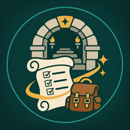

<h1 align="center">Dungeon Journal</h1>

<b>Every dungeon of WoW Forever: its bosses, what they drop and how often, its quests and the way to pick them up.</b>

  
  
  

---

You are about to run a dungeon. Who is inside, what can drop for you, and did you take all its quests? The Dungeon Journal shows it on one page. (Its folder is still called Gulli-DungeonPrep.)

## Features

- **Bosses.** Each dungeon lists its bosses in order, then its rare mobs. Each boss shows its level in the game's colours for you (red is too hard, grey is easy). Click a boss to see it in 3D (drag to turn it), its spells and how many times you killed it.
- **Loot and drop chances.** Every item a boss drops, with its chance and about how many runs it takes (**~5 runs**). Items better than yours are marked, items for another class are pale. Ctrl+click tries an item on, Shift+click links it in chat.
- **Your own numbers.** The journal counts your kills and what dropped. After 10 kills of a boss it shows your own chances, and items the data did not know are added.
- **Wishlist.** Click the gem next to an item (or right-click the item) to wish for it. The **Loot** tab shows the whole dungeon's loot with the filters **All**, **For me** and **Wishlist**. When a wished item drops, you get a notice and a sound.
- **Notes.** Write your own note on a boss or a quest. It stays there for next time.
- **A warning at the door.** When you enter a dungeon with quests you have not taken yet, it tells you once. The journal opens on the dungeon you are in.
- **Lead me.** On the **Quests** tab, **Lead me** pins the next quest giver on the map, and the next one after you take each quest, up to the entrance.
- **Every dungeon of WoW Forever**, also the new ones: the Hall of Thanes, the Ruins of Lordaeron, the Excavation Site in the Wetlands, the City of Dalaran, the Drowned City, Krol'dok Stronghold, Alcaz Prison, Blackmaw Hold and Shaper's Terrace.
- **A page for each quest**, like a dungeon journal. Click a quest to see what to do (each objective with its count, ticked when done), who gives it and who takes it back (each with a **Show on map** button), the whole quest chain as numbered steps (done steps ticked, the step you still miss in red), the rewards by name (marked when they are better than yours or not for your class) and the mobs it needs. The arrows go to the quest before and after it in the list. **Track** puts it on your quest tracker, **Share** offers it to your group, **Hide** takes it off the list.
- **A header for each dungeon**, like a dungeon journal: its name and levels, its bosses, how many of its quests are in your log, to take, for later and done, whether its key is in your bags, and the **Entrance** button. The dungeon list shows how many quests wait in each dungeon.
- **All dungeons at a glance.** The journal opens on big tiles of every dungeon, the ones for your level first, each with its picture, levels and the quests that wait there. Click one to open it; **« All dungeons** goes back. Inside a dungeon it opens on the dungeon you are in.
- **Suggests a dungeon** for your level. Each dungeon in the list on the left shows its full name on one line and its levels and waiting quests on the next. Classic dungeons show the game's own dungeon picture and portrait; WoW Forever's new dungeons show their icon. The level range has the game's colours: red is too hard, yellow is right for you, green is easy, gray gives little experience.
- **Only your quests.** Horde and Alliance quests are kept apart. Repeatable turn-ins with no experience (like the Sparklematic 5200 in Gnomeregan) are not listed.
- **A way to pick them up.** The quests you can take now come as stops: first the ones in your zone, nearest first, then other zones. The last stop is the dungeon entrance. Click a stop to put a pin on the map (and a TomTom arrow, if you have TomTom). **Entrance** pins the way in at once.
- **Rewards.** Each quest shows its reward items. Items for another class are pale, and an item better than what you wear has a green border. Point at a quest for the list, and for the experience and money of a quest in your log.
- **Chains.** "Step 2 of 4" on quests in a chain. A quest you cannot take yet says which quest you need first and where it starts.
- **Hand in.** A quest in your log says who takes it back. When you leave a dungeon, it tells you in chat where to hand in your finished quests and pins the first one.
- **Your group.** A quest in your log shows who in your group has it too. Share it from its page.
- **Search and hide.** Find a quest by its name, its quest giver or a mob it needs. Right-click a quest to hide it. The filters **All**, **To take**, **In log** and **Done** show only those quests, each with its count. A switch in **Settings** folds the quests you cannot take yet.
- **Quest colours.** Each quest shows its level in the same colours, and says if it is hard or easy for you.
- **Three lists of quest cards.** Quests in your log, quests to pick up on the way, and quests for later. Each card shows the quest's level, the level it opens at, its step in the chain, a clear tag (**In log**, **Can take**, **Later**, **Done**) and what comes next: the earlier quest you need first and where it starts, or who takes it back.
- **Ready to go?** Repairs, free bag slots, food, water, the hearthstone, ammo and reagents moved to the **Ready** card on the home page of `/gulli`, so you see them without opening the journal.
- **Data built in.** The quests come from the QuestieDB data for WoW Forever, the bosses and drop chances from Wowhead's WoW Forever pages.

## Install

**With [Runeloader](https://github.com/Gulliby-development/runeloader)** (Android): install **Gulli Toolkit**. The Dungeon Journal comes with it.

**By hand:** download `Gulli-DungeonPrep-<version>-forever.zip` from the [releases](https://github.com/Gulliby-development/gulli-toolkit/releases) and unpack it into `Interface/AddOns`. Then type `/reload`.

## How to use it

1. Type `/gdj`, or `/gdj DM` for a dungeon by its short name (`/gdp` works too).
2. Pick a dungeon tile (or a dungeon on the left). **Bosses** shows who is inside and what they drop.
3. On **Quests**, follow the stops in **Pick up on the way** before you go. Click a stop for a map pin.
4. Point at a quest for a short card, or click it for its page with the chain and the map buttons. **<** goes back to the list.

## FAQ

<b>A quest is missing</b>

The list comes from quest data. Tell us on GitHub which quest and which dungeon.

<b>The entrance pin is a bit off</b>

The entrances are set by hand from the game's maps. For the new Forever dungeons the pin stands at the quest giver or camp next to the way in for now. Tell us on GitHub which dungeon, and where the way in really is.

<b>Where do the drop chances come from?</b>

From Wowhead's WoW Forever pages, counted from many players' kills. After 10 kills of a boss the journal uses your own numbers instead (marked **your own drops**). Turn this off with **Count my kills and drops** on the **Settings** tab.

<b>A dungeon has no bosses</b>

Wowhead has no boss list yet for the City of Dalaran, Krol'dok Stronghold and Shaper's Terrace. Their quests are there; the bosses come in a later version. Your own kills there are not counted until then.

<b>Where are the durability and food checks?</b>

On the home page of `/gulli`, in the **Ready** card. Its **Settings** button sets the limits.

<b>Do I need TomTom?</b>

No. Without TomTom, the pin goes on the game's own map. With TomTom, you also get its arrow. You can turn the arrow off on the **Settings** tab.

<b>Is it tested in the game?</b>

Not yet in WoW Forever itself. It is tested on a fake game client. If something does not work, tell us on GitHub.

---

Part of <a href="../../README.md">Gulli Toolkit</a>. A fan project, not affiliated with Blizzard Entertainment. Free software under the <a href="../../LICENSE">GPLv3</a>.

