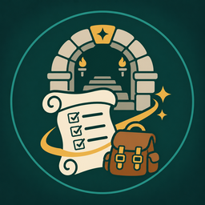
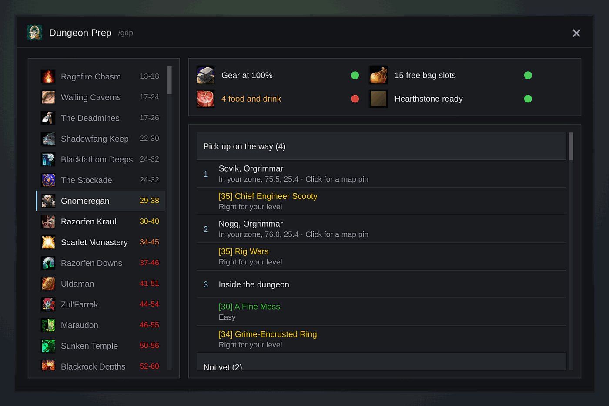

<h1 align="center">Gulli-DungeonPrep</h1>

<b>Before a dungeon: its quests, their rewards, the way there and a checklist.</b>

  
  
  

---

You are about to run a dungeon. Did you take all its quests? Gulli Dungeon Prep shows them, and checks what usually runs out inside.

## Features

- **Every dungeon of WoW Forever**, also the new ones: the Hall of Thanes, the Ruins of Lordaeron, the Excavation Site in the Wetlands, the City of Dalaran, the Drowned City, Krol'dok Stronghold, Alcaz Prison, Blackmaw Hold and Shaper's Terrace.
- **A page for each quest**, like a dungeon journal. Click a quest to see what to do, who gives it and who takes it back (each with a **Show on map** button), the whole quest chain as numbered steps (done steps ticked, the step you still miss in red), the rewards and the mobs it needs. **Track** puts it on your quest tracker, **Share** offers it to your group, **Hide** takes it off the list.
- **Suggests a dungeon** for your level. Each dungeon has its icon, and its level range has the game's colours: red is too hard, yellow is right for you, green is easy, gray gives little experience.
- **Only your quests.** Horde and Alliance quests are kept apart. Repeatable turn-ins with no experience (like the Sparklematic 5200 in Gnomeregan) are not listed.
- **A way to pick them up.** The quests you can take now come as stops: first the ones in your zone, nearest first, then other zones. The last stop is the dungeon entrance. Click a stop to put a pin on the map (and a TomTom arrow, if you have TomTom). **Entrance** pins the way in at once.
- **Rewards.** Each quest shows its reward items. Items for another class are pale, and an item better than what you wear has a green border. Point at a quest for the list, and for the experience and money of a quest in your log.
- **Chains.** "Step 2 of 4" on quests in a chain. A quest you cannot take yet says which quest you need first and where it starts.
- **Hand in.** A quest in your log says who takes it back. When you leave a dungeon, it tells you in chat where to hand in your finished quests and pins the first one.
- **Your group.** A quest in your log shows who in your group has it too. Share it from its page.
- **Search and hide.** Find a quest by its name, its quest giver or a mob it needs. Right-click a quest to hide it. **Hide not yet** folds the quests you cannot take yet.
- **Quest colours.** Each quest shows its level in the same colours, and says if it is hard or easy for you.
- **Three lists.** Quests in your log, quests to pick up on the way, and quests for later (with the level or the quest you need first).
- **A checklist.** Gear durability, free bag slots, food and drink, and your hearthstone. It also checks the dungeon key (the Scarlet Key, the Workshop Key and others) and what your class brings along: arrows or bullets, soul shards, or your reagent. With Gulli Restock, it also says what your restock list misses. You set the limits on the **Settings** tab.
- **Quest data built in.** It comes from the QuestieDB data for WoW Forever.

## Install

**With [Runeloader](https://github.com/Gulliby-development/runeloader)** (Android): install **Gulli Toolkit**. Dungeon Prep comes with it.

**By hand:** download `Gulli-DungeonPrep-<version>-forever.zip` from the [releases](https://github.com/Gulliby-development/gulli-toolkit/releases) and unpack it into `Interface/AddOns`. Then type `/reload`.

## How to use it

1. Type `/gdp`, or `/gdp DM` for a dungeon by its short name.
2. Pick a dungeon on the left.
3. Follow the stops in **Pick up on the way** before you go. Click a stop for a map pin.
4. Point at a quest for a short card, or click it for its page with the chain and the map buttons. **<** goes back to the list.

## FAQ

<b>A quest is missing</b>

The list comes from quest data. Tell us on GitHub which quest and which dungeon.

<b>The entrance pin is a bit off</b>

The entrances are set by hand from the game's maps. For the new Forever dungeons the pin stands at the quest giver or camp next to the way in for now. Tell us on GitHub which dungeon, and where the way in really is.

<b>Do I need TomTom?</b>

No. Without TomTom, the pin goes on the game's own map. With TomTom, you also get its arrow. You can turn the arrow off on the **Settings** tab.

<b>Is it tested in the game?</b>

Not yet in WoW Forever itself. It is tested on a fake game client. If something does not work, tell us on GitHub.

---

Part of <a href="../../README.md">Gulli Toolkit</a>. A fan project, not affiliated with Blizzard Entertainment. Free software under the <a href="../../LICENSE">GPLv3</a>.

