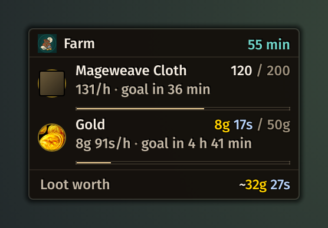
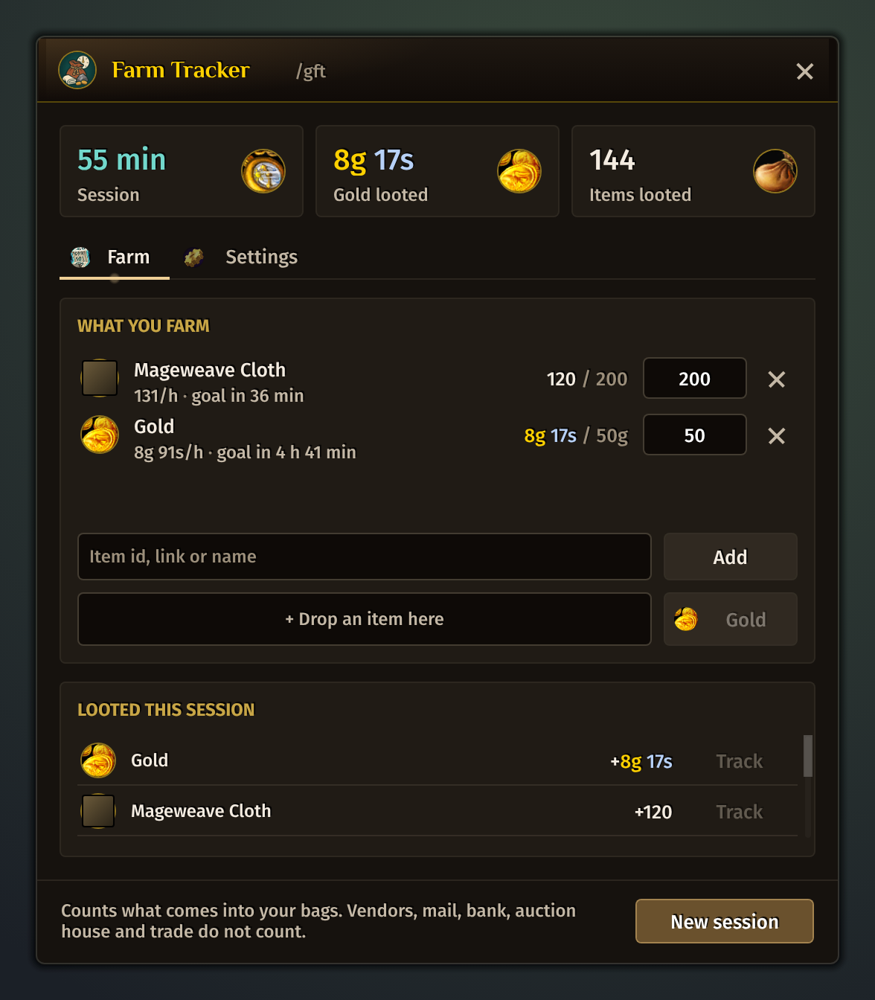

<h1 align="center">Gulli-FarmTrack</h1>

<b>How much did you farm this session? A small panel on the screen tells you, with a goal if you want one.</b>

  
  
  

 

---

You go out to farm Mageweave, Mithril or gold. Farm Tracker counts what comes into your bags, how fast, and when you reach your goal.

## Features

- **Pick what you farm.** Up to three things at once: any item (cloth, ore, herbs, leather...) or gold. Drop an item on the window, type its id, link or name and press **Add**, press **Gold**, or press **Track** next to anything you looted.
- **A goal, if you want.** Type a number next to a target, such as 200 Mageweave or 50 gold. Leave it empty to just count.
- **A small panel on the screen.** Each target with its icon, how many you got, a bar to the goal, the rate per hour and the time left to the goal. Click it to open the window.
- **Only what you farm counts.** What you buy at a vendor or the auction house, take from the mail or the bank, or get in a trade does not count. Using or selling items does not take them away. Turn on **Count mail and auction house** in the settings if you want letters and auction buys and sales to count too.
- **Gold.** Looted gold counts. Gold from selling to a vendor counts too; a switch turns that off.
- **What the loot is worth.** Turn on **Estimate what the loot is worth** and the panel gets one more line: the gold you looted plus what your loot would bring. Grey things and plain white things (teeth, a white shield) count at the vendor price. Cloth, herbs, ore and other trade goods, and blue or purple gear that is not bound, count at the auction price from a price addon (Auctionator, auxForever, Naowh Forever, TradeSkillMaster or Hammerprice). Green gear counts as the cheapest thing it disenchants into when you know Enchanting, or at the vendor price if that is more; without Enchanting, at the vendor price. Without a price addon everything counts at the vendor price. It is an estimate. The toolkit's **This session** card shows the same estimate as its gold, with or without this switch.
- **Only a vendor.** If you never use the auction house, turn on **Sell everything to a vendor**. Then every item counts at what a vendor pays: no auction prices and no disenchanting. This changes the panel line, the **Session** tab and the toolkit's **This session** card.
- **How the estimate is made.** The **Session** tab (the first one) shows the parts of the estimate: loot and quests, auction, vendor, disenchant, crafting, and the overall sum. Beside it, every looted item that adds something, with its price, how many and what it adds, and how it was judged (auction, vendor, disenchant). Items that add nothing, such as quest items, are left off. A thing you can trade that a vendor pays almost nothing for (a Craftsman's Writ) counts at the auction price. It also says why: vendor sales are not added again, since what you sold is already counted as items, and items with no auction price count at the vendor price.
- **Everything you looted.** The **Farm** tab lists every item that came into your bags this session, the most first, with the gold on top.
- **Goal reached.** A notice and a sound tell you, once. A switch turns it off. The toolkit's **Recent** list keeps it.
- **One session, until you leave the game.** A `/reload`, a dungeon and a quick relog (within 15 minutes) keep the count. Coming back to the game later, or **New session**, starts from zero. Your targets and goals stay.
- **Breaks do not count.** A long break between loots counts as 10 minutes at most, so the rate stays honest.
- **Move it.** The panel starts hidden. Turn it on and drag it in **Unlock frames** in `/gulli` (`/gulli unlock`); a right-click there puts it back. Opacity and size are settings in the window.

## Install

**With [Runeloader](https://github.com/Gulliby-development/runeloader)** (Android): install **Gulli Toolkit**. Farm Tracker comes with it.

**By hand:** download `Gulli-FarmTrack-<version>-forever.zip` from the [releases](https://github.com/Gulliby-development/gulli-toolkit/releases) and unpack it into `Interface/AddOns`. Then type `/reload`.

## How to use it

1. Type `/gft` (or open **Farm Tracker** in `/gulli`).
2. Drop the item you farm on **Drop an item here**, or type its id or name and press **Add** (Shift+click an item puts its link there). For gold, press **Gold**.
3. Type a goal next to it if you want one.
4. Go farm. The panel shows your progress.

Commands: `/gft add <item link, id or name> [goal]`, `/gft gold [goal in gold]`, `/gft clear`, `/gft reset` (new session).

## FAQ

<b>I craft. How does that count?</b>

What you craft is not new loot, so it does not count toward a farm goal. The estimate counts only what crafting adds: the end product, less the reagents it used. Reagents you bought at the auction house in this session count at the price you paid; the others at what they would bring. So 300 ore bought and made into bars adds only the difference, and bars made into a sword and sold to a vendor count once, as the sword. The **Session** tab shows it in the **Crafting** row, and the list shows what was crafted and what was used. A new session does not know what you paid before it.

<b>Does it count items on my other characters?</b>

No. Each character has its own session and its own targets.

<b>Is it tested in the game?</b>

Not yet in WoW Forever itself. It is tested on a fake game client. If something does not work, tell us on GitHub.

