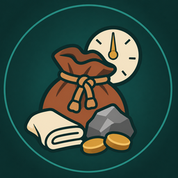
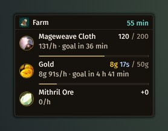
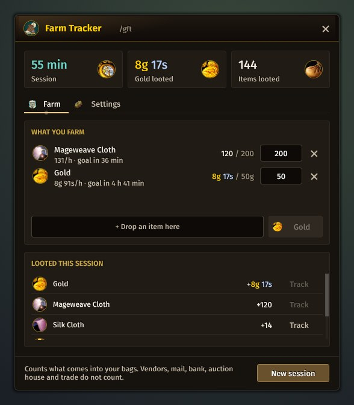

<h1 align="center">Gulli-FarmTrack</h1>

<b>How much did you farm this session? A small panel on the screen tells you, with a goal if you want one.</b>

  
  
  

 

---

You go out to farm Mageweave, Mithril or gold. Farm Tracker counts what comes into your bags, how fast, and when you reach your goal.

## Features

- **Pick what you farm.** Up to three things at once: any item (cloth, ore, herbs, leather...) or gold. Drop an item on the window, press **Gold**, or press **Track** next to anything you looted.
- **A goal, if you want.** Type a number next to a target, such as 200 Mageweave or 50 gold. Leave it empty to just count.
- **A small panel on the screen.** Each target with its icon, how many you got, a bar to the goal, the rate per hour and the time left to the goal. Click it to open the window.
- **Only what you farm counts.** What you buy at a vendor or the auction house, take from the mail or the bank, or get in a trade does not count. Using or selling items does not take them away.
- **Gold.** Looted gold counts. Gold from selling to a vendor counts too; a switch turns that off.
- **Everything you looted.** The window lists every item that came into your bags this session, the most first, with the gold on top.
- **Goal reached.** A notice and a sound tell you, once. A switch turns it off. The toolkit's **Recent** list keeps it.
- **One session.** A `/reload` keeps the count. Logging in again, or **New session**, starts from zero. Your targets and goals stay.
- **Breaks do not count.** A long break between loots counts as 10 minutes at most, so the rate stays honest.
- **Move it.** Switch off **Lock in place** in the settings (or use `/gulli move`) and drag the panel. Opacity and size are settings too.

## Install

**With [Runeloader](https://github.com/Gulliby-development/runeloader)** (Android): install **Gulli Toolkit**. Farm Tracker comes with it.

**By hand:** download `Gulli-FarmTrack-<version>-forever.zip` from the [releases](https://github.com/Gulliby-development/gulli-toolkit/releases) and unpack it into `Interface/AddOns`. Then type `/reload`.

## How to use it

1. Type `/gft` (or open **Farm Tracker** in `/gulli`).
2. Drop the item you farm on **Drop an item here**, or press **Gold**.
3. Type a goal next to it if you want one.
4. Go farm. The panel shows your progress.

Commands: `/gft add <item link or id> [goal]`, `/gft gold [goal in gold]`, `/gft clear`, `/gft reset` (new session).

## FAQ

<b>I crafted Bolts of Mageweave and they counted. Why?</b>

Farm Tracker counts every item that comes into your bags away from a vendor, the mail, the bank, the auction house and a trade. A crafted item comes into your bags too.

<b>Does it count items on my other characters?</b>

No. Each character has its own session and its own targets.

<b>Is it tested in the game?</b>

Not yet in WoW Forever itself. It is tested on a fake game client. If something does not work, tell us on GitHub.

