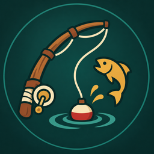
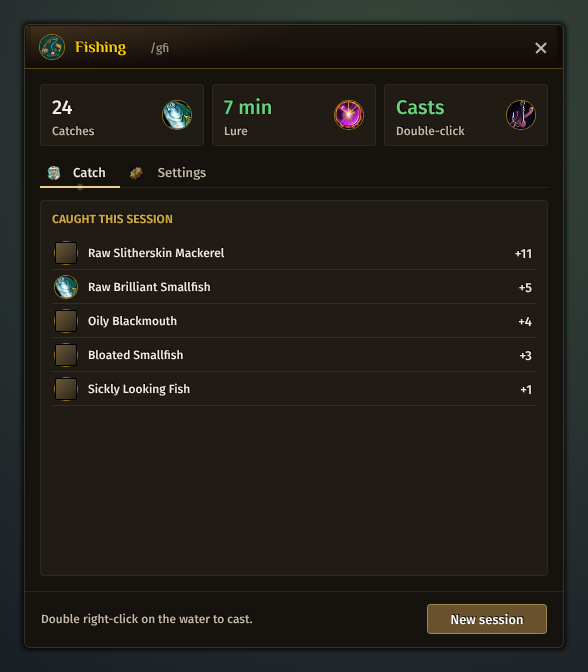

<h1 align="center">Gulli-Fishing</h1>

<b>Fishing made easy: double-click to cast, hear the splash, the fish goes into your bags.</b>

  
  
  

---

You stand at the water and fish for an hour. Fishing takes the clicks away: no button to find, no bobber to stare at, no loot window to empty.

## Features

- **Double-click to cast.** Equip a fishing pole and double right-click anywhere on the water. Fishing is cast. Without a pole it works for five minutes after your last cast. It never casts in a fight, on a mount, or when you right-click a player, a mob or an NPC.
- **Lures by double-click.** When your pole has no lure and one is in your bags, the double-click puts the best one on first. The next double-click casts.
- **A loud splash.** While you fish, sound effects play at full volume, also when the game is in the background. A switch turns the music and ambient sounds off too, so you hear only the splash. About 20 seconds after your last cast your own sound settings come back. They also come back when you log out, and after a crash at the next login.
- **Catch with the Interact key.** While you fish, the bobber becomes a soft target, so your Interact key (or a gamepad button) catches the fish.
- **The catch goes into your bags.** Everything you fish up is looted at once, even when auto loot is off in the game's settings.
- **A note when the lure is gone.** When your pole has no lure and you carry one, a notice says so, once. When that lure runs out, it says so again.
- **What you caught.** The window counts your catches this session and lists every fish, the most first. The toolkit's home page shows the count too.
- Every action has its own switch. The toolkit's switch stops the whole module at once and puts your sound back.

## Install

**With [Runeloader](https://github.com/Gulliby-development/runeloader)** (Android): install **Gulli Toolkit**. Fishing comes with it.

**By hand:** download `Gulli-Fishing-<version>-forever.zip` from the [releases](https://github.com/Gulliby-development/gulli-toolkit/releases) and unpack it into `Interface/AddOns`. Then type `/reload`.

## How to use it

1. Equip a fishing pole.
2. Double right-click on the water. The first double-click puts on a lure if you have one, the next one casts.
3. When you hear the splash, right-click the bobber (or press your Interact key).

Commands: `/gfi` opens the window, `/gfi reset` starts the catch count again.

## FAQ

<b>My right-click does something else now.</b>

Only a quick double right-click casts, and only while a fishing pole is equipped or you cast Fishing in the last five minutes. A single right-click works as always. To turn it off, open `/gfi`, **Settings**, and switch off **Double-click to cast**.

<b>My sound stayed loud.</b>

Your settings come back about 20 seconds after the last cast. In a fight they come back when the fight ends. If the game closed while you fished, they come back at the next login.

<b>Is it tested in the game?</b>

Not yet in WoW Forever itself. It is tested on a fake game client. If something does not work, tell us on GitHub.

