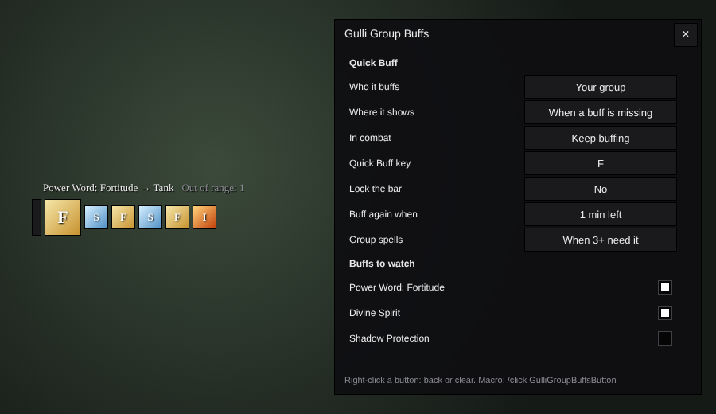
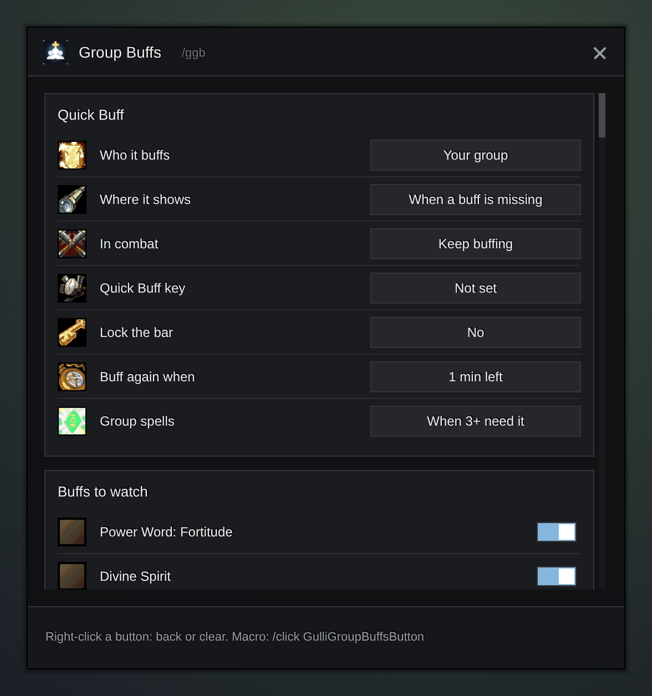

<h1 align="center">Gulli-GroupBuffs</h1>

<b>A small WoW Forever addon that buffs your group for you: one press, one missing buff. It keeps going in combat too.</b>

  
  
  

---

Before a pull, somebody always misses Fortitude or Intellect. Gulli-GroupBuffs looks at your group and puts the next missing buff on one button. Press it, or press your key, until everyone has your buffs.

## Features

- **One button, one key.** The big button shows the next buff and who gets it. Click it or press your Quick Buff key. You first, then the group.
- **See who is missing what.** Small buttons next to it show the buffs after that. Click one to cast that buff on that player.
- **In combat too.** The game does not let an addon change a button in combat. So when the fight starts, the addon gives the button the list of missing buffs. Each press in combat casts the next buff from that list and skips the dead. Buffs that landed in combat are greyed out on the bar.
- **Group spells when they pay off.** When three or more players in a party need the same buff, it casts Prayer of Fortitude, Arcane Brilliance or Gift of the Wild instead, if you have the reagent.
- **Buff again in time.** A buff with less than one minute left counts as missing. You choose: when it is gone, or 1, 3 or 5 minutes before.
- **Every buffing class.**
  - Priest: Power Word: Fortitude, Divine Spirit, Shadow Protection (off by default), Inner Fire.
  - Mage: Arcane Intellect.
  - Druid: Mark of the Wild, and Thorns on you, on your tanks or on everyone.
  - Paladin: one blessing per class, and one for tanks and one for healers.
  - Shaman: your shield and a weapon imbue you choose.
- **Smart about people.** No Intellect or Spirit for warriors and rogues. Dead, offline and far away players are skipped; the bar says how many are out of range.
- **Your target too.** Set **Who it buffs** to **Group and target** to buff a friendly player outside your group.
- **Your bar, your place.** Drag the bar by its grip. Show it only when a buff is missing, always, or never (key only). `/ggb lock` locks it.
- **Made for handhelds.** Big buttons, so it works with a mouse and with touch on WoW Forever for Android.
- **Your language.** English, German, Spanish, French, Polish, Portuguese, Russian and Chinese. Spell and class names come from your game.

## Install

**With [Runeloader](https://github.com/Gulliby-development/runeloader)** (Android): open **Browse**, search for **Gulli Toolkit** and tap **Install**. You get every Gulli module; remove the ones you do not want in **Library**.

**By hand:**

1. **Download** `Gulli-GroupBuffs-<version>-forever.zip` from the newest `GroupBuffs-v…` [release](https://github.com/Gulliby-development/gulli-toolkit/releases).
2. **Unpack** it into the game's `Interface/AddOns` folder. You get the folder `Interface/AddOns/Gulli-GroupBuffs`.
3. **Restart** the game, or type `/reload`.

## How to use it

1. Type `/ggb`, or open it from the [Gulli Toolkit](../../README.md) window (`/gulli`).
2. Press the **Quick Buff key** button, then the key you want.
3. Turn on the buffs you want to watch.
4. Press your key (or the big button) until the bar says **Everyone has your buffs**.

On a gamepad or a phone you can also put `/click GulliGroupBuffsButton` in a macro and place it on your action bar.

## FAQ

<b>Why does it skip a buff in combat?</b>

In combat the game does not tell the button who still needs a buff. The button walks through the list made when the fight started. If a press does not cast (the spell is on cooldown, or you are moving), the button still moves on. After the last one it starts the list again, so just keep pressing. Out of combat it always aims at the right player.

<b>The key does nothing</b>

A key set in combat works after the fight. If another addon uses the same key, pick another one. Right-click the key button to clear it.

<b>It does not see buffs in a battleground</b>

The game hides some buffs from addons there. Then the addon leaves that player alone instead of asking you again and again.

<b>Is it the same as HealKit?</b>

The idea is the same as HealKit's Quick Buff, but it is a small addon of its own, written from scratch, with no healing frames. It also keeps working in combat.

<b>For developers</b>

- `Buffs.lua`: the buffs per class by spell id. Names come from the game, so they are always in your language.
- `Core.lua`: the plan (`ns.Plan`): units you first, what each one misses, group spells, range. It never casts.
- `UI.lua`: the secure buttons. Out of combat every change sets their `spell` and `unit`. On `PLAYER_REGEN_DISABLED` the list goes into attributes of the big button, and a restricted snippet (`ns.COMBAT_SNIPPET`) picks the next living unit on each press in combat.
- Tests: `lua5.1 tests/groupbuffs/test.lua`. They run the combat snippet with only the calls the restricted environment has.

---

  Gulli-GroupBuffs is a fan project. It is not affiliated with Blizzard Entertainment or with HealKit. 
  It is free software under the <a href="../../LICENSE">GPLv3</a>.

