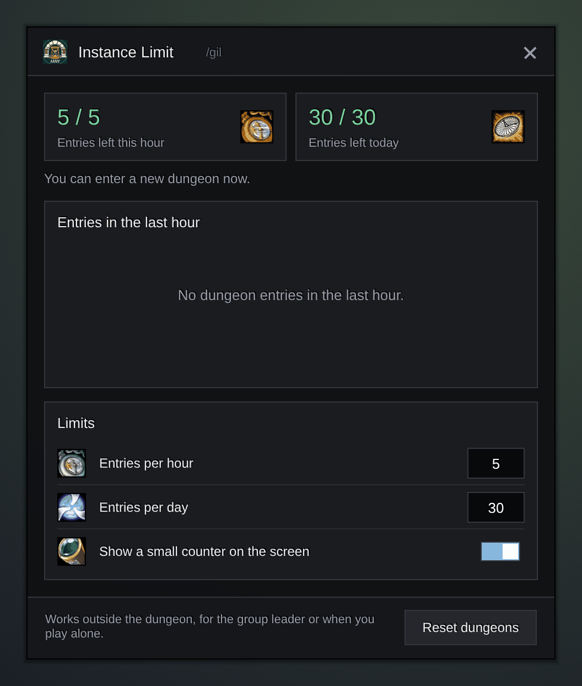

<h1 align="center">Gulli-InstanceLimit</h1>

<b>Counts your dungeon entries this hour and today, and shows when the next one is free.</b>

  
  
  

---

The game lets you enter only a few new dungeons per hour. Gulli Instance Limit counts them for you, so you never stand at the portal and see "You have entered too many instances".

## Features

- **Entries left.** A small counter on screen shows how many entries you have left this hour, for example 3/5.
- **When the next one is free.** It shows the time until the oldest entry stops counting.
- **Smart counting.** Going out and back into the same dungeon does not count again. A reset or a new group does.
- **Learns the real limit.** If the game says "too many instances", the addon sets its count to the limit.
- **Reset button** for the group leader.

## Install

**With [Runeloader](https://github.com/Gulliby-development/runeloader)** (Android): install **Gulli Toolkit**. Instance Limit comes with it.

**By hand:** download `Gulli-InstanceLimit-<version>-forever.zip` from the [releases](https://github.com/Gulliby-development/gulli-toolkit/releases) and unpack it into `Interface/AddOns`. Then type `/reload`.

## How to use it

1. The counter works on its own after you install it.
2. Type `/gil` to see the list, change the limits, or hide the counter. `/gil status` prints one line in chat.
3. Drag the counter to move it. Click it to open the window.

## FAQ

<b>Is the limit really 5 per hour?</b>

That is the classic rule (5 per hour, 30 per day). WoW Forever can use other numbers: you can change both limits in the window.

<b>Is it tested in the game?</b>

Not yet in WoW Forever itself. It is tested on a fake game client. If something does not work, tell us on GitHub.

---

Part of <a href="../../README.md">Gulli Toolkit</a>. A fan project, not affiliated with Blizzard Entertainment. Free software under the <a href="../../LICENSE">GPLv3</a>.

