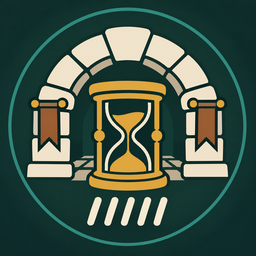
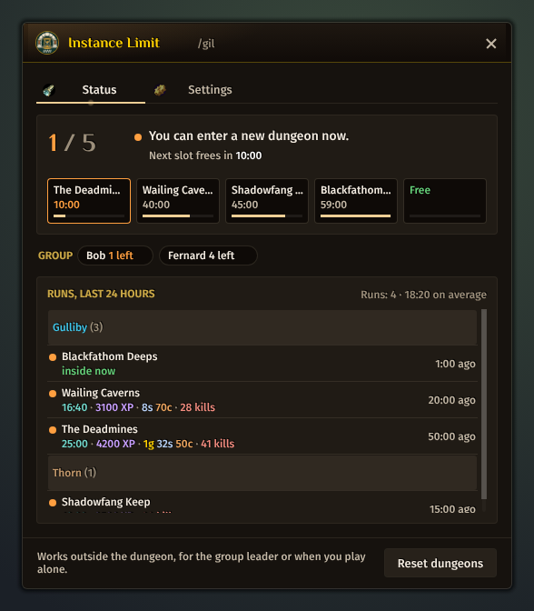

<h1 align="center">Gulli-InstanceLimit</h1>

<b>Counts your dungeon entries this hour and shows when the next one is free.</b>

  
  
  

---

The game lets you enter only a few new dungeons per hour. Gulli Instance Limit counts them for you, so you never stand at the portal and see "You have entered too many instances".

## Features

- **Entries left.** A small counter on screen shows how many entries you have left this hour, for example 3/5.
- **When the next one is free.** It shows the time until the oldest entry stops counting.
- **Smart counting.** Going out and back into the same dungeon does not count again. A reset or a new group does.
- **The slots of the hour.** The window shows one slot for each entry. A used slot names the dungeon and the time until it is free again. Below is the list of your runs of the last 24 hours, grouped by character.
- **"Entry free again".** A sound and a chat line when you can enter a dungeon again. You can also get a warning when only a few entries are left.
- **Learns the real limit.** The addon starts with 5 entries per hour. If the game says "too many instances" earlier, or lets you in more often, the addon changes the number by itself. There is nothing to set.
- **Run stats.** Time inside, XP, money and kills for each run, with a short line in chat when you leave.
- **Works with your group.** After **Reset dungeons** the group gets a chat line, and group members with the addon also reset their counters. They share how many entries they have left, so you see it for every member. If someone may still be inside, Reset asks you to press it again.
- **Your counter, your way.** Show it always or only in a group or dungeon; hide it in **Unlock frames** in `/gulli`. Change its size and opacity. It gets a red edge at 0.

## Install

**With [Runeloader](https://github.com/Gulliby-development/runeloader)** (Android): install **Gulli Toolkit**. Instance Limit comes with it.

**By hand:** download `Gulli-InstanceLimit-<version>-forever.zip` from the [releases](https://github.com/Gulliby-development/gulli-toolkit/releases) and unpack it into `Interface/AddOns`. Then type `/reload`.

## How to use it

1. The counter works on its own after you install it.
2. Type `/gil` to see the list. **Settings** has the alerts, group and counter options. `/gil status` prints one line in chat.
3. The counter shows the entries left with one mark per entry. Click it to open the window. It starts hidden: turn it on and place it in **Unlock frames** in `/gulli` (not in the module's window). When an entry is free again, a card at the top of the screen tells you.

## FAQ

<b>Is the limit really 5 per hour?</b>

Blizzard has not published the number for WoW Forever. Players report about 5 new dungeons per hour, like in Classic, so the addon starts with 5 and corrects itself when the game shows another number. Nobody has confirmed a limit per day in WoW Forever, so the addon does not count one.

<b>Is it tested in the game?</b>

Not yet in WoW Forever itself. It is tested on a fake game client. If something does not work, tell us on GitHub.

---

Part of <a href="../../README.md">Gulli Toolkit</a>. A fan project, not affiliated with Blizzard Entertainment. Free software under the <a href="../../LICENSE">GPLv3</a>.

