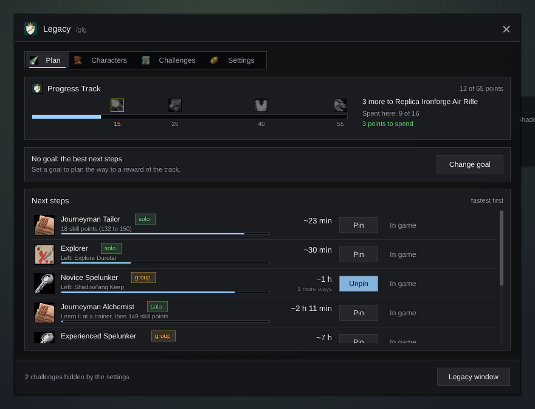
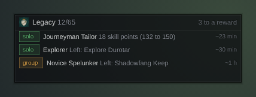

<h1 align="center">Gulli-Legacy</h1>

<b>Shows the fastest next steps to your Legacy points and to the next reward of the Progress Track.</b>

  
  
  

---

WoW Forever gives a Legacy point for each of its 65 Legacy challenges: class levels, professions, dungeons, raids, PvP and more. Which one is the quickest to get next? Gulli Legacy tells you.

## Features

- **Next steps, fastest first.** Every open challenge with the time it should take: the levels to go at your pace, the skill points to go, the dungeons you still miss. The fastest is on top.
- **Your real pace.** With Gulli XP the level steps use your own XP per hour. Without it, a usual pace for each level.
- **The Progress Track.** Your points out of 65, the rewards at 15, 25, 40 and 55 points, and how many points are still free to spend on this character (16 at most).
- **A goal.** Pick a reward of the track. Gulli Legacy lists the fastest steps that reach it and the time they take together.
- **All your characters.** Each character you log in is saved. A step can be faster on another character (three levels on your warlock), and a class you have no character of is a new point too.
- **Help from other modules.** A button on a step opens the module that helps: Craft Profit for a profession, Bulletin Board to find a group for a dungeon, XP for your pace.
- **A tracker on the screen.** Pin the steps you work on. Without pins it shows the first three. Move it with `/gulli move`.
- **A notice for each new point**, also in the Recent list of the toolkit.
- **In game:** a step opens the game's own Legacy window at its challenge.
- **You choose** what it suggests: dungeons, raids, PvP, other characters, a new class.

## Install

**With [Runeloader](https://github.com/Gulliby-development/runeloader)** (Android): install **Gulli Toolkit**. Legacy comes with it.

**By hand:** download `Gulli-Legacy-<version>-forever.zip` from the [releases](https://github.com/Gulliby-development/gulli-toolkit/releases) and unpack it into `Interface/AddOns`. Then type `/reload`.

## How to use it

1. Type `/glg`, or open **Legacy** in `/gulli`. **Plan** shows the track and your next steps.
2. **Change goal** walks through the rewards of the track. **Pin** puts a step on the tracker. **In game** opens it in the game's Legacy window.
3. **Characters** shows the fastest step of each character. **Challenges** lists all of them. **Settings** has the switches.
4. `/glg game` opens the game's Legacy window.

## FAQ

<b>The list is empty</b>

The game sends the achievements a few seconds after you log in. Wait a moment. If it stays empty, open the game's Legacy window once.

<b>Where are my other characters?</b>

Log in with each character once. Gulli Legacy saves its level and professions then.

<b>How exact are the times?</b>

They are estimates. Levels use your pace from Gulli XP when it has seen 15 minutes of play, else a usual pace. A skill point counts 45 seconds, a dungeon an hour with finding the group, a raid boss 20 minutes. PvP has no estimate and comes last.

<b>Is it tested in the game?</b>

Not yet in WoW Forever itself. It is tested on a fake game client. If something does not work, tell us on GitHub.

<b>Technical details</b>

The challenges are the game's achievements that give Legacy points (`C_Traits.GetTraitCurrencyForAchievement`, currency 4225). The points come from the Progress Track renown (faction 2802) and the Legacy trees (`C_Traits.GetTreeCurrencyInfo`). Gulli Legacy only reads. It never spends points.

---

Part of <a href="../../README.md">Gulli Toolkit</a>. A fan project, not affiliated with Blizzard Entertainment. Free software under the <a href="../../LICENSE">GPLv3</a>.

