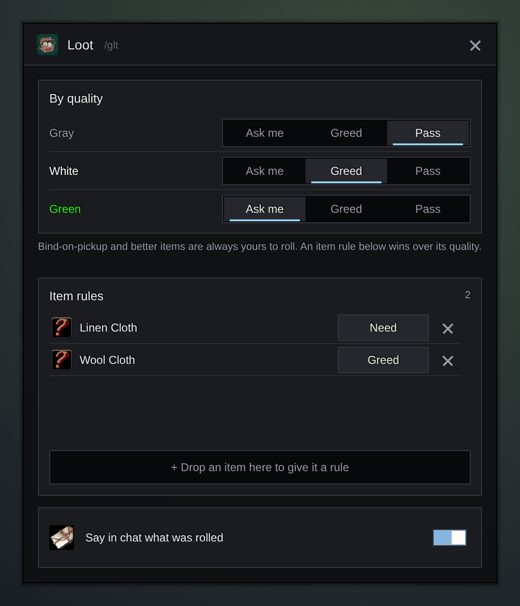

<h1 align="center">Gulli-Loot</h1>

<b>Rolls Need, Greed or Pass for you by your rules for each quality and item.</b>

  
  
  

---

In a dungeon group, every gray drop asks you to roll. Gulli Loot answers by your rules.

## Features

- **A rule per quality.** Gray, white and green: Ask, Greed or Pass. Gray is passed by default. Choose where these rules count: always, only in a party, or only in a raid.
- **A rule per item type.** Recipes, cloth and trade goods, food and potions, quest items: for example "recipes: always ask".
- **A rule per item.** Ask, Need, Greed or Pass, picked with one tap. Add an item without dragging: Alt-click it in your bags, in a roll frame or in a chat link, or type `/glt need <link>` (also `greed`, `pass`, `ask`). You can also drop it on the window. An item rule wins over everything else.
- **Recent rolls.** The last 30 rolls, with what was done, why (item rule, quality, bind on pickup...), and who won. One tap on **Make rule** turns a roll into a rule. What you win also goes to the toolkit's **Recent** feed.
- **Smart extras, off by default.** Greed on green bind-on-equip items your class cannot use. Need on a green item that is better than what you wear in that slot.
- **One switch, and Shift.** Turn the whole module off with one switch (also in the toolkit hub, or `/glt off`). Hold Shift when a roll starts to make that one yourself.
- **Try a rule.** `/glt test <link>` says what the addon would do with that item, and why.
- **Quiet chat.** Rolls that start together get one chat line.
- **Looting alone.** Fast loot takes everything at once when auto loot is on. Another switch answers the bind-on-pickup question for you when you are not in a group.
- **Your best items stay yours.** Bind-on-pickup and better items are always yours to roll, unless you gave the item its own rule.
- **Protected items** in the toolkit are never passed by a quality or type rule.

## Install

**With [Runeloader](https://github.com/Gulliby-development/runeloader)** (Android): install **Gulli Toolkit**. Loot comes with it.

**By hand:** download `Gulli-Loot-<version>-forever.zip` from the [releases](https://github.com/Gulliby-development/gulli-toolkit/releases) and unpack it into `Interface/AddOns`. Then type `/reload`.

## How to use it

1. Type `/glt`.
2. Pick a rule for each quality.
3. Alt-click items you always want (or never want), or drop them on the **Items** page.
4. Look at **Recent rolls** after a dungeon to see what happened.

## FAQ

<b>It rolled Greed but I wanted Need</b>

Give that item its own rule: Alt-click it (or type `/glt need <link>`) and pick **Need** on the **Items** page.

<b>Why did it not roll on an item?</b>

Open **Recent rolls**: each roll shows the reason. Or type `/glt test <link>`.

<b>Can it show its own roll frames with a timer?</b>

No. The game's roll frames already do this well, so the addon keeps them.

<b>Is it tested in the game?</b>

Not yet in WoW Forever itself. It is tested on a fake game client. If something does not work, tell us on GitHub.

---

Part of <a href="../../README.md">Gulli Toolkit</a>. A fan project, not affiliated with Blizzard Entertainment. Free software under the <a href="../../LICENSE">GPLv3</a>.

