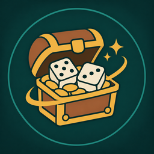
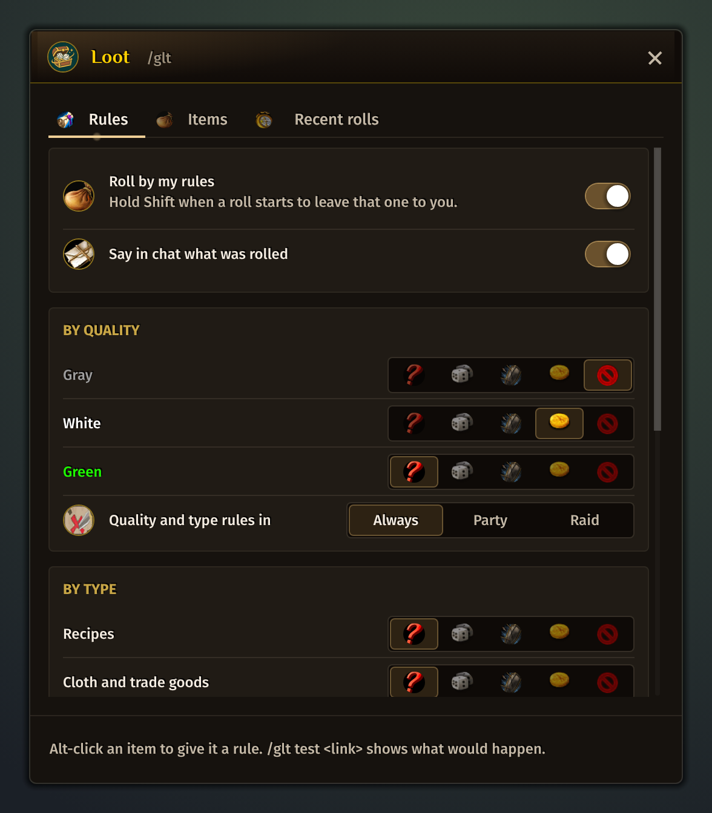

<h1 align="center">Gulli-Loot</h1>

<b>Rolls Need, Greed or Pass for you by your rules for each quality and item.</b>

  
  
  

---

In a dungeon group, every gray drop asks you to roll. Gulli Loot answers by your rules.

## Features

- **Four pages.** **Rolls** (what to roll for you), **Pickup** (looting and the loot feed), **Items** (rules for single items) and **History** (the last rolls).
- **A rule per quality.** Gray, white and green: Ask me, If it fits, Greed or Pass, with the words over the roll icons. **If it fits** (the shield) rolls Need only when you can use the item and, for gear, it is better than what you wear in that slot; otherwise it rolls Greed. Gray is passed by default.
- **A rule per item type.** Recipes, cloth and trade goods, food and potions, quest items, with the same four choices: for example "recipes: always ask" or "recipes: Need if it fits". A type wins over a quality.
- **A rule per item.** Ask, Need, Greed or Pass, picked with one tap on the game's own roll icons (question mark, dice, coin, cross). Add an item without dragging: Alt-click it in your bags, in a roll frame or in a chat link, or type `/glt need <link>` (also `greed`, `pass`, `ask`). You can also drop it on the **Items** page, which lists the rules group by group: Need, Greed, Pass, Ask me. An item rule wins over everything else, and only an item rule can be a plain Need.
- **History.** The last 30 rolls, with what was rolled, why (item rule, quality, bind on pickup...), and who won. One tap on **Make rule** turns a roll into a rule. What you win also goes to the toolkit's **Recent** feed.
- **One switch, and Shift.** Turn the whole module off with one switch (also in the toolkit hub, or `/glt off`). Hold Shift when a roll starts to make that one yourself.
- **Try a rule.** `/glt test <link>` says what the addon would do with that item, and why.
- **Quiet chat.** Rolls that start together get one chat line.
- **Looting alone.** Fast loot takes everything at once when auto loot is on. The loot window then does not open at all; it comes only for what could not be taken, such as with full bags. Another switch answers the bind-on-pickup question for you when you are not in a group.
- **A loot window of its own** (off by default). A short list with **Take all**. With auto loot it shows for a moment what you picked up.
- **Loot rolls where you want them.** Turn on **Move loot rolls**, then place the Need, Greed and Pass windows in the hub's **Unlock frames** mode, and set their size in the window.
- **A loot feed** (off by default). A small panel shows what you just looted for a few seconds: the gold, and each item with its icon, count and quality colour. It works with fast loot and auto loot too. Each item also shows what it is worth (at a vendor, at the auction or as dust for an enchanter, whichever pays most; auction prices need a price addon such as Auctionator) and one note: the quest that needs it with its count, a quest item you can sell, gear better than what you wear, your Farm Tracker goal, or how many you have in your bags. A line at the bottom adds everything up. The **Pickup** page shows an example of the feed and its four settings: compact one-line rows, no background, and how many lines show at most (loot beyond that still counts in the total) and how wide the panel is: it keeps that width, a longer line is cut short, and the mouse on the line shows it whole. Turn it on in the hub's **Unlock frames** mode or on the **Tweaks** page, and place it there.
- **Who rolled what** (off by default). Under the Need, Greed and Pass window, a small panel lists what each member of the group chose, Need first, with the number of Need, Greed and Pass on top. When the game tells it, a Need shows **Main spec** or **Off spec**, and the roll numbers show at the end. With several rolls at once, point at one to see its list. Turn it on on the **Rolls** page or on the **Tweaks** page.
- **A Real reminder** (off by default). At level 60, after you kill a dungeon boss that drops a Tarnished Undermine Real (Blackrock Depths, Blackrock Spire, Dire Maul, Scholomance, Stratholme, Blackmaw Hold, Shaper's Terrace), an icon shows until you loot the Real, so you never leave it on the corpse. It goes as soon as the Real is in your currencies or you closed a loot window that held it, at the latest after 5 minutes, and a click on it hides it. A boss that already gave you a Real today is skipped, and at the cap of 250 it stays quiet. Turn it on in the hub's **Unlock frames** mode or on the **Tweaks** page, and place it there.
- **On the Tweaks page.** Fast loot, the own loot window, the loot feed, the Real reminder, moving the rolls, who rolled what and the bind question alone are rows of the hub's **Tweaks** page too, while Loot is installed. The loot feed's row has a gear there: it opens the feed's settings (compact lines, no background, the number of lines, the width).
- **Your best items stay yours.** Bind-on-pickup and better items are always yours to roll, unless you gave the item its own rule.
- **Protected items** in the toolkit are never passed by a quality or type rule.

## Install

**With [Runeloader](https://github.com/Gulliby-development/runeloader)** (Android): install **Gulli Toolkit**. Loot comes with it.

**By hand:** download `Gulli-Loot-<version>-forever.zip` from the [releases](https://github.com/Gulliby-development/gulli-toolkit/releases) and unpack it into `Interface/AddOns`. Then type `/reload`.

## How to use it

1. Type `/glt`.
2. Pick a rule for each quality.
3. Alt-click items you always want (or never want), or drop them on the **Items** page.
4. Look at **History** after a dungeon to see what happened.

## FAQ

<b>It rolled Greed but I wanted Need</b>

Give that item its own rule: Alt-click it (or type `/glt need <link>`) and pick **Need** on the **Items** page.

<b>Why did it not roll on an item?</b>

Open **History**: each roll shows the reason. Or type `/glt test <link>`.

<b>Who rolled what shows only some players, or no Main spec / Off spec</b>

The panel shows what the game tells: the loot history (choices, Main spec or Off spec, roll numbers) and the loot chat lines ("Bob has selected Need for..."). When the game sends only the chat lines, the panel shows Need, Greed and Pass without the spec, and a player whose line has not come yet is not listed.

<b>Can it show its own roll frames with a timer?</b>

No. The game's roll frames already do this well, so the addon keeps them. It only adds the **Who rolled what** panel under them.

<b>Is it tested in the game?</b>

Not yet in WoW Forever itself. It is tested on a fake game client. If something does not work, tell us on GitHub.

---

Part of <a href="../../README.md">Gulli Toolkit</a>. A fan project, not affiliated with Blizzard Entertainment. Free software under the <a href="../../LICENSE">GPLv3</a>.

