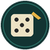

<h1 align="center">Gulli-Loot</h1>

<b>Rolls Need, Greed or Pass for you by your rules for each quality and item.</b>

  
  
  

---

In a dungeon group, every gray drop asks you to roll. Gulli Loot answers by your rules.

## Features

- **A rule per quality.** Gray, white and green: Ask me, Greed or Pass. Gray is passed by default.
- **A rule per item.** Drop an item on the window to give it Need, Greed or Pass. An item rule wins over its quality.
- **Your best items stay yours.** Bind-on-pickup and better items are always yours to roll, unless you gave the item its own rule.
- **Protected items** in the toolkit are never passed by a quality rule.

## Install

**With [Runeloader](https://github.com/Gulliby-development/runeloader)** (Android): install **Gulli Toolkit**. Loot comes with it.

**By hand:** download `Gulli-Loot-<version>-forever.zip` from the [releases](https://github.com/Gulliby-development/gulli-toolkit/releases) and unpack it into `Interface/AddOns`. Then type `/reload`.

## How to use it

1. Type `/glt`.
2. Pick a rule for each quality.
3. Drop items you always want (or never want) on the window.

## FAQ

<b>It rolled Greed but I wanted Need</b>

Give that item its own rule: drop it on the window and tap the rule until it says **Need**.

<b>Is it tested in the game?</b>

Not yet in WoW Forever itself. It is tested on a fake game client. If something does not work, tell us on GitHub.

---

Part of <a href="../../README.md">Gulli Toolkit</a>. A fan project, not affiliated with Blizzard Entertainment. Free software under the <a href="../../LICENSE">GPLv3</a>.

