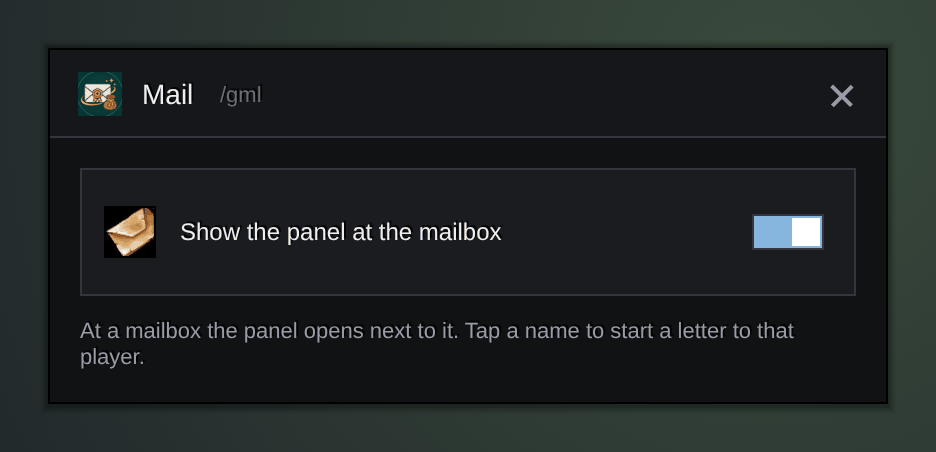

<h1 align="center">Gulli-Mail</h1>

<b>Takes everything from the mailbox in one tap, and gives you your characters and recent recipients as names to tap.</b>

  
  
  

---

Ten letters from the auction house mean ten taps per letter. Gulli Mail takes them all in one.

## Features

- **Take all.** Money and items from every letter, one after the other.
- **Safe.** Letters with cash on delivery are left alone. It stops when your bags are full.
- **Names to tap.** Your other characters on this realm and faction, then the last 10 players you wrote to. Tap a name to start a letter.

## Install

**With [Runeloader](https://github.com/Gulliby-development/runeloader)** (Android): install **Gulli Toolkit**. Mail comes with it.

**By hand:** download `Gulli-Mail-<version>-forever.zip` from the [releases](https://github.com/Gulliby-development/gulli-toolkit/releases) and unpack it into `Interface/AddOns`. Then type `/reload`.

## How to use it

1. Open a mailbox. The panel opens next to it.
2. Tap **Take all**.
3. To write, tap a name under **Send to**.

## FAQ

<b>The panel is in my way</b>

Type `/gml` away from a mailbox and untick **Show the panel at the mailbox**.

<b>Is it tested in the game?</b>

Not yet in WoW Forever itself. It is tested on a fake game client. If something does not work, tell us on GitHub.

---

Part of <a href="../../README.md">Gulli Toolkit</a>. A fan project, not affiliated with Blizzard Entertainment. Free software under the <a href="../../LICENSE">GPLv3</a>.

