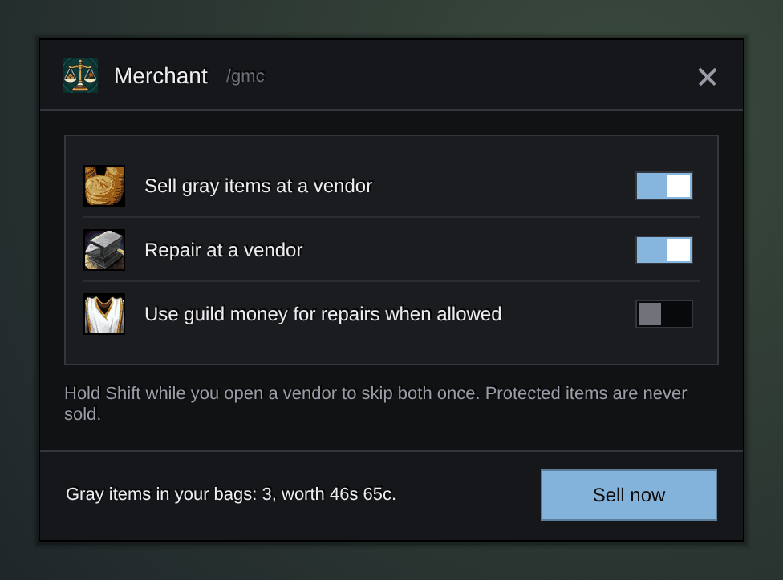

<h1 align="center">Gulli-Merchant</h1>

<b>Sells your gray items and repairs your gear when you open a vendor, with guild money when you may use it.</b>

  
  
  

---

Every time you open a vendor, you sell the gray junk and press Repair. Gulli Merchant does both for you.

## Features

- **Sells gray items.** Every gray item with a price goes, in small steps. The vendor keeps the last 12 for buyback; turn on **Sell no more than 12 per visit** to be able to buy back everything.
- **Repairs.** With guild money when your guild allows it and the amount is within your limit, else with your own. Short of money? It sells the junk first and repairs with what it brought.
- **Your own junk list.** Alt+click an item in your bags (or drop it on the list in the window, or `/gmc junk <item link>`) to always sell it. Gulli Bag Space uses the same list.
- **See before you sell.** The window lists what the next vendor gets. Untick an item to keep it this time.
- **Learns a little.** Sell the same item by hand twice and the window suggests adding it to your list. It never adds it by itself.
- **Marks in the bags.** A coin on junk items and a line in their tooltip.
- **Gear you cannot use.** A switch also sells bound armour and weapons your class can never wear. Off at first.
- **Never the wrong item.** Quest items, keys, profession tools, equipment set items and items you protected in the toolkit are never sold.
- **Your choice.** A switch for selling, one for repairing, one for guild money, one for the 12 limit. Hold **Shift** when you open a vendor to skip it once.

## Install

**With [Runeloader](https://github.com/Gulliby-development/runeloader)** (Android): install **Gulli Toolkit**. Merchant comes with it.

**By hand:** download `Gulli-Merchant-<version>-forever.zip` from the [releases](https://github.com/Gulliby-development/gulli-toolkit/releases) and unpack it into `Interface/AddOns`. Then type `/reload`.

## How to use it

1. It works on its own when you open a vendor.
2. Type `/gmc` to see what will be sold, your list and the switches.
3. Skipped a vendor with Shift? Press **Sell junk** on the vendor's window, or type `/gmc sell`.

## FAQ

<b>I sold something by mistake</b>

Open the vendor's buyback tab. The last 12 sold items are there. If you want all of them back every time, turn on **Sell no more than 12 per visit**.

<b>Is it tested in the game?</b>

Not yet in WoW Forever itself. It is tested on a fake game client. If something does not work, tell us on GitHub.

---

Part of <a href="../../README.md">Gulli Toolkit</a>. A fan project, not affiliated with Blizzard Entertainment. Free software under the <a href="../../LICENSE">GPLv3</a>.

