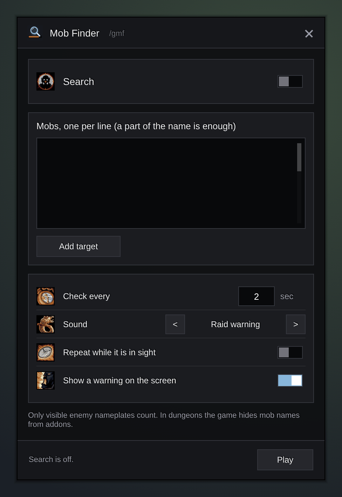

# Gulli-MobFinder

Type the mobs you look for. When one of them shows its nameplate, you hear a sound.

## Features

- **A list of mobs.** Type a name, take your target, or press **Zone rares** to add every rare of the zone you are in. A part of the name is enough, and the case does not matter (also in Russian). Each mob on the **Mobs** page has its own switch, **Exact** or **Part**, and shows how often and where it was found.
- **Zone rares in every language.** Rares are found by their game id, so the list works in any client language.
- **A card when a mob is found.** It shows the portrait, name, level and rare or elite, with your Target key on the button. **Target** takes the mob as your target, **Tell group** writes where it is in the group chat, **Pin** puts a pin on the map. The card closes itself after the time you pick.
- **A key for Target.** Bind one key in the window; it targets the last mob found.
- **Not only nameplates.** With **Also target, mouseover and the group's targets** on, it finds a mob even when its nameplate is hidden. Rare icons on the minimap count too.
- **No false alarms.** Players' pets and mobs another player already tagged do not count. The same mob alerts again only after the time you pick.
- **Pick a sound.** Raid warning, ready check, alarm clock and more. It plays even when game effects are muted. It can repeat until you look, or stay quiet in towns and in combat.
- **A warning on the screen**, flashing screen edges, a line in the chat, and a skull on the mob if you want.
- **Found history.** The last 50 finds with the zone and the time. **Pin** shows the place on the map.
- **Share with the group.** Group members with Mob Finder hear about your finds, and you about theirs.
- Works alone, or as a module of **Gulli Toolkit**. The Toolkit home page shows how many mobs it looks for.
- Speaks English, Deutsch, Español, Français, Polski, Português, Русский and 中文 (it follows the game language).

## Install

Install it in [Runeloader](https://github.com/Gulliby-development/runeloader): search for **Gulli-MobFinder** and press **Install**. Or download the zip from the releases and unpack it into `Interface/AddOns`.

Open the window with `/gmf` or from the addon menu at the minimap.

## FAQ

**Why does it not find a mob I can see?**
The game makes a nameplate only for a mob that is close enough and only when nameplates are on. The addon turns on enemy nameplates for you. A friendly NPC needs friendly nameplates (Options, Interface, Nameplates).

**Does it work in dungeons?**
No. In dungeons and raids the game hides mob names from addons, so the addon cannot read them there.

**Can it target the mob for me?**
Yes, with one click or key press: press **Target** on the card or your Target key. The game does not let an addon target on its own. In combat the button keeps the mob from before the fight and takes the new one after it.

Slash commands

- `/gmf` opens the window.
- `/gmf on`, `/gmf off` switch the search.
- `/gmf add <name>` adds a name, `/gmf target` adds your target.
- `/gmf rares` adds the rares of your zone.
- `/gmf list` shows the list, `/gmf clear` empties it.

How it works

A timer (`C_Timer.NewTicker`) runs every N seconds and reads `C_NamePlate.GetNamePlates()`. For each plate it reads `UnitName` of the plate's unit and compares it with the list. `NAME_PLATE_UNIT_ADDED` runs the same check at once. Dead mobs do not count. On WoW 12 a creature's name can be a secret value (in instances): the addon checks `issecretvalue` first and skips such a plate instead of raising an error. The sound plays with `PlaySound(id, "Master")`. With the sources switch on it also reads `target`, `mouseover` and `partyNtarget`, and `C_VignetteInfo` for minimap rares. Zone rares come from `Data.lua`, built by `tools/mobfinder/build_data.py` from the QuestieDB Forever data; they are matched by the npc id in the unit GUID. The **Target** button is a `SecureActionButtonTemplate` button with a `/targetexact` macro, changed only out of combat. Shared finds go over the addon prefix `GulliMF`.

