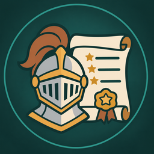
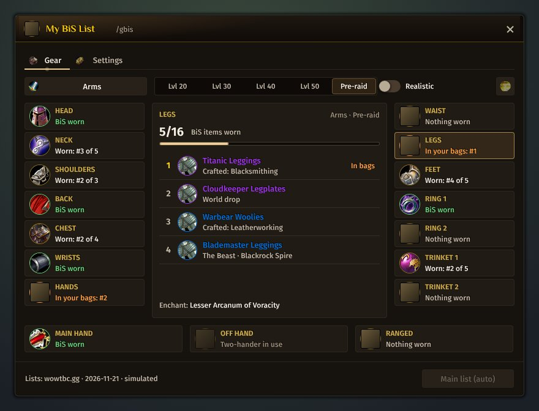

<h1 align="center">Gulli-MyBisList</h1>

<b>The best gear for your class, spec and level, slot by slot, against what you wear.</b>

  
  
  

---

Which helmet should you hunt for at level 40? My BiS List shows the best items for every slot of your character, from level 20 up to the raids, and what you already have of them.

## Features

- **Every class and spec.** 28 specs, tanks, healers and damage, with lists for levels 20, 30, 40 and 50 and before the raids. Your spec and level are picked for you; the button at the top left shows the list of any other spec.
- **Five items for each slot.** The best first. Items of the other faction leave the list.
- **Against what you wear.** Each slot says what you have: the best item, its place on the list (`Worn: #2 of 5`), or a better one waiting in your bags. A bar shows how many best items you wear.
- **Where to get it.** Each item says where it comes from: a boss and its dungeon, a quest, a reputation, a craft or a world drop.
- **Realistic before the raids.** The switch **Realistic** shows the list without the hardest items to get.
- **Favourite lists.** The star keeps a list at the top of the picker, for an alt or a second spec.
- **Your main list.** **Make main list** chooses the list the tooltips and notices follow. Until you choose, it is the list of your spec and level.
- **In the tooltip.** An item on your main list shows its place in its slot, and the place of what you wear there.
- **A note for a better item.** When an item near the top of your list comes into your bags, a notice says so, once.
- **In the toolkit.** The home page shows how many best items you wear.

## Install

Download `Gulli-MyBisList-<version>-forever.zip` from the [releases](https://github.com/Gulliby-development/gulli-toolkit/releases) and unpack it into `Interface/AddOns`. Then type `/reload`.

My BiS List works alone. With [Gulli Toolkit](../../README.md) installed, it also shows up in the toolkit's window.

## How to use it

1. Type `/gbis`.
2. Click a slot to see its five best items.
3. Shift-click an item to put its link in the chat.

Commands: `/gbis` opens the window, `/gbis reset` puts the settings back.

## FAQ

<b>Where do the lists come from?</b>

From the WoW Forever BiS lists of [wowtbc.gg](https://wowtbc.gg/warcraftforever/). They are the work of its authors; the addon only shows them in the game. We read them again every week, and the date of the lists is at the bottom of the window. Lists marked "simulated" come from a simulator; the healer lists are picked by hand.

<b>My spec is wrong.</b>

The addon reads your spec from your talents. Pick the right one with the button at the top left; it stays for this character.

<b>Why does the off hand say "Two-hander in use"?</b>

The best weapon of this list is a two-handed one, so the off hand does not count.

