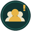

<h1 align="center">Gulli-PartyQuests</h1>

<b>Shows which quests your group shares, who still needs one, and lets you share it in one tap.</b>

  
  
  

---

Before you leave town with a group, you want to know: who has which quest? Gulli Party Quests shows your quests against every group member.

## Features

- **Your quests against your group.** One row per quest, one column per player: green has it, gold is done, red does not have it.
- **Share in one tap.** **Share** gives a quest to the group when the game lets you share it.
- **Ask for a quest.** **Ask** writes "Can someone share ... with me?" in party chat.
- **Their quests.** When your friends use Gulli Party Quests too, you also see the quests only they have.

## Install

**With [Runeloader](https://github.com/Gulliby-development/runeloader)** (Android): install **Gulli Toolkit**. Party Quests comes with it.

**By hand:** download `Gulli-PartyQuests-<version>-forever.zip` from the [releases](https://github.com/Gulliby-development/gulli-toolkit/releases) and unpack it into `Interface/AddOns`. Then type `/reload`.

## How to use it

1. Join a group.
2. Type `/gpq`, or open it from `/gulli`.
3. Press **Share** next to a quest that someone does not have.

## FAQ

<b>A friend's quests are missing in "Their quests"</b>

That list needs Gulli Party Quests on both sides. The first list ("My quests") works without it.

<b>Is it tested in the game?</b>

Not yet in WoW Forever itself. It is tested on a fake game client. If something does not work, tell us on GitHub.

---

Part of <a href="../../README.md">Gulli Toolkit</a>. A fan project, not affiliated with Blizzard Entertainment. Free software under the <a href="../../LICENSE">GPLv3</a>.

