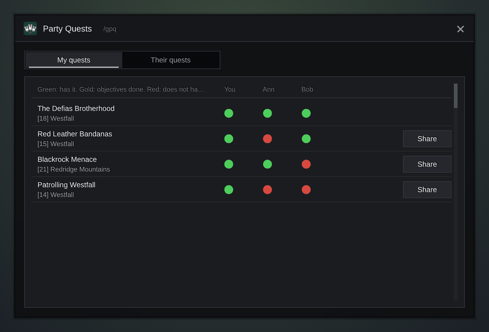

<h1 align="center">Gulli-PartyQuests</h1>

<b>Shows which quests your group shares, who still needs one, and lets you share it in one tap.</b>

  
  
  

---

Before you leave town with a group, you want to know: who has which quest? Gulli Party Quests shows your quests against every group member.

## Features

- **Your quests against your group.** One row per quest, one column per player: a tick has it, gold is done, red does not have it, a clock did it before, **?** is offline.
- **Progress of everyone.** When a friend runs Gulli Party Quests too, the cell shows how far they are (**3/8**). Tap a quest to see everyone's objectives.
- **Who runs the module.** Under each name: **module**, **old data** or **no module**, so you know what the cells can tell.
- **One line about the group.** "To share: 2. Ready to hand in for everyone: 1", or "The group is in sync".
- **Share in one tap, or all at once.** **Share** gives one quest, **Share all** gives every quest someone lacks, one per second. The game's answer ("too low level", "did it before") shows at the bottom.
- **Share with new members.** A switch shares your quests with everyone who joins (off by default).
- **Request a quest.** In "Their quests", **Request** asks the owner to share it. They get a card at the top of the screen with **Share**. Without the module, it is a whisper.
- **Group news.** A line in chat and in the Gulli Toolkit feed when a member takes, finishes or hands in a quest, and when the whole group finished one. Each kind has a switch, plus one for the sound.
- **This zone and search.** Show only the quests of the zone you are in, or search by name.
- **Progress in tooltips.** A mob or an item that one of your quests needs shows how far each member is.
- **Track for all.** One button puts a quest in the tracker of everyone who has it.
- **Spare items.** "2 spare" when you carry more quest items than you need, to give to a friend.

## Install

**With [Runeloader](https://github.com/Gulliby-development/runeloader)** (Android): install **Gulli Toolkit**. Party Quests comes with it.

**By hand:** download `Gulli-PartyQuests-<version>-forever.zip` from the [releases](https://github.com/Gulliby-development/gulli-toolkit/releases) and unpack it into `Interface/AddOns`. Then type `/reload`.

## How to use it

1. Join a group.
2. Type `/gpq`, or open it from `/gulli`.
3. Press **Share** next to a quest that someone does not have, or **Share all**.
4. `/gpq share` shares all without opening the window.

## FAQ

<b>A friend's quests are missing in "Their quests"</b>

That list needs Gulli Party Quests on both sides. The first list ("My quests") works without it: it shows who has a quest, but not their progress.

<b>Does it read Questie's group data?</b>

No. Questie sends its data in a compressed library format, and Gulli Party Quests uses no libraries. Ask your friends to install Gulli Party Quests to see their progress.

<b>Is it tested in the game?</b>

Not yet in WoW Forever itself. It is tested on a fake game client. If something does not work, tell us on GitHub.

---

Part of <a href="../../README.md">Gulli Toolkit</a>. A fan project, not affiliated with Blizzard Entertainment. Free software under the <a href="../../LICENSE">GPLv3</a>.

