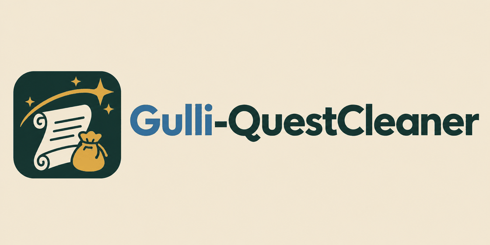
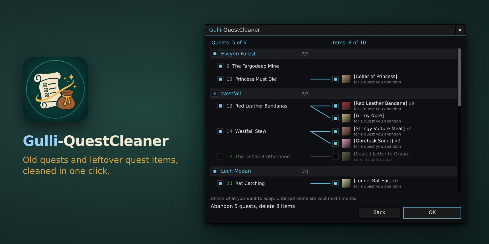
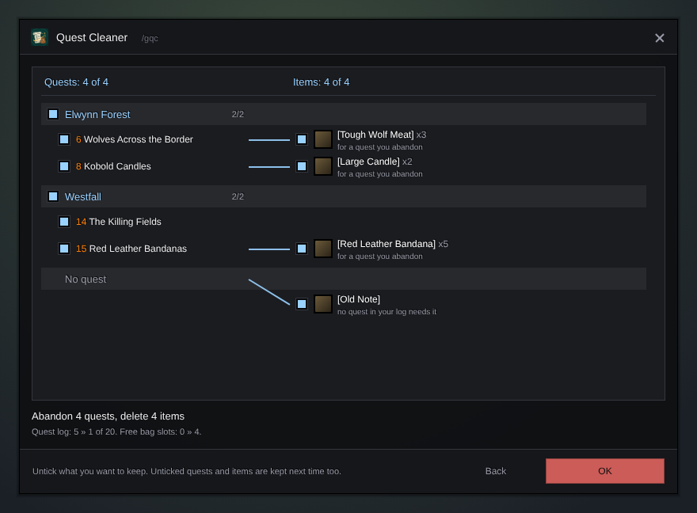
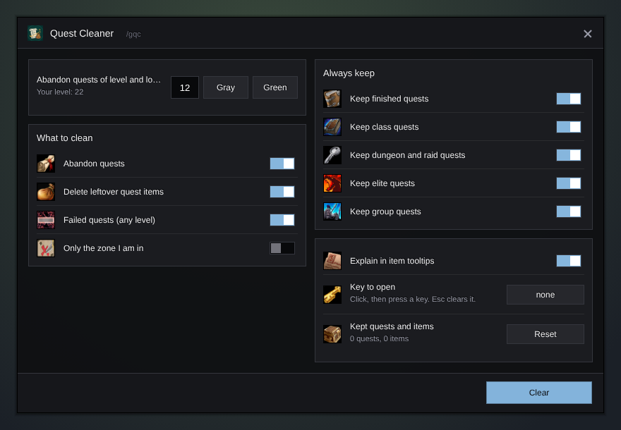

<p align="center">
  <picture>
    <source media="(prefers-color-scheme: dark)" srcset="wordmark-dark.png">
    
  </picture>
</p>

<p align="center"><b>A small WoW Forever addon that cleans your quest log and your bags in one click. You see everything before it goes.</b></p>

<p align="center">
  <a href="https://github.com/Gulliby-development/gulli-toolkit/releases"></a>
  
  
</p>

<p align="center"></p>

---

After a few zones, your quest log is full of grey quests, and your bags are full of pelts, letters and notes for quests you will never finish. Gulli-QuestCleaner cleans both. Enter a level, press **Clear**, look at the list, press **OK**.

## Features

- **Old quests out.** Enter a level, and every quest of that level and lower is abandoned. Or press **Gray** to clean every quest that gives you almost no experience now, or **Green** for every green and gray quest.
- **Leftover quest items out.** Pelts for a quest you abandon, notes nobody asks for any more, items that start a quest you already did: they go too.
- **See it before it goes.** Nothing is removed until you press **OK**. The list shows your quests on the left and their items on the right, with a line from each quest to its items. Items no quest needs hang under **No quest**.
- **Sorted by zone.** Quests are grouped by zone, as in your quest log. Tick or untick a whole zone with one click.
- **Keep what you want.** Untick a quest, and its items stay too. Untick a quest or an item and press **OK**: the addon remembers it and does not offer it again until `/gqc reset` (or **Reset** in the window).
- **Safe by design.** An item a quest in your log still needs is never offered. Dungeon keys, Drakefire Amulet, Juju, arcanums, summoning braziers and other items that stay useful after their quest are never offered either.
- **Knows the quests ahead.** The addon carries a quest database. An item for a quest you have not taken yet, above your cleaning level, stays in your bags.
- **Important quests stay.** Finished quests (handing them in pays more), class quests, dungeon and raid quests, elite quests and group quests are not touched. Each has its own switch.
- **Failed quests go.** A failed quest is offered at any level, because it cannot be finished any more.
- **One zone at a time.** **Clean** on the game's quest log, `/gqc zone`, or the **Only the zone I am in** switch cleans just the zone you are in.
- **Explains itself.** The tooltip of a quest item says which quest needs it, or that no quest does and it will be offered.
- **The bank too.** With the bank open, leftover quest items in the bank are listed as well.
- **Where to take it again.** The list and `/gqc last` show the quest giver and the zone of an abandoned quest.
- **Warns you.** A quest that started from an item is unticked, because it is hard to get again. A quest from a chain gets a mark.
- **Sells when it can.** With a merchant open, items that have a price are sold instead of deleted.
- **Shows what you get.** The list says how many places the quest log and the bags will have after **OK**.
- **Reminds you.** When your quest log is almost full, one line in the chat says how many old quests `/gqc` can clean. `/gqc last` shows what the last cleaning removed.
- **Small and quick.** One window, with the main button at the bottom right. Open it with `/gqc`, from the addon button on the minimap, or from the [Gulli Toolkit](../../README.md) window (`/gulli`).
- **Made for handhelds.** Big buttons and check boxes, so it works with a mouse and with touch on WoW Forever for Android. With a gamepad: up and down move through the list, A ticks, X presses **Clear** or **OK**, B goes back.
- **Your own key.** Pick a key that opens the window, right in the window.
- **In the Gulli Toolkit feed.** What the last cleaning removed shows in `/gulli`.
- **Clean, modern look.** A flat dark window in your class colour, in the style of ElvUI. It fits a modern interface.
- **Your language.** English, German, Spanish, French, Polish, Portuguese, Russian and Chinese. It follows the language of your game.

<p align="center"></p>

<details>
<summary><b>More pictures</b></summary>

<p align="center"></p>
</details>

## Install

**With [Runeloader](https://github.com/Gulliby-development/runeloader)** (Android): open **Browse**, search for **Gulli Toolkit** and tap **Install**. You get every Gulli module; remove the ones you do not want in **Library**.

**By hand:**

1. **Download** `Gulli-QuestCleaner-<version>-forever.zip` from the newest `QuestCleaner-v…` [release](https://github.com/Gulliby-development/gulli-toolkit/releases).
2. **Unpack** it into the game's `Interface/AddOns` folder. You get the folder `Interface/AddOns/Gulli-QuestCleaner`.
3. **Restart** the game, or type `/reload`.

## How to use it

1. Type `/gqc`, or click the addon button on the minimap.
2. Enter a level, or press **Gray** or **Green**. Quests of this level and lower are cleaned. Each character keeps its own level.
3. Press **Clear**. The list shows what will go, zone by zone.
4. Untick anything you want to keep: a quest, an item or a whole zone.
5. Press **OK**.

> [!TIP]
> The first time, try it on a character whose quests you do not mind losing. An abandoned quest can be taken again from its quest giver, but a deleted item is gone.

## FAQ

<details>
<summary><b>It says "Press OK again"</b></summary>

The game refused to remove something, for example because the item was busy. The list shows what is left; press **OK** again.
</details>

<details>
<summary><b>An item I need is in the list</b></summary>

Untick it and press **OK**. The addon remembers it and does not offer it again. To forget all quests and items you kept, type `/gqc reset` or press **Reset**.
</details>

<details>
<summary><b>Why is my quest item not in the list?</b></summary>

A quest in your log still needs it, a quest you can still take needs it, or it is one of the items that stay useful after their quest, such as a dungeon key. The addon keeps an item whenever it is not sure. Below the list it says how many items it kept for quests you can still take.
</details>

<details>
<summary><b>The window is in the wrong language</b></summary>

The addon uses the language of your game client. If your game's language is not one of the eight, it speaks English.
</details>

<details>
<summary><b>What did the last cleaning remove?</b></summary>

Type `/gqc last`. It also says where to take each abandoned quest again.
</details>

<details>
<summary><b>Does it work in combat?</b></summary>

No. Leave combat first. The addon never removes anything during a fight.
</details>

## For developers

<details>
<summary><b>What counts as a leftover quest item</b></summary>

- A bag item is a quest item when its class is Quest, the game marks it as a quest item, or it starts a quest.
- It is offered when no quest that stays in your log needs it: its name is not in that quest's objectives, summary or description, it is not the quest's usable item, and the quest database does not list it for that quest.
- It stays when the database lists it for a quest above the cleaning level that the character can still take: not done, not closed by a quest already done, and open to the character's race, class and level.
- An item that starts a quest is offered only when that quest is already done.
- Quests are never planned when they are locked (unticked before), finished (`keepComplete`), class, dungeon or raid, elite or group quests while their switch is on. A failed quest is planned at any level.
- Items in the built-in list of lasting items (keys, attunements, raid summoning items), quest-class rewards no quest asks for, and items you unticked before are never offered.
</details>

<details>
<summary><b>The quest database</b></summary>

`Gulli-QuestCleaner/Data.lua` is made from the [QuestieDB](https://github.com/Questie/QuestieDB) Forever data by `tools/questcleaner/build_data.py` (Python 3, standard library). It reads the data files as plain tables and runs no QuestieDB code:

```sh
git clone --depth 1 https://github.com/Questie/QuestieDB /tmp/questiedb
python3 tools/questcleaner/build_data.py /tmp/questiedb
```
</details>

<details>
<summary><b>Releases and Runeloader</b></summary>

Each QuestCleaner release (tag `QuestCleaner-v<version>`) has `Gulli-QuestCleaner-<version>-forever.zip` and a `release.json` with the `forever` flavor. The [Runeloader index](https://github.com/Gulliby-development/runeloader-index) reads them every night, and Runeloader installs and updates the addon from them.

To make a release, bump `## Version` in the TOC and run the **Release** workflow from the Actions tab with the module `QuestCleaner`.
</details>

<details>
<summary><b>Tests</b></summary>

The tests run the addon on a small fake WoW client:

```sh
lua5.1 tests/questcleaner/test.lua
```

[AGENTS.md](../../AGENTS.md) has the code map, the development workflow and the checks to run.
</details>

---

<p align="center">
  <br>
  <sub>Gulli-QuestCleaner is a fan project. It is not affiliated with Blizzard Entertainment.<br>
  It is free software under the <a href="../../LICENSE">GPLv3</a>. The quest data comes from <a href="https://github.com/Questie/QuestieDB">QuestieDB</a> by the Questie team and contributors.</sub>
</p>
