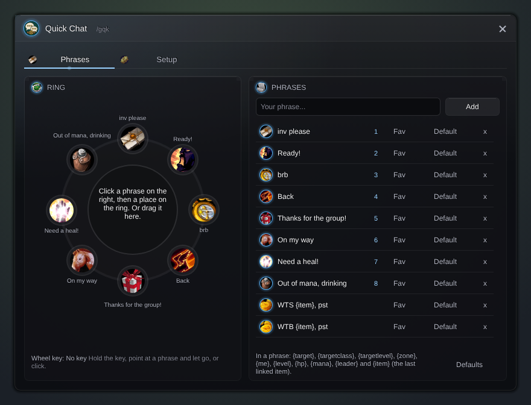
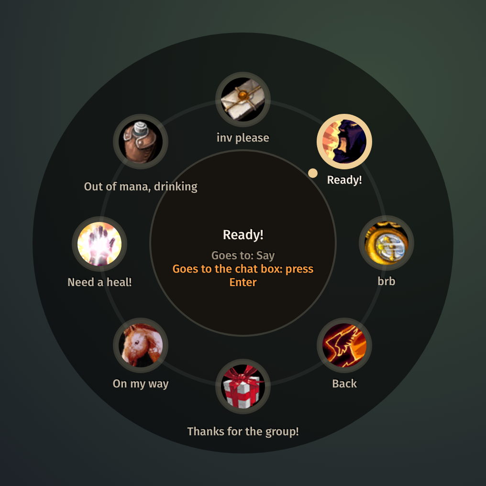

<h1 align="center">Gulli-QuickChat</h1>

<b>Chat without a keyboard: ready phrases on big buttons, a group message from a quest, and the whispers you missed.</b>

  
  
  

---

Typing on a phone or a handheld is slow. Gulli Quick Chat gives you big buttons for the phrases you use most.

## Features

- **One ring of phrases.** Hold your key (or a gamepad button): a ring of up to eight phrases opens at the mouse. Point at one and let go of the key, or click, to send it. The middle shows what it says and where it goes. The game does not let an addon write to say and yell outside a dungeon, or to channels such as Trade, so for them the phrase opens in the chat box with its channel set: press Enter to send it. Raid, party, guild and whispers go out at once.

  
- **Set up the ring by hand.** The **Phrases** page shows the ring on the left and all phrases on the right. Click a phrase, then a place on the ring, or drag it there. A right-click empties a place.
- **Your own phrases.** Type one in **Your phrase...** and press **Add**. "inv please", "Ready!", "brb", "Need a heal!", "WTS {item}" and more are there from the start. The **x** on a row removes the phrase. **Reset ring** puts the starting phrases back on the ring and keeps yours.
- **Where it goes.** In **Setup**, put the channels in your order: raid, party, guild, say, yell, LookingForGroup, Trade, General, whisper. A phrase goes to the first one you can write in now. Each row shows where its phrase goes: **As in Setup** uses that order, a channel name in blue means the phrase has its own order. Click it to change it.
- **Favourites panel.** A small panel on the screen with the phrases you marked with the star (or the ring's). Pick how many buttons, the size, a row or a column. It starts hidden: turn it on and place it in **Unlock frames** in `/gulli`.
- **Smart words.** {target}, {targetclass}, {targetlevel}, {zone}, {me}, {level}, {hp}, {mana}, {leader} and {item} (the last item you linked).
- **No double posts.** Two taps on the same phrase send it once.

The busy auto-reply is now in Gulli Social.

## Install

**With [Runeloader](https://github.com/Gulliby-development/runeloader)** (Android): install **Gulli Toolkit**. Quick Chat comes with it.

**By hand:** download `Gulli-QuickChat-<version>-forever.zip` from the [releases](https://github.com/Gulliby-development/gulli-toolkit/releases) and unpack it into `Interface/AddOns`. Then type `/reload`.

## How to use it

1. Type `/gqk`, or open it from `/gulli`.
2. In **Setup**, pick the wheel key and the order of the channels.
3. On **Phrases**, put the phrases you want on the ring.
4. In the game, hold the key, point at a phrase and let go. `/gqk wheel` opens the ring too.

## FAQ

<b>Why can it not post on its own?</b>

The game lets an addon write in public channels only right after a tap. That is why every message needs your tap.

<b>Is it tested in the game?</b>

Not yet in WoW Forever itself. It is tested on a fake game client. If something does not work, tell us on GitHub.

---

Part of <a href="../../README.md">Gulli Toolkit</a>. A fan project, not affiliated with Blizzard Entertainment. Free software under the <a href="../../LICENSE">GPLv3</a>.

