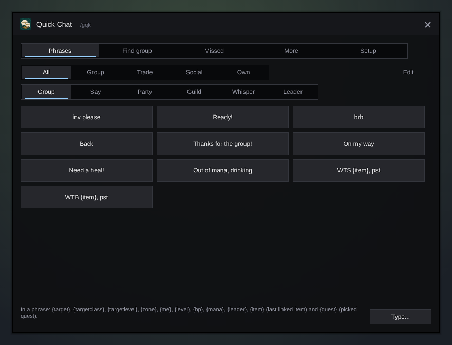
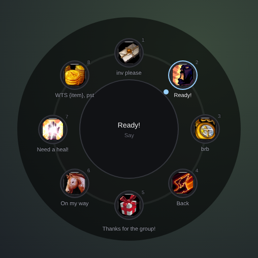

<h1 align="center">Gulli-QuickChat</h1>

<b>Chat without a keyboard: ready phrases on big buttons, a group message from a quest, and the whispers you missed.</b>

  
  
  

---

Typing on a phone or a handheld is slow. Gulli Quick Chat gives you big buttons for the phrases you use most.

## Features

- **Phrases on big buttons.** "inv please", "Ready!", "brb", "Thanks for the group!", "WTS {item}" and more, in tabs: Group, Trade, Social and your own. Change them or add your own.
- **Where it goes.** Group, Say, Party, Guild, a whisper to your target, or a whisper to the group leader. Each phrase can keep its own channel.
- **Phrase wheel.** Pick a key (or a gamepad button) in **Setup**. A ring of your favourite phrases opens at the mouse, each with its own picture. Point at one and click (or press the key again, or 1-8) to send it; the middle shows what it says and where it goes.

  
- **Favourites panel.** A small panel of your favourite phrases on the screen. `/gulli move` places it.
- **Smart words.** {target}, {targetclass}, {targetlevel}, {zone}, {me}, {level}, {hp}, {mana}, {leader}, {item} (the last item you linked) and {quest}.
- **Find a group.** From a quest, or for a WoW Forever dungeon (the ones near your level first): "LFM 2 for Stratholme, need healer". Or look for a group yourself: "LFG Stratholme, healer, level 58". After two minutes it reminds you to post again. Gulli Bulletin's **My LFM** opens this page.
- **Whispers.** Whispers that came while you fought or were away are kept, with **Reply**, a ready phrase as the answer, and **Busy**. A sound when one comes, and an optional busy auto-reply (once per player every few minutes). A history of whispers by player.
- **More.** Emotes and raid marks on buttons, and the last messages you sent with **Again**.
- **No double posts.** Two taps on the same phrase send it once.

## Install

**With [Runeloader](https://github.com/Gulliby-development/runeloader)** (Android): install **Gulli Toolkit**. Quick Chat comes with it.

**By hand:** download `Gulli-QuickChat-<version>-forever.zip` from the [releases](https://github.com/Gulliby-development/gulli-toolkit/releases) and unpack it into `Interface/AddOns`. Then type `/reload`.

## How to use it

1. Type `/gqk`, or open it from `/gulli`.
2. Tap a phrase to send it.
3. In **Find group**, pick a quest or a dungeon and tap **Post in LookingForGroup**.
4. In **Setup**, set a key for the wheel. `/gqk wheel` opens it too.

## FAQ

<b>Why can it not post on its own?</b>

The game lets an addon write in public channels only right after a tap. That is why every message needs your tap.

<b>Does it work with a gamepad keyboard?</b>

**Type...** opens the chat box. ConsolePort and other gamepad keyboards open with it when they are installed.

<b>Is it tested in the game?</b>

Not yet in WoW Forever itself. It is tested on a fake game client. If something does not work, tell us on GitHub.

---

Part of <a href="../../README.md">Gulli Toolkit</a>. A fan project, not affiliated with Blizzard Entertainment. Free software under the <a href="../../LICENSE">GPLv3</a>.

