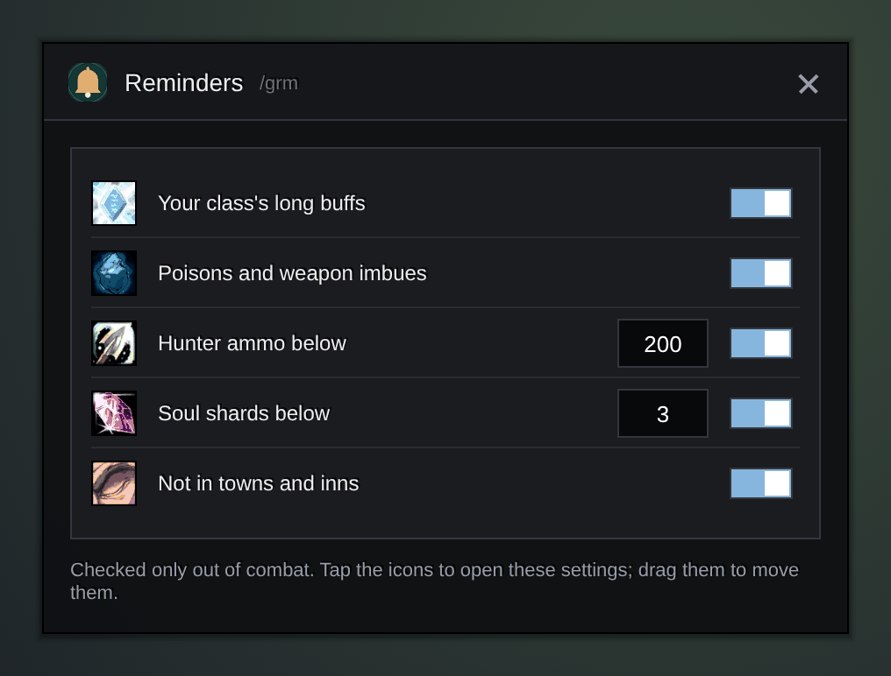
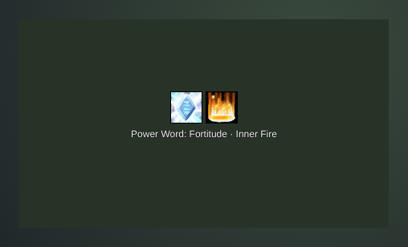

<h1 align="center">Gulli-Reminders</h1>

<b>Shows icons for what is missing before a fight: your class buffs, poisons and weapon imbues, ammo and soul shards.</b>

  
  
  

---

Pulled without Inner Fire again? Gulli Reminders puts an icon on screen while something is missing.

## Features

- **Your class buffs, one switch each.** Fortitude, Inner Fire, Arcane Intellect, armor spells, Mark of the Wild, Demon Armor, blessings, auras, aspects, Trueshot Aura, Lightning Shield and more. The window lists only your class, with the game's own icons. A buff you have not learned yet waits until you learn it.
- **Before it runs out.** A buff with less than 3 minutes left already shows, with the time on the icon. You choose the minutes, or turn it off.
- **Weapons, pet, ammo and shards.** Rogue poisons and shaman imbues, a hunter or warlock pet that is not out, hunter ammo and warlock soul shards below the number you set.
- **Click to fix it.** Click an icon and it casts the buff on you, puts poison or an oil on your weapon, summons or revives your pet, or eats your food. Right-click opens the settings. (The panel hides in a fight, as before.)
- **Food, elixirs and flasks.** Well Fed shows when it is gone or ends soon; a click eats the best buff food in your bags, or the food you dropped on **Your food**. Turn on **Oils and stones** to get mana and wizard oils, sharpening stones and weightstones for any class.
- **Your own reminders.** Drop any item on the window: an elixir or a flask reminds you of its buff, other items (water, bandages, potions, reagents) of how many you want to keep. Or type `/grm item <link>` or `/grm spell <id>`. At an open vendor, a click on a count icon buys what is missing.
- **Repairs and bag space.** An icon when an item is below the durability you set, or your bags have too few free slots.
- **Buffs from your group.** Turn it on, and when you lack Fortitude, Mark of the Wild, Intellect or a blessing, it shows who in your group can give it.
- **Where it counts.** Class checks and consumables each have their own place: everywhere, only in a group, or only in dungeons and raids. Consumables start with dungeons and raids.
- **A sound and a line on screen** when a new reminder shows up: always, only in dungeons and raids (the default), or never.
- **Tanks.** Righteous Fury is on for a paladin who has the tank role, unless you turn it off.
- **A panel you place.** Press **Move the panel**: it shows every icon it can show, and you drag it where you want. Set the icon size, the opacity, a row or a column, and names with the icons.
- **Quiet in a fight.** It checks only out of combat, not while you are dead or on a flight. In cities and inns too, unless you turn that off.

## Install

**With [Runeloader](https://github.com/Gulliby-development/runeloader)** (Android): install **Gulli Toolkit**. Reminders comes with it.

**By hand:** download `Gulli-Reminders-<version>-forever.zip` from the [releases](https://github.com/Gulliby-development/gulli-toolkit/releases) and unpack it into `Interface/AddOns`. Then type `/reload`.

## How to use it

1. Type `/grm`, or open **Reminders** in `/gulli`.
2. Switch on the buffs you want to watch.
3. Press **Move the panel**, drag the icons where you want them, and press **Done**.
4. Hover over an icon to see what is missing. A click fixes it, a right-click opens the settings.

`/grm unlock` and `/grm lock` free and lock the panel, `/grm reset` puts it back at the top of the screen.

## FAQ

<b>I see no icons. Why?</b>

Nothing is missing, or the panel waits: in a fight, while you are dead, on a flight, in a city when you turned **Also in cities and inns** off, or outside a group or a dungeon when **Where to check** says so. The line at the bottom of the window says which. Press **Move the panel** to see where the icons appear.

<b>A click on the food icon does nothing</b>

You have none of the buff foods it knows in your bags. Drop the food you use on **Your food** in the window, and it eats that one first.

<b>A group buff from another player counts?</b>

Yes. Any buff with the same name counts, from you or from another player.

<b>Is it tested in the game?</b>

Not yet in WoW Forever itself. It is tested on a fake game client. If something does not work, tell us on GitHub.

---

Part of <a href="../../README.md">Gulli Toolkit</a>. A fan project, not affiliated with Blizzard Entertainment. Free software under the <a href="../../LICENSE">GPLv3</a>.

