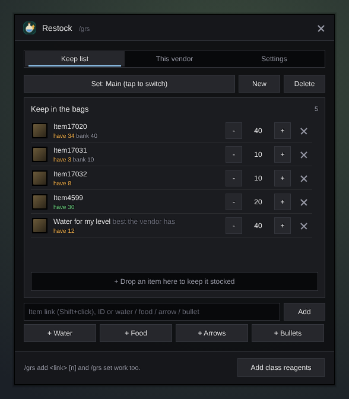

<h1 align="center">Gulli-Restock</h1>

<b>Keeps reagents, ammo, food and water at the amount you set, and buys them at a vendor after you look at the list.</b>

  
  
  

---

Out of candles before a raid? Gulli Restock remembers how many reagents, arrows and drinks you want to carry, and buys the rest at the vendor.

## Features

- **Your list per character, in sets.** Keep one list for levelling and one for a raid. Switch with one tap or `/grs set`.
- **Add things your way.** Drop an item on the window, Shift-click its link into the box, type its number, or type `/grs add <item> 20`.
- **"Best for my level".** Water, food, arrows and bullets: Restock counts every kind you carry and buys the best one the vendor has for your level.
- **Class reagents in one tap.** Candles, powders, runes, symbols, seeds and more, for your class and level.
- **A list before it buys.** At a vendor you see what it would buy and the cost. Untick a line or change the number. Only **Buy** buys. Or tick the box to buy at once. Hold **Shift** to skip one visit.
- **It knows your limits.** It buys only what fits in your bags, and it keeps the gold you set aside.
- **This vendor tab.** Food, drink, reagents and ammo the open vendor sells, one tap to add them to the list.
- **Quick buy.** Alt+click an item at the vendor: buy up to what fits in your bags and your purse.
- **The bank, too.** At the bank it takes what the bags miss out of the bank. With a switch, it also puts the surplus into the bank.
- **A warning in time.** In chat when an item drops to a quarter, or (forecast) when it lasts less than two hours at the speed you use it.
- **Works with DungeonPrep.** Its checklist shows what your list still misses.

## Install

**With [Runeloader](https://github.com/Gulliby-development/runeloader)** (Android): install **Gulli Toolkit**. Restock comes with it.

**By hand:** download `Gulli-Restock-<version>-forever.zip` from the [releases](https://github.com/Gulliby-development/gulli-toolkit/releases) and unpack it into `Interface/AddOns`. Then type `/reload`.

## How to use it

1. Type `/grs`. Press **Add class reagents**, a **+** button for water, food or ammo, or drop an item on the window.
2. Set the number to keep.
3. Open a vendor that sells it and press **Buy**. At the bank, press **OK** to take what is missing.

## FAQ

<b>It buys nothing</b>

The vendor must sell the item for gold. Items for tokens or marks are left out.

<b>It bought less than my list says</b>

The line in the list tells you why: the bags were full, or the gold you keep aside (Settings) was reached.

<b>Is it tested in the game?</b>

Not yet in WoW Forever itself. It is tested on a fake game client. If something does not work, tell us on GitHub.

---

Part of <a href="../../README.md">Gulli Toolkit</a>. A fan project, not affiliated with Blizzard Entertainment. Free software under the <a href="../../LICENSE">GPLv3</a>.

