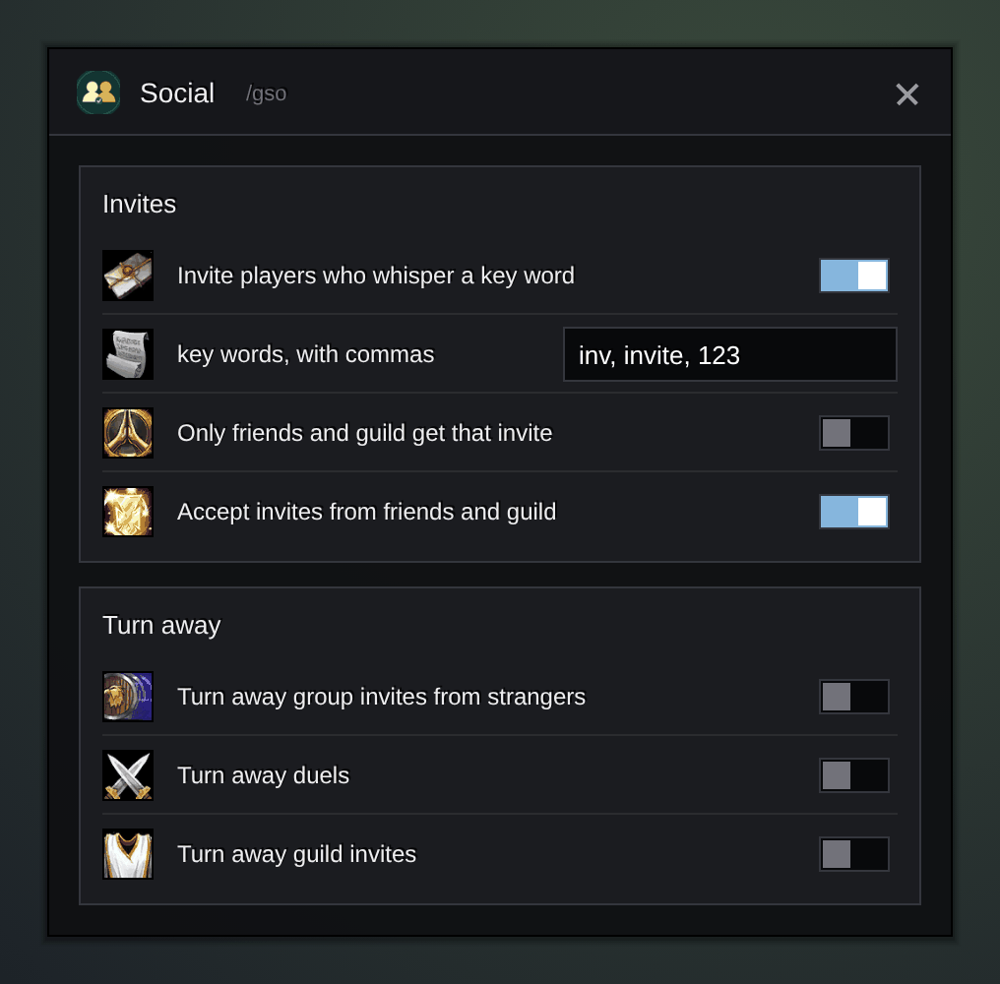

<h1 align="center">Gulli-Social</h1>

<b>Invites players who whisper a key word, accepts friends and guild, and turns away strangers, duels and guild invites if you want.</b>

  
  
  

---

Running a group or just tired of duel requests? Gulli Social handles the small social chores.

## Features

- **Invite on a word.** A player who whispers just `inv` (or your own words) gets an invite. Pick **Starts with** to also take "inv please". Only friends and guild, if you like.
- **A polite answer.** When you cannot invite (group full, you are not the leader, friends only), the player gets a short whisper back. A full party can turn into a raid on its own (off by default).
- **Accept friends.** Invites from friends, Battle.net friends and guild members are accepted at once.
- **Your own lists.** **Always allow** names count as friends. **Always turn away** names are never invited and always declined. Add a player from **Recent** with one tap.
- **Turn away strangers.** Group invites, duels, guild invites, trades and guild charters from players you do not know, each with its own switch. Off by default.
- **Hide spam.** Whispers from strangers with links or gold offers are hidden (off by default).
- **Summons and resurrections** are accepted out of combat, if you turn them on.
- **Recent.** The window shows whether you can invite now, what was turned away today, and the last 20 things the addon did. What it turned away also shows in the hub's Recent feed.

## Install

**With [Runeloader](https://github.com/Gulliby-development/runeloader)** (Android): install **Gulli Toolkit**. Social comes with it.

**By hand:** download `Gulli-Social-<version>-forever.zip` from the [releases](https://github.com/Gulliby-development/gulli-toolkit/releases) and unpack it into `Interface/AddOns`. Then type `/reload`.

## How to use it

1. Type `/gso`.
2. Tick what you want and set your key words.

## FAQ

<b>Nobody gets an invite</b>

You must lead the group (or not be in one), and the group must have room. The whole whisper must be the key word.

<b>Is it tested in the game?</b>

Not yet in WoW Forever itself. It is tested on a fake game client. If something does not work, tell us on GitHub.

---

Part of <a href="../../README.md">Gulli Toolkit</a>. A fan project, not affiliated with Blizzard Entertainment. Free software under the <a href="../../LICENSE">GPLv3</a>.

