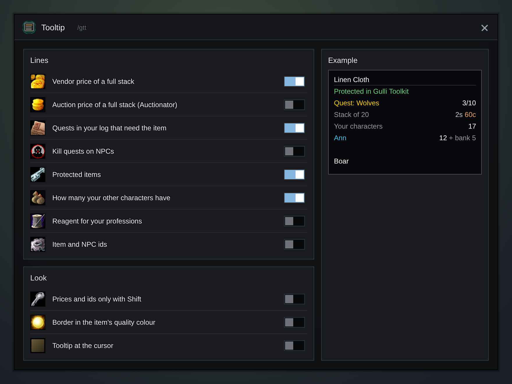

<h1 align="center">Gulli-Tooltip</h1>

<b>Adds prices, the quests that need an item, what your other characters hold, and ids to tooltips.</b>

  
  
  

---

Is this worth keeping? Which quest wanted it? Gulli Tooltip puts the answer in the tooltip.

## Features

- **Easy to read.** A thin line sets the Gulli lines apart from the game's and other addons' lines. Quests are yellow, money shows in gold, silver and copper colours, your characters in their class colours.
- **Stack price.** What a full stack sells for at a vendor.
- **Auction price of a full stack** from Auctionator, when you have it. Off by default, because Auctionator already shows the price of one.
- **Quests that need it.** "Quest: Wolves 3/10" on a Wolf Pelt, from the quests in your log. The count turns green when your bags hold enough. Only the whole name counts: a Large Wolf Pelt is not a Wolf Pelt.
- **Kill quests on NPCs** ("Quest: Kill boars 1/5" on a boar). Off by default, because the game may show this already.
- **Protected** on items you protected in the Gulli Toolkit.
- **Your other characters:** how many you have in all, then each character with its bags and bank, from Gulli Chores.
- **Reagent for** your professions, from Gulli Craft Profit. Off by default, because the game already says "Crafting Reagent".
- **Ids** of items, NPCs and spells, for guides and bug reports. Off by default.
- **Look:** prices and ids only while you hold **Shift**, the border in the item's quality colour, the tooltip at the cursor.
- The window shows an **example tooltip** with only the lines you switched on.

## Install

**With [Runeloader](https://github.com/Gulliby-development/runeloader)** (Android): install **Gulli Toolkit**. Tooltip comes with it.

**By hand:** download `Gulli-Tooltip-<version>-forever.zip` from the [releases](https://github.com/Gulliby-development/gulli-toolkit/releases) and unpack it into `Interface/AddOns`. Then type `/reload`.

## How to use it

1. Hover over an item or an NPC, or tap it on a touch screen.
2. Type `/gtt` (or open it from `/gulli`) to choose the lines. The example on the right shows the result.

## FAQ

<b>The quest line is missing</b>

It reads the objectives in your quest log. A quest that does not name the item in its objectives is not shown.

<b>The line for my other characters is empty</b>

It reads what Gulli Chores saved. Log in once on each character with Chores on, and open the bank there.

<b>Is it tested in the game?</b>

Not yet in WoW Forever itself. It is tested on a fake game client. If something does not work, tell us on GitHub.

---

Part of <a href="../../README.md">Gulli Toolkit</a>. A fan project, not affiliated with Blizzard Entertainment. Free software under the <a href="../../LICENSE">GPLv3</a>.

