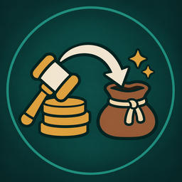
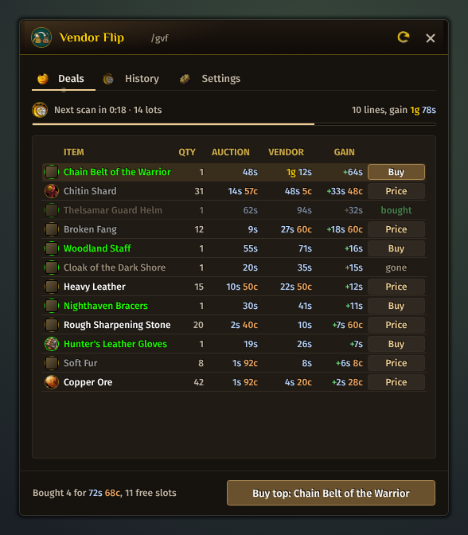
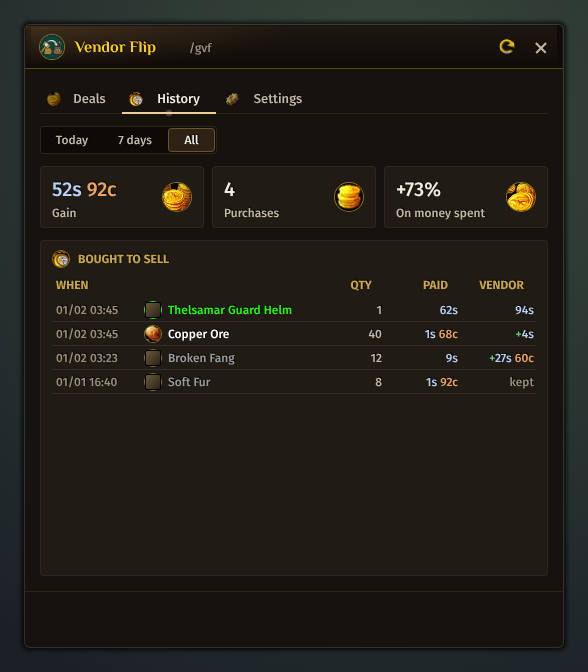

<h1 align="center">Gulli-VendorFlip</h1>

<b>Buys what the auction house sells for less than a vendor pays, so you can sell it on.</b>

  
  
  

 

---

Players often put items on the auction house for less than a vendor pays for them. Vendor Flip finds them for you. Stand at the auction house, click down the list, then sell everything at the next vendor.

## Features

- **A scan as often as you like.** While the auction house is open, Vendor Flip looks at the whole market every minute. Pick another wait in the settings: from 5 seconds to 5 minutes. The line at the top tells you when the next scan comes. **Scan now** beside it scans at once. A good lot shows in the list as soon as the scan finds it, so you can buy it before the scan ends.
- **A dense list.** Small text and low rows, so many lines fit. Each line shows the item, how many one click buys, the auction price of one, what a vendor pays for one and your gain from that click. The best gain is on top. Point at a line to see how many are on sale.
- **Buy with clicks.** Each line has its own button. The big button at the bottom always buys the top line, so you can press it again and again.
- **A queue.** Click more lines while one is being bought: they wait in a queue, and each press of the big button buys the next one. While you buy, the scan waits, so your purchase goes through at once.
- **Two clicks for goods, one for gear.** Ore, herbs, leather and other goods are sold in stacks: the first click asks the auction house for the real price, the second buys. Gear and bags are bought one at a time: a line is one item, and it stays while more are on sale at that price.
- **Never at a loss.** If the price went up since the scan and a vendor would now pay less, the line says **Too dear** and nothing is bought. It only buys out: it never bids.
- **Your limits.** Lines you cannot pay for, or that would take the gold you keep, or the bag slots you keep free, are not shown. Lines below your least gain are not shown either. Set the least gain and the gold you keep in gold, silver and copper: press - or + on each, or type the number. The least gain goes down to 1 copper.
- **Only what you want.** Choose what to buy: gear (weapons and armour), goods and the rest, and which qualities, from grey to purple. Set the most one line may cost and the least gain in percent of its price.
- **It waits for you.** When you search the auction house yourself, the scan waits, so your own results stay on screen.
- **Buy to disenchant.** If your character is an enchanter, the **Disenchant** list shows green and blue gear that costs less than the dust, essence or shard it gives at the least. These items are for you to disenchant: Vendor Flip never sells them to a vendor.
- **Its own prices.** Every scan remembers the lowest price of each item, for 14 days. Once an hour a longer scan reads the whole market. The other Gulli addons (Craft Profit, Waylaid Crates, Tooltip and more) use these prices, so they work without another price addon.
- **Sell at the vendor.** At any vendor a notice offers to sell what you bought here, with what the vendor pays. Turn on **Sell at once at a vendor** to sell without the notice. It sells only what Vendor Flip bought, never your own items and never items you protected in the toolkit.
- **Keep one.** Right-click a line in the History tab to keep that item: it is not sold.
- **History.** Everything you bought to sell, with what you paid and what the vendor pays, green once it is sold. Today, 7 days or all, with your gain on top.
- **Beside the auction house.** The window opens beside the auction house and closes by itself when you close it or walk away. When Waylaid Crates or Craft Profit have work there too, the windows share that place as tabs. The number on the tab is how many lines are left to buy.

## Install

**With [Runeloader](https://github.com/Gulliby-development/runeloader)** (Android): install **Gulli Toolkit**. Vendor Flip comes with it.

**By hand:** download `Gulli-VendorFlip-<version>-forever.zip` from the [releases](https://github.com/Gulliby-development/gulli-toolkit/releases) and unpack it into `Interface/AddOns`. Then type `/reload`.

Vendor Flip works on its own. With the Gulli Toolkit hub it also shows in `/gulli`.

## How to use it

1. Go to the auction house. Vendor Flip opens beside it and scans.
2. Press the big button, or a line's own button, until the list is done. Goods take two presses.
3. Go to a vendor and press **Sell** on the notice.

Type `/gvf` to open the window anywhere, `/gvf scan` to scan now.

## FAQ

<b>Why two presses for goods?</b>

The game lets an addon ask for a price and buy at the auction house only when you press a button yourself, for each step. So goods take two presses: one for the price, one to buy. It never buys without your press.

<b>Can it scan every few seconds?</b>

Yes, down to every 5 seconds. But the auction house limits how many questions an addon may ask, about 100 a minute. So with a short wait each scan reads fewer lots, the best ones first. A scan a minute reads the most lots in each scan and leaves room for your own searches.

<b>Does it use Auctionator?</b>

No. It reads the auction house itself, and the vendor price comes from the game.

<b>How does it know what disenchanting gives?</b>

It uses the usual table by item level and counts only the least you can get: for green gear the cheaper of its dust and its essence, for blue gear its shard. Then it takes off the auction house cut. The prices of dust, essences and shards come from its own scans. A line shows only when all of them have a price.

