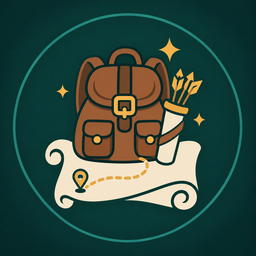
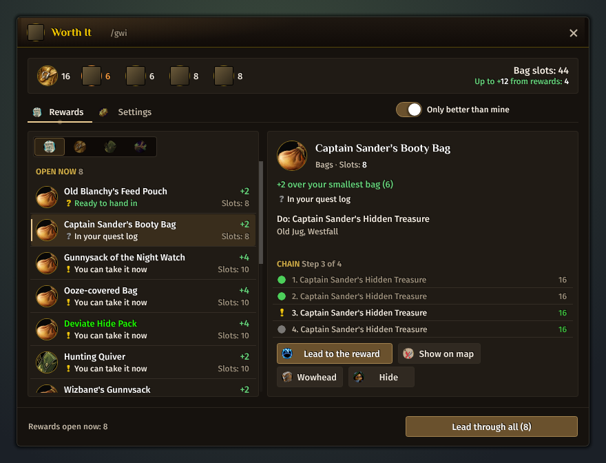
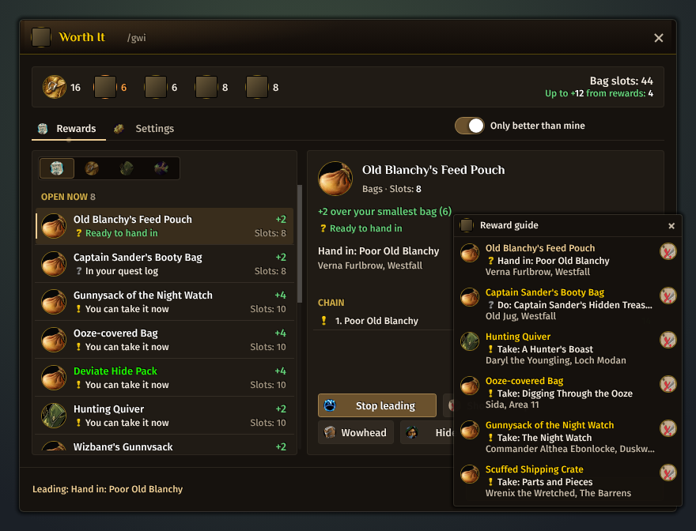

<h1 align="center">Gulli-WorthIt</h1>

<b>The quests whose reward is worth the walk: bags, quivers and pouches, and a guide that leads you to them.</b>

  
  
  

---

Some quests give a bag. Most players find out too late, or never. Worth It lists these quests for your character, shows how many slots each one adds to the bags you wear, and leads you to them step by step.

## Features

- **Every reward that lasts.** Bags for everyone, quivers and ammo pouches for hunters, soul bags for warlocks, profession bags. Also the ones WoW Forever added. Only quests your faction, race and class can do.
- **Compared with your bags.** The window shows the bags you wear and marks the smallest one. Each reward says what it adds: `+4 over your smallest bag`. The switch **Only better than mine** hides the rest.
- **Open now, later, got.** Rewards you can go for now come first. Then the ones that wait for a level. Then the ones you already have.
- **The whole chain.** When a bag is the end of a quest chain, you see every step and where you are in it.
- **Lead to the reward.** One button puts a pin on the map: first on who gives the quest, then on the place of its work, then on who takes it back. **Lead through all** does this for every open reward, the nearest first.
- **A tracker on the screen.** While the guide leads, a small panel shows what to do now and where. Place it with the toolkit's **Unlock frames**.
- **A note when a reward opens.** When you reach the level of a reward quest, or finish the step before it, a notice says so, once.
- **In the toolkit.** The home page shows how many slots the open rewards would add.

## Install

Download `Gulli-WorthIt-<version>-forever.zip` from the [releases](https://github.com/Gulliby-development/gulli-toolkit/releases) and unpack it into `Interface/AddOns`. Then type `/reload`.

Worth It works alone. With [Gulli Toolkit](../../README.md) installed, it also shows up in the toolkit's window.

## How to use it

1. Type `/gwi`.
2. Pick a reward on the left.
3. Press **Lead to the reward** and follow the pin on your map.

Commands: `/gwi` opens the window, `/gwi lead` leads to every open reward, `/gwi stop` ends the guide, `/gwi reset` puts the settings back.

## FAQ

<b>A reward shows no number of slots.</b>

The game tells a bag's size a moment after it first hears of the item. Open the window again and the number is there.

<b>The map pin did not appear.</b>

Some quests start from an item or inside a dungeon. These places are on no map, so there is no pin. The window still says who or what starts the quest.

<b>I know a quest with a bag that is not in the list.</b>

Tell us on GitHub. The list comes from the QuestieDB data, and new WoW Forever quests get there with a delay.

<b>Does it take or hand in quests for me?</b>

No. It only shows the way. You talk to the people yourself.

<b>Is it tested in the game?</b>

Not yet in WoW Forever itself. It is tested on a fake game client. If something does not work, tell us on GitHub.

<b>Where does the data come from?</b>

`Data.lua` is built by `tools/worthit/build_data.py` from the [QuestieDB](https://github.com/Questie/QuestieDB) data for WoW Forever (GPLv3). Bag sizes are read from the game.

