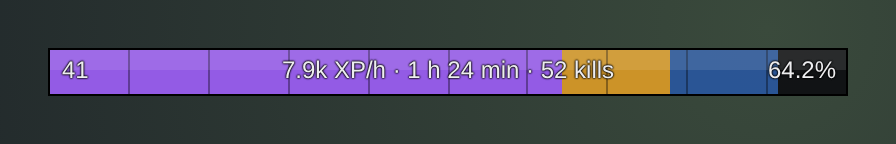

<h1 align="center">Gulli-XP</h1>

<b>Shows your XP per hour, the time and the kills to the next level, and where your XP came from.</b>

  
  
  

---

How long until the next level? Gulli XP tells you on a small bar.

## Features

- **XP per hour** over the last hour of play. Breaks of more than 10 minutes (AFK, a chat, a meal) do not count, so the pace stays honest.
- **Time to level** at that pace, and **kills** and **quests to level** from your average XP per kill and per quest.
- **Finished quests:** the XP of the quests you can hand in now, and how far the level gets when you do. The gold part of the line under the bar shows it.
- The bar fills from end to end: the **level so far** (purple), **finished quests** (gold) and your **rested XP** (blue), with a tick every 10%. Your level is at the left end, the percent at the right. Under **Bar look** you can switch back to a **thin line** under the text.
- **Hover** the bar for every number, in three blocks: **Pace** (XP per hour, time, kills and quests to level), **Level** (done, left, rested, finished quests) and **Session**. **Shift-click** it to tell your group your pace.
- **Choose the text** on the bar: everything, XP per hour, time to level, XP to go or percent.
- **Your last levels:** how long each one took in play time, and the XP from kills and quests. The Gulli Toolkit shows a line when you level up.
- **Where the XP came from:** kills, quests, the rest (exploring and so on) and the rested bonus, each in its own colour, next to your **pace** (play time, XP per kill, kills and quests to level), plus a small graph of XP per 10 minutes.
- **A /reload keeps the session.** A new one starts when you log in again or after a long break.
- **Lock** the bar, or unlock it and drag it. **Across the whole screen** makes it as wide as the screen. Set the **background opacity** (0% shows only the text) and the **size** (60-200%).
- At the top level the bar shows the **reputation** you watch, or hides.

## Install

**With [Runeloader](https://github.com/Gulliby-development/runeloader)** (Android): install **Gulli Toolkit**. XP comes with it.

**By hand:** download `Gulli-XP-<version>-forever.zip` from the [releases](https://github.com/Gulliby-development/gulli-toolkit/releases) and unpack it into `Interface/AddOns`. Then type `/reload`.

## How to use it

1. The bar appears on the screen. Drag it to move it. In the window, under **Bar**, **Lock the bar** keeps it in place and **Place: Reset** puts it back at the top. `/gulli move` unlocks it together with the other Gulli frames.
2. Tap the bar, or type `/gxp`, for all numbers: **Session**, **Levels** and **Bar**. **Start again** (or `/gxp reset`) starts a new session.

## FAQ

<b>The numbers start again after a login</b>

Yes. Each login is a new session, so the rate shows how you play now. A `/reload` keeps the session.

<b>Is it tested in the game?</b>

Not yet in WoW Forever itself. It is tested on a fake game client. If something does not work, tell us on GitHub.

---

Part of <a href="../../README.md">Gulli Toolkit</a>. A fan project, not affiliated with Blizzard Entertainment. Free software under the <a href="../../LICENSE">GPLv3</a>.

