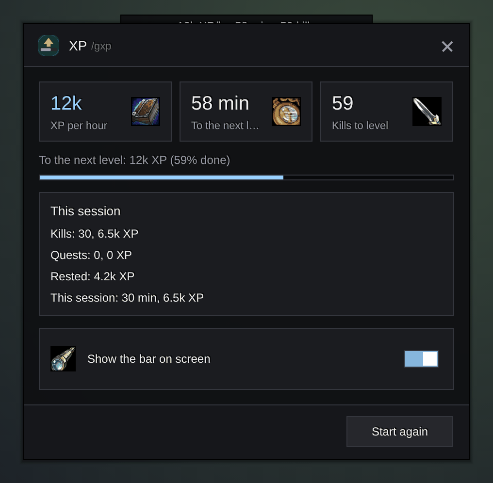

<h1 align="center">Gulli-XP</h1>

<b>Shows your XP per hour, the time and the kills to the next level, and where your XP came from.</b>

  
  
  

---

How long until the next level? Gulli XP tells you on a small bar.

## Features

- **XP per hour** over the last hour of play.
- **Time to level** at that pace.
- **Kills to level** from your average XP per kill.
- **Kills and quests** apart, plus your rested XP.
- The bar hides at the top level.

## Install

**With [Runeloader](https://github.com/Gulliby-development/runeloader)** (Android): install **Gulli Toolkit**. XP comes with it.

**By hand:** download `Gulli-XP-<version>-forever.zip` from the [releases](https://github.com/Gulliby-development/gulli-toolkit/releases) and unpack it into `Interface/AddOns`. Then type `/reload`.

## How to use it

1. The bar appears after your first XP. Drag it to move it.
2. Tap the bar, or type `/gxp`, for all numbers. `/gxp reset` starts again.

## FAQ

<b>The numbers start again after a login</b>

Yes. Each login is a new session, so the rate shows how you play now.

<b>Is it tested in the game?</b>

Not yet in WoW Forever itself. It is tested on a fake game client. If something does not work, tell us on GitHub.

---

Part of <a href="../../README.md">Gulli Toolkit</a>. A fan project, not affiliated with Blizzard Entertainment. Free software under the <a href="../../LICENSE">GPLv3</a>.

